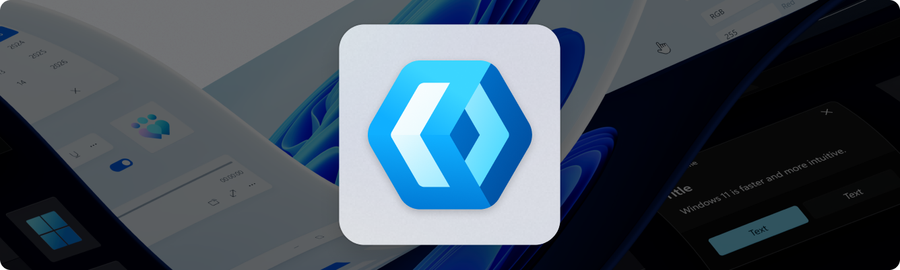
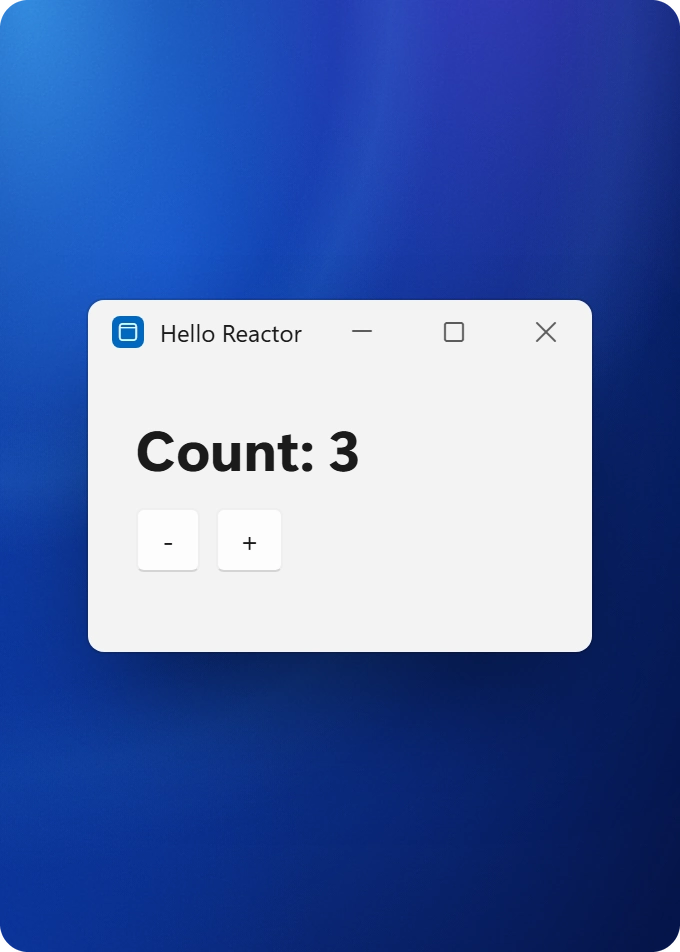

<p align="center">
  <a href="https://microsoft.github.io/microsoft-ui-reactor/">
    
  </a>
</p>

<h1 align="center">Microsoft.UI.Reactor</h1>

<p align="center">
  <b>Native Windows apps, in pure C#.</b><br />
  A declarative UI framework for <a href="https://github.com/microsoft/microsoft-ui-xaml">WinUI</a>:
  no XAML, no data binding, no view models.
</p>

<h3 align="center">
  <a href="https://microsoft.github.io/microsoft-ui-reactor/get-started/first-app/">Get started</a>
  <span> · </span>
  <a href="https://microsoft.github.io/microsoft-ui-reactor/">Documentation</a>
  <span> · </span>
  <a href="https://microsoft.github.io/microsoft-ui-reactor/showcase/">Showcase</a>
  <span> · </span>
  <a href="https://microsoft.github.io/microsoft-ui-reactor/reference/">API reference</a>
  <span> · </span>
  <a href="https://microsoft.github.io/microsoft-ui-reactor/changelog/">Changelog</a>
</h3>

<br />

> [!IMPORTANT]
> Reactor is experimental. We build it in the open, and the API can change
> between previews. Your [feedback](https://github.com/microsoft/microsoft-ui-reactor/discussions)
> shapes what it becomes.

## 👋 Hello, Reactor

Describe your UI as a function of state. When the state changes, Reactor
compares the new description with the old one and updates only the WinUI
controls that changed.

<table>
<tr>
<td>

```csharp
using Microsoft.UI.Reactor;
using Microsoft.UI.Reactor.Core;
using static Microsoft.UI.Reactor.Factories;

ReactorApp.Run<MyApp>("Hello Reactor");

class MyApp : Component
{
    public override Element Render()
    {
        var (count, setCount) = UseState(0);

        return VStack(12,
            Heading($"Count: {count}"),
            HStack(8,
                Button("-", () => setCount(count - 1)),
                Button("+", () => setCount(count + 1))
            )
        ).Padding(24);
    }
}
```

</td>
<td>
<picture>
  <source media="(prefers-color-scheme: dark)" srcset="docs/images/hello-reactor-dark.webp" />
  
</picture>
</td>
</tr>
</table>

Every control on screen is a real WinUI control. There is no `App.xaml`, no
`MainWindow.xaml` and no code-behind, and you get IntelliSense, refactoring and
compile-time checks for all of your UI.

Reactor doesn't replace WinUI, XAML or MVVM. It is a different way to describe
WinUI content, and it works with the rest of the WinUI ecosystem.

- **Shipping XAML and MVVM today?** Keep going. Much of the work in this repo,
  like accessibility APIs, theming, commanding and charting, is meant to move
  into WinUI itself, so XAML apps benefit too.
- **Like React, SwiftUI or Jetpack Compose?** Reactor brings hooks, state next
  to the UI that uses it, and typed UI code to WinUI, on the same runtime and
  controls.
- **Want both?** Host Reactor content in a XAML app, or XAML content in a
  Reactor app. They share one visual tree.

## 🚀 Get started

You need Windows 10 (1809) or Windows 11, the
[.NET 10 SDK](https://dotnet.microsoft.com/download/dotnet/10.0) and the
Windows App Runtime 2.2 or later. New apps are framework-dependent, so they
load the runtime that is installed on the machine. If it is missing, install it
with `winget install Microsoft.WindowsAppRuntime.2`. If an older 2.x runtime is
installed, update it with `winget upgrade Microsoft.WindowsAppRuntime.2`.
[Installation](https://microsoft.github.io/microsoft-ui-reactor/get-started/install/)
has the full list. Create an app with the WinApp CLI:

```powershell
winget install Microsoft.WinAppCli
winapp new -t reactor -n MyApp
cd MyApp
dotnet run
```

`winapp new` installs the Reactor templates the first time you use it. New
apps are packaged, so `dotnet run` needs
[Developer Mode](https://learn.microsoft.com/windows/apps/get-started/enable-your-device-for-development).
For a plain `.exe`, use `dotnet new reactor -n MyApp --packaging Unpackaged`
instead. Run `winapp new --list` to see the other templates, such as
`reactor-navview` and `reactor-singlefile`.

Next, [Your first app](https://microsoft.github.io/microsoft-ui-reactor/get-started/first-app/)
takes you from a counter to a working todo list. If you know XAML,
[Coming from XAML](https://microsoft.github.io/microsoft-ui-reactor/get-started/xaml-developers/)
maps what you know to Reactor.

## 🤖 Build with AI agents

Reactor is new, so AI models don't know it well yet. Without help, an agent
invents API names or falls back to XAML. These tools close that gap:

| Tool | What it gives your agent | How to get it |
|---|---|---|
| Agent plugin | The `reactor-dev` agent and the Reactor skills, for GitHub Copilot CLI and Claude Code | `copilot plugin install microsoft/microsoft-ui-reactor:plugins/reactor` |
| Skill kit | [`SKILL.md`](SKILL.md), the topic files in [`skills/`](skills/) and an index of every public API, for agents without plugins | The `reactor-skill-kit` zip on the [releases page](https://github.com/microsoft/microsoft-ui-reactor/releases) |
| `mur check` | Build output with one line per problem and a fix to try | Comes with the skill kit |
| [WinUI DevTools](https://microsoft.github.io/microsoft-ui-reactor/tools/devtools/) | Eyes on the running app: the component tree, hook state, screenshots, clicks and typing | Run `winapp run . --devtools on`, then the `winapp` commands with `--json` and the `winui-devtools` skill |
| Docs for AI tools | `llms.txt`, `llms-full.txt` and a Markdown copy of every docs page | [`llms.txt`](https://microsoft.github.io/microsoft-ui-reactor/latest/llms.txt) |

[Build with AI](https://microsoft.github.io/microsoft-ui-reactor/tools/build-with-ai/)
has the setup steps and example prompts. Working on Reactor itself with an
agent? [`AGENTS.md`](AGENTS.md) has the build commands, test tiers and
conventions for this repo.

## 🛠️ Tools

| Tool | What it does |
|---|---|
| [Hot reload and live preview](https://microsoft.github.io/microsoft-ui-reactor/tools/hot-reload/) | Save a file and see the change without a restart. Preview one component at a time. |
| [Devtools](https://microsoft.github.io/microsoft-ui-reactor/tools/devtools/) | Inspect and drive a running app with the WinUI DevTools in the winapp CLI, from a terminal or an agent. |
| [Analyzers](https://microsoft.github.io/microsoft-ui-reactor/tools/analyzers/) | Catch hook-order, accessibility and theming mistakes as you type. |
| [mur CLI](https://microsoft.github.io/microsoft-ui-reactor/tools/mur-cli/) | `mur check`, `mur doctor`, localization tools and more. |
| [Editor extensions](https://microsoft.github.io/microsoft-ui-reactor/tools/vs-extension/) | Live preview in VS Code and Visual Studio. |

## 📦 What's included

Every area is pre-1.0. *Preview* areas are the most stable, then *Draft*, then
*Early*. The labels describe how well tested an area is and how much its API
may still change, not how complete it is.

| Area | What it does | Maturity |
|---|---|---|
| **Core reconciler** | Virtual element tree, keyed diffing, element pooling, render coalescing, skip-unchanged optimization | Preview |
| **DSL & elements** | Factory methods covering WinUI controls, fluent modifier chains, attached properties | Preview |
| **Hooks & state** | UseState, UseReducer, UseEffect, UseMemo, UseRef, UseCallback, UseContext, UseObservable, UseCollection | Preview |
| **Flex layout** | C# port of facebook/yoga with FlexPanel, 543 ported test fixtures | Preview |
| **Commanding** | Command records bundling label, icon, shortcut, and action; 16 standard commands; focus-scoped accelerators | Preview |
| **Charting (D3)** | Full D3 algorithm port plus declarative chart DSL — line, bar, area, pie, tree, force-directed graphs | Preview |
| **Markdown** | Native md4c parser with `Markdown()` element builder | Preview |
| **Navigation** | Type-safe declarative routing, GPU composition transitions, lifecycle guards, back-stack serialization | Draft |
| **Accessibility** | `AutomationProperties` modifiers (e.g. name, heading level, landmarks, live regions), WCAG 2.1 AA target, compile- and runtime-validation | Draft |
| **Animation** | Compositor-layer transitions, keyframes, stagger, scroll-linked and connected animations | Draft |
| **Theming & styling** | `ThemeRef` tokens, dark / light / high-contrast, style caching, per-control overrides | Draft |
| **Lists & virtualization** | Virtualized `ListView`, `GridView`, `ItemsRepeater`, `LazyStack` with recycling | Draft |
| **Input & gestures** | Pan / pinch / rotate / long-press gesture recognizers, drag-and-drop with typed data transfer, pointer and focus management | Draft |
| **Docking & windows** | Visual Studio-style docking — tab tear-off, cross-window dock-in, floating panes, splitters, reserved document area, layout serialization and migration | Draft |
| **WinForms interop** | Simple hosting of WinUI content inside WinForms apps | Draft |
| **DevTools & diagnostics** | WinUI DevTools in the winapp CLI (`winapp run . --devtools on`: component tree, C# call sites, state, live edits, UI automation), source mapping, ETW events. Reactor's own `mur devtools` CLI and in-app MCP server have been removed; the `Microsoft.UI.Reactor.Devtools` preview-host package is deprecated | Draft |
| **`mur` CLI & analyzers** | App scaffolding, `mur check` did-you-mean linter, localization tooling, `mur doctor` / `mur upgrade`, 40+ Roslyn analyzers (hooks, commanding, accessibility, theming, pooling, forms) | Draft |
| **Localization** | ICU message format, source generator, CLI tooling (extract, translate, validate), RTL/BiDi | Early |
| **Data system** | `DataGrid`, `PropertyGrid`, `FormField`, metadata model, async validation, inline editing | Early |
| **Async resources** | `UseResource` / `UseInfiniteResource` / `UseMutation` — async value states, query caching, pagination, cancellation, optimistic updates | Early |
| **Shell integration** | Taskbar progress and overlays, jump lists, tray icons, thumbnail toolbars, layered-window hosting (opacity, no-activate, click-through) | Early |
| **Win2D canvas** | Optional `Reactor.Advanced` package — immediate-mode GPU drawing via `Win2DCanvas` / `Win2DAnimatedCanvas` / `Win2DVirtualCanvas` and draw-state hooks | Early |
| **Control wrapper generator** | Source generator that turns WinUI controls into Reactor elements via `[GenerateReactorWrapper]` — auto factory methods, descriptors, two-way props | Early |
| **Preview / hot reload** | `MetadataUpdateHandler` hot reload, CLI `--preview` flag, VS Code live preview | Early |
| **Visual Studio embedded preview** | Experimental VSIX that reparents a live WinUI app into a Visual Studio tool window | Experimental |

The Visual Studio embedded preview is the roughest part of the repo. Use it to
try things out and send feedback, not as your daily workflow yet. For Native
AOT, see the [AOT support matrix](docs/aot-support.md).

## 🎨 Samples

The [Showcase](https://microsoft.github.io/microsoft-ui-reactor/showcase/) has
screenshots of apps built with Reactor. Their source is in this repo:

| App | What it shows | Folder |
|---|---|---|
| Reactor Gallery | Every WinUI control, rebuilt with Reactor | [`samples/ReactorGallery`](samples/ReactorGallery) |
| Reactor IDE | Tool windows and documents with the docking system | [`samples/apps/reactor-ide`](samples/apps/reactor-ide) |
| HeadTrax | A data grid over SQLite and GraphQL data | [`samples/apps/headtrax`](samples/apps/headtrax) |
| Charting Gallery | Bar and donut charts, force-directed graphs and more | [`samples/ReactorCharting.Gallery`](samples/ReactorCharting.Gallery) |
| Minesweeper | A complete game with state, timers and input | [`samples/apps/minesweeper`](samples/apps/minesweeper) |

To run one, set up a clone (see [Contributing](#-contributing)) and run:

```powershell
dotnet run --project samples/apps/minesweeper -p:Platform=x64
```

## 🤝 Contributing

We welcome bug reports, ideas and pull requests. Clone to a short path such as
`C:\src`, because long paths break the Windows App SDK build tools
([#678](https://github.com/microsoft/microsoft-ui-reactor/issues/678)). Then run
the bootstrap script once:

```powershell
git clone https://github.com/microsoft/microsoft-ui-reactor.git C:\src\microsoft-ui-reactor
cd C:\src\microsoft-ui-reactor
& (Get-Process -Id $PID).Path -ExecutionPolicy Bypass -File .\bootstrap.ps1

# In a new terminal, so that mur is on PATH:
mur doctor
```

The script installs the .NET SDK and runtime it needs, the `mur` CLI, the
templates and the agent plugin. When you build or run a single app project,
pass `-p:Platform=x64` or `-p:Platform=ARM64`.

| Doc | What's in it |
|---|---|
| [CONTRIBUTING.md](CONTRIBUTING.md) | Setup, building, project layout and code style |
| [TESTING.md](TESTING.md) | The four test tiers and how to pick one |
| [AGENTS.md](AGENTS.md) | Instructions for AI agents that work in this repo |
| [docs/specs](docs/specs/) | Numbered design specs |
| [CHANGELOG.md](CHANGELOG.md) | What changed in each release |

## 🦀 Prefer Rust?

The same idea is being explored in Rust.
[windows-reactor](https://github.com/microsoft/windows-rs/blob/HEAD/docs/crates/windows-reactor.md),
part of [windows-rs](https://github.com/microsoft/windows-rs), is a separate
declarative WinUI library with its own model, on
[crates.io](https://crates.io/crates/windows-reactor). Different language, same
native controls.

## 📄 License

Reactor is licensed under the [MIT license](LICENSE). This project follows the
[Microsoft Open Source Code of Conduct](CODE_OF_CONDUCT.md). To report a
security issue, see [SECURITY.md](SECURITY.md).
