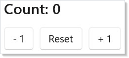
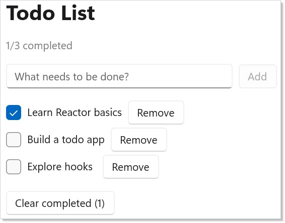
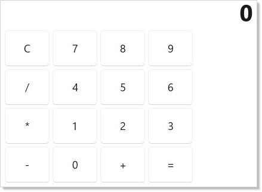

# Your first app

Build a Reactor app step by step, from a single line of text to a working
todo list.

In this tutorial you write five small Microsoft.UI.Reactor (Reactor) apps.
Each step adds one idea. You start with a [component](components.md) that
shows text. Then you add state with the `UseState` [hook](hooks.md), arrange
controls with [layout](layout.md) containers, and show a list where each row
has a key. In the last step you put it all together in a todo app. After each
step you run the app and see the result. You need about 30 minutes, and you
do not need to know XAML or React.

Before you start, follow [Installation](install.md) to create a project and
check that `dotnet run` opens a window.

| Step | You learn | You see |
|---|---|---|
| [1. Your first component](#step-1-your-first-component) | `ReactorApp.Run`, `Render()`, elements and modifiers | A greeting that follows what you type |
| [2. Add state](#step-2-add-state) | `UseState`, event handlers, values computed from state | A counter with three buttons |
| [3. Layout basics](#step-3-layout-basics) | `VStack`, `HStack`, spacing and nesting | Rows and columns of controls |
| [4. Lists with keys](#step-4-lists-with-keys) | `ForEach`, `WithKey`, replacing a list in state | A list you can add to and remove from |
| [5. Finish the todo app](#step-5-finish-the-todo-app) | `UseReducer`, `When`, records for data | A complete todo list |

## How to run each step

Step 1 and Step 5 show a complete `App.cs` file. Steps 2 to 4 show one
component class. To run a class, replace the old class in `App.cs` with it.
Then change the `ReactorApp.Run<T>()` line at the top to the class name. The
first comment in each snippet shows the line to use, for example
`ReactorApp.Run<CounterExample>("Counter");`. Keep the `using` lines at the
top of the file. Then run:

```powershell
dotnet run
```

Close the window before you run the next step. To see changes without closing
the window, use `dotnet watch` instead (see
[Hot reload with `dotnet watch`](#hot-reload-with-dotnet-watch)).

## Step 1: Your first component

Replace the contents of `App.cs` with this code:

```csharp
using Microsoft.UI.Reactor;
using Microsoft.UI.Reactor.Core;
using static Microsoft.UI.Reactor.Factories;
using Microsoft.UI.Xaml;

ReactorApp.Run<GettingStartedApp>("Getting Started");

class GettingStartedApp : Component
{
    public override Element Render()
    {
        var (name, setName) = UseState("World");

        return VStack(16,
            TextBlock($"Hello, {name}!").FontSize(24).Bold(),
            TextBox(name, setName, placeholderText: "Enter your name")
                .AutomationName("Name")
                .Width(250)
        ).Padding(24);
    }
}
```

Run `dotnet run`. You see a greeting and a text box. Type a name, and the
greeting changes as you type:


Here is what each part does:

- **`ReactorApp.Run<T>`** opens a window and mounts your root component in it.
- **`class GettingStartedApp : Component`** is a component. Its `Render()`
  method returns the UI as a tree of elements.
- **[`UseState`](reference/hooks/UseState.md)** returns the current value and
  a setter. When you call the setter, Reactor runs `Render()` again with the
  new value.
- **[`VStack`](layout.md)** stacks its children from top to bottom. The `16`
  is the space between them, in pixels.
- **`TextBlock(...).FontSize(24).Bold()`** shows the modifier pattern. Every
  element has chainable modifiers for style and layout.

There is no event wiring and no property-changed notification. The text box
calls `setName`, and the greeting reads `name`. State goes in, and UI comes
out.

## Step 2: Add state

Every interactive UI needs state. Replace the `GettingStartedApp` class with
this counter, and change the `Run` line to
`ReactorApp.Run<CounterExample>("Counter");`:

```csharp
// Launch with:
//   ReactorApp.Run<CounterExample>("Counter");

class CounterExample : Component
{
    public override Element Render()
    {
        var (count, setCount) = UseState(0);

        return VStack(12,
            TextBlock($"Count: {count}").FontSize(20).SemiBold(),
            HStack(8,
                Button("- 1", () => setCount(count - 1)),
                Button("Reset", () => setCount(0)),
                Button("+ 1", () => setCount(count + 1))
            )
        ).Padding(24);
    }
}
```

Run the app. You see "Count: 0" above three buttons. Click **+ 1** and the
number goes up. Click **Reset** and it goes back to 0:



Each call to `setCount` makes Reactor render the component again. Reactor
compares the new element tree with the old one and updates only the WinUI
controls that changed. Here, that is the text of one `TextBlock`.

### Several pieces of state

A component can call `UseState` more than once. Each call holds its own value.
Try this example:

```csharp
// Launch with:
//   ReactorApp.Run<MultipleStateExample>("Multiple State");

class MultipleStateExample : Component
{
    public override Element Render()
    {
        var (firstName, setFirstName) = UseState("");
        var (lastName, setLastName) = UseState("");
        var (fontSize, setFontSize) = UseState(16.0);

        var fullName = string.IsNullOrWhiteSpace(firstName) && string.IsNullOrWhiteSpace(lastName)
            ? "Anonymous"
            : $"{firstName} {lastName}".Trim();

        return VStack(12,
            TextBlock($"Hello, {fullName}!").FontSize(fontSize).Bold(),
            TextBox(firstName, setFirstName, placeholderText: "First name")
                .AutomationName("First name")
                .Width(200),
            TextBox(lastName, setLastName, placeholderText: "Last name")
                .AutomationName("Last name")
                .Width(200),
            HStack(8,
                TextBlock("Font size:"),
                Slider(fontSize, 10, 40, setFontSize).Width(200),
                TextBlock($"{fontSize:F0}px")
            )
        ).Padding(24);
    }
}
```

You see two text boxes and a slider. Type a first and last name, and the
greeting shows the full name. Move the slider, and the greeting gets bigger or
smaller.

`fullName` is computed from `firstName` and `lastName` on every render. You do
not need computed properties or bindings. A plain C# expression works,
because `Render()` runs again every time the state changes.

## Step 3: Layout basics

Reactor has a small set of layout containers that you nest inside each other.
Try this example:

```csharp
// Launch with:
//   ReactorApp.Run<LayoutBasicsExample>("Layout");

class LayoutBasicsExample : Component
{
    public override Element Render()
    {
        return VStack(16,
            Heading("Layout Demo"),

            SubHeading("Horizontal Stack"),
            HStack(8,
                Button("One"),
                Button("Two"),
                Button("Three")
            ),

            SubHeading("Nested Layout"),
            HStack(16,
                VStack(4,
                    TextBlock("Left Column").Bold(),
                    TextBlock("Item A"),
                    TextBlock("Item B")
                ),
                VStack(4,
                    TextBlock("Right Column").Bold(),
                    TextBlock("Item X"),
                    TextBlock("Item Y")
                )
            )
        ).Padding(24);
    }
}
```

You see a heading, a row of three buttons, and two columns of text side by
side:


These containers cover most layouts:

| Element | What it does |
|---|---|
| `VStack` | Stacks children from top to bottom. |
| `HStack` | Places children from left to right. |
| `Grid` | Places children in rows and columns, with fixed or proportional sizes. |
| `ScrollView` | Scrolls content that does not fit. |
| `Border` | Draws a background, a corner radius or an outline around one child. |

`VStack` and `HStack` take the spacing as an optional first argument:
`VStack(12, child1, child2)` puts 12 pixels between the children. The
[Layout](layout.md) guide covers `Grid` and the other containers.

## Step 4: Lists with keys

Most apps show a list that changes. This example keeps a list of fruit in
state. You can add a fruit or remove one:

```csharp
// Launch with:
//   ReactorApp.Run<KeyedListExample>("Keyed List");

record Fruit(string Id, string Name);

class KeyedListExample : Component
{
    static readonly string[] Names = ["Apple", "Banana", "Cherry", "Mango", "Pear"];

    static readonly IReadOnlyList<Fruit> StartFruits =
        [new("fruit-1", "Apple"), new("fruit-2", "Banana")];

    public override Element Render()
    {
        var (fruits, setFruits) = UseState(StartFruits);
        var (nextId, setNextId) = UseState(3);

        void AddFruit()
        {
            var name = Names[(nextId - 1) % Names.Length];
            setFruits([.. fruits, new Fruit($"fruit-{nextId}", name)]);
            setNextId(nextId + 1);
        }

        void RemoveFruit(string id) =>
            setFruits([.. fruits.Where(f => f.Id != id)]);

        return VStack(12,
            Button("Add fruit", AddFruit),
            VStack(4,
                ForEach(fruits, fruit =>
                    HStack(8,
                        TextBlock(fruit.Name).Width(120),
                        Button("Remove", () => RemoveFruit(fruit.Id))
                            .AutomationName($"Remove {fruit.Name}")
                    ).WithKey(fruit.Id)
                )
            )
        ).Padding(24);
    }
}
```

You see an **Add fruit** button and two rows, Apple and Banana, each with a
**Remove** button. Click **Add fruit** and a new row appears at the end. Click
**Remove** on a row and only that row goes away.

Three things make this work:

- **`ForEach(fruits, fruit => ...)`** turns each item into an element.
- **`.WithKey(fruit.Id)`** gives each row a stable identity. When you remove
  Apple, Reactor knows which row went away and keeps the other rows as they
  are. Use an ID from your data, not the position in the list. The
  [Rules of Reactor](rules-of-reactor.md#3-lists-need-stable-keys) explain
  why.
- **`setFruits([.. fruits, new Fruit(...)])`** creates a **new** list.
  Reactor renders again only when the setter gets a value that is different
  from the old one. If you change the old list in place and pass it back,
  Reactor sees the same object and does nothing.

The start list is a `static readonly` field. `UseState` uses its argument only
on the first render, so there is no need to build a new list on every render.

## Step 5: Finish the todo app

Now put the pieces together. A todo app needs a list of items, a way to add
items, and check boxes to mark them done.

Replace the contents of `App.cs` with this code:

```csharp
using Microsoft.UI.Reactor;
using Microsoft.UI.Reactor.Core;
using static Microsoft.UI.Reactor.Factories;
using Microsoft.UI.Xaml;

ReactorApp.Run<TodoApp>("Todo App");

class TodoApp : Component
{
    public override Element Render()
    {
        var initialItems = UseMemo(() => new List<TodoItem>
        {
            new("todo-1", "Learn Reactor basics", true),
            new("todo-2", "Build a todo app", false),
            new("todo-3", "Explore hooks", false),
        });
        var (items, updateItems) = UseReducer(initialItems);
        var (newText, setNewText) = UseState("");
        var (nextId, setNextId) = UseState(4);

        var doneCount = items.Count(i => i.Done);

        return VStack(16,
            Heading("Todo List"),
            TextBlock($"{doneCount}/{items.Count} completed").Opacity(0.6),

            // Input row
            HStack(8,
                TextBox(newText, setNewText, placeholderText: "What needs to be done?")
                    .AutomationName("New todo")
                    .Width(300),
                Button("Add", () =>
                {
                    if (!string.IsNullOrWhiteSpace(newText))
                    {
                        var text = newText.Trim();
                        updateItems(list => [.. list, new TodoItem($"todo-{nextId}", text, false)]);
                        setNextId(nextId + 1);
                        setNewText("");
                    }
                }).IsEnabled(!(string.IsNullOrWhiteSpace(newText)))
            ),

            // Item list
            VStack(4,
                items.Select((item, _) =>
                    HStack(8,
                        CheckBox(item.Done, done =>
                            updateItems(list =>
                            {
                                var copy = new List<TodoItem>(list);
                                var itemIndex = copy.FindIndex(i => i.Id == item.Id);
                                if (itemIndex >= 0)
                                    copy[itemIndex] = item with { Done = done };
                                return copy;
                            }),
                            label: item.Text
                        ),
                        Button("Remove", () =>
                            updateItems(list =>
                            {
                                var copy = new List<TodoItem>(list);
                                copy.RemoveAll(i => i.Id == item.Id);
                                return copy;
                            })
                        ).AutomationName($"Remove {item.Text}")
                    ).WithKey(item.Id)
                ).ToArray()
            ),

            // Clear completed button
            When(doneCount > 0, () =>
                Button($"Clear completed ({doneCount})", () =>
                    updateItems(list => list.Where(i => !i.Done).ToList())
                ).AutomationName("Clear completed todos")
            )
        ).Padding(24);
    }
}
```

Then add a record for one todo item at the end of the file:

```csharp
record TodoItem(string Id, string Text, bool Done);
```

Run the app. You see three todo items, and the first one is already checked.
Below the list is a **Clear completed (1)** button. Type a new item and click
**Add**: the item appears at the end of the list. Check an item, and the
"completed" count goes up. The **Add** button is turned off while the text box
is empty:



New ideas in this step:

- **[`UseReducer`](reference/hooks/UseReducer.md)** is like `UseState`, but
  its setter takes a function of type `Func<T, T>`. The function gets the
  current list and returns the next one. Use it when the new state depends on
  the old state, as when you add an item to a list.
- **[`UseMemo`](reference/hooks/UseMemo.md)** builds the start list once, on
  the first render, instead of on every render.
- **`items.Select(...).ToArray()`** maps data to elements, like `ForEach` in
  Step 4. Each row still gets a key with `WithKey(item.Id)`.
- **`When(condition, () => element)`** shows an element only when the
  condition is true, without an `if`/`else` in the middle of the tree.
- **`item with { Done = done }`** creates a changed copy of a record. The old
  item stays as it was.

You now have a complete Reactor app.

## Next challenge: a calculator

The calculator keeps four pieces of related state and changes them from plain
C# methods. Replace the contents of `App.cs` with this code and run it:

```csharp
using Microsoft.UI.Reactor;
using Microsoft.UI.Reactor.Core;
using static Microsoft.UI.Reactor.Factories;
using Microsoft.UI.Xaml;

ReactorApp.Run<CalculatorApp>("Calculator");

class CalculatorApp : Component
{
    public override Element Render()
    {
        var (display, setDisplay) = UseState("0");
        var (operand, setOperand) = UseState<double?>(null);
        var (op, setOp) = UseState<string?>(null);
        var (resetNext, setResetNext) = UseState(false);

        void PressDigit(string digit)
        {
            if (resetNext || display == "0")
            {
                setDisplay(digit);
                setResetNext(false);
            }
            else
            {
                setDisplay(display + digit);
            }
        }

        void PressOp(string nextOp)
        {
            var current = double.Parse(display);
            if (operand.HasValue && op != null)
            {
                var result = Calculate(operand.Value, current, op);
                setDisplay(FormatResult(result));
                setOperand(result);
            }
            else
            {
                setOperand(current);
            }
            setOp(nextOp);
            setResetNext(true);
        }

        void PressEquals()
        {
            if (operand.HasValue && op != null)
            {
                var current = double.Parse(display);
                var result = Calculate(operand.Value, current, op);
                setDisplay(FormatResult(result));
                setOperand(null);
                setOp(null);
                setResetNext(true);
            }
        }

        void PressClear()
        {
            setDisplay("0");
            setOperand(null);
            setOp(null);
            setResetNext(false);
        }

        Element NumButton(string digit) =>
            Button(digit, () => PressDigit(digit))
                .AutomationName($"Digit {digit}")
                .Width(60).Height(48);

        Element OpButton(string label, string opCode) =>
            Button(label, () => PressOp(opCode))
                .AutomationName(opCode switch
                {
                    "+" => "Add",
                    "-" => "Subtract",
                    "*" => "Multiply",
                    "/" => "Divide",
                    _ => $"Operator {label}"
                })
                .Width(60).Height(48);

        return VStack(4,
            // Display
            TextBlock(display)
                .FontSize(32).Bold()
                .HAlign(HorizontalAlignment.Right)
                .Padding(horizontal: 12, vertical: 8),

            // Button grid
            HStack(4, Button("C", PressClear).Width(60).Height(48),
                       NumButton("7"), NumButton("8"), NumButton("9")),
            HStack(4, OpButton("/", "/"),
                       NumButton("4"), NumButton("5"), NumButton("6")),
            HStack(4, OpButton("*", "*"),
                       NumButton("1"), NumButton("2"), NumButton("3")),
            HStack(4, OpButton("-", "-"),
                       NumButton("0"), OpButton("+", "+"),
                       Button("=", PressEquals)
                          .AutomationName("Equals")
                          .Width(60).Height(48))
        ).Padding(16);
    }

    static double Calculate(double a, double b, string op) => op switch
    {
        "+" => a + b,
        "-" => a - b,
        "*" => a * b,
        "/" => b != 0 ? a / b : 0,
        _ => b,
    };

    static string FormatResult(double value) =>
        value == Math.Floor(value) ? $"{value:F0}" : $"{value:G10}";
}
```



Methods, `switch` expressions and local functions all work inside a component.
You do not need a command pattern. A button calls a method, the method calls
`setDisplay(...)`, and the UI updates. Try to add a percent key or a
backspace key.

> **Caveat:** The argument you pass to `UseState` or `UseReducer` is the **initial** value.
> Reactor reads it only on the first render. If you pass a different value
> later, the state does not change. Call the setter instead. Hooks are also
> matched by the order you call them, so call them at the top of `Render()`,
> never inside an `if` or a loop.

## Patterns

### Hot reload with `dotnet watch`

The fastest way to work is to run `dotnet watch` from the project folder.
When you save `App.cs`, Reactor runs `Render()` again without restarting the
window. State in `UseState` is kept, so a counter at 42 stays at 42 after you
change the layout. State in static fields is **not** kept. Keep the state you
want to survive a reload in `UseState`. See [Hot reload](hot-reload.md).

### First event, first state

Every interactive app has the same two parts: an event handler that calls a
setter, and a value that `Render()` reads from state. In Step 1, the text box
calls `setName`, and the `TextBlock` reads `name`. That round trip is the
whole model. The other [hooks](hooks.md) build on it: `UseReducer` for updates
that depend on the old value, `UseEffect` for side effects, and `UseRef` for
values that do not cause a render.

### Running with devtools

The dev menu needs **two** separate signals. Neither one is `#if DEBUG`.

1. **Build-time capability.** The `Reactor.DevtoolsSupport` feature switch.
   `dotnet new reactor` sets it in Debug builds, together with the
   `Microsoft.UI.Reactor.Devtools` package.
2. **Session opt-in.** A command-line argument:

   ```powershell
   dotnet run -- --devtools app
   ```

`dotnet run` passes everything after `--` to the app, and a packaged app still
gets it. The default profile in the template's
`Properties/launchSettings.json` passes no arguments, so a plain
`dotnet run -c Debug` starts the app **without** the dev menu. Keep the word
`app`: a bare `--devtools` means `--devtools run`, the heavier session behind
[`mur devtools`](devtools.md#mcp-server) that also starts an MCP endpoint.

`UseDevtools()` returns `true` only when both signals are present. The
signals do not draw anything by themselves. The menu is the `DevtoolsMenu(...)`
element, so it appears only if your tree renders one. To add it to the title
bar, see [In-app dev menu](devtools.md#in-app-dev-menu). Release builds
leave out the package and the switch, so the devtools code is trimmed away.

## Common Mistakes

### Changing a list in place

```csharp
// Don't: this changes the old list and passes the same object back
names.Add("Ada");
setNames(names);
```

The setter compares the new value with the old one. The same list object
counts as "no change", so the screen does not update. Build a new list
instead, as in Step 4: `setNames([.. names, "Ada"])`.

### Calling a setter twice and expecting two updates

```csharp
// Don't: both calls read the same count, so the result is count + 1
setCount(count + 1);
setCount(count + 1);
```

`count` is a normal local variable. It keeps the value from the current
render until `Render()` runs again. To change a value based on its latest
state, use `UseReducer` and pass a function, as the todo app does:
`updateItems(list => [.. list, item])`.

### Using the list position as the key

```csharp
// Don't: the key moves to another item when a row is removed
items.Select((item, index) => Row(item).WithKey(index))
```

When you remove a row, every row after it gets a new index, so Reactor matches
rows to the wrong items. The `REACTOR_DSL_002` analyzer flags index keys, and
`REACTOR_DSL_001` warns when a list item has no key. Use an ID from the data.
See [Collections](collections.md#stable-identity-with-withkey).

### Editing files under `bin/`

Reactor does not read the build output. Edit the source files in your
project, such as `App.cs`, and run `dotnet run` or `dotnet watch` again. The
build replaces the `bin/` folder each time, so changes there are lost.

### Writing Reactor elements in a XAML `Page`

`ReactorApp.Run<T>` opens a window and owns the whole tree. Reactor elements
are C# records, so there is no XAML loader for them, and you cannot write them
in a `Page` or `UserControl` file. To show a Reactor component inside an
existing WinUI page, add a `ReactorHostControl` to the page and name the
component:

```xml
<reactor:ReactorHostControl ComponentType="local:StatsCard" />
```

Declare the prefix with `xmlns:reactor="using:Microsoft.UI.Reactor.Hosting"`.
See [Coming from XAML](xaml-developers.md). For WinForms, see
[WinForms interop](winforms-interop.md).

### Using `INotifyPropertyChanged` out of habit

If you come from XAML, you may reach for a view model. In Reactor, state is
the binding: `UseState` returns a value and a setter, and the setter causes
the render. You can still connect an existing `INotifyPropertyChanged` source
with `UseObservable` (see [Advanced patterns](advanced.md)), but for new code
hooks are shorter. [Coming from XAML](xaml-developers.md) maps each XAML idea
to Reactor.

## Tips

**Think in functions, not objects.** `Render()` turns state into UI. It runs
again from the top every time the state changes. Do not change the UI
directly.

**Keep state as high as it needs to be, but no higher.** If only one
component uses a value, keep it in that component. If two sibling components
need the same value, move it to their parent.

**Use records for data.** C# records are immutable and compare by value. Use
`with` to make a changed copy, as the todo app does.

**Build small components.** Give each component one job, then combine them in
a parent component. See [Components](components.md).

**Use modifiers for simple styling.** Instead of wrapping an element in a
container, chain modifiers: `TextBlock("hi").Margin(8).Bold()`.

## Next Steps

- **[Thinking in Reactor](thinking-in-reactor.md)**: the mental model behind
  what you just built.
- **[Components](components.md)**: split your app into reusable parts with
  `Component<TProps>` and typed props.
- **[Hooks](hooks.md)**: [UseState](reference/hooks/UseState.md),
  [UseReducer](reference/hooks/UseReducer.md),
  [UseEffect](reference/hooks/UseEffect.md),
  [UseMemo](reference/hooks/UseMemo.md) and more.
- **[Layout](layout.md)**: `Grid`, flex layout and responsive patterns.
- **[Collections](collections.md)**: `ListView`, virtualized lists and keys
  for large data sets.
- **[Effects and lifecycle](effects.md)**: timers, file access and API calls
  with `UseEffect`.
- **[Hot reload and live preview](hot-reload.md)**: see each change in the
  running app as you save.
- **[Devtools](devtools.md)**: the dev menu, the element tree inspector and
  the MCP server.

Working on Reactor itself? The source checkout setup is in
[CONTRIBUTING.md](https://github.com/microsoft/microsoft-ui-reactor/blob/main/CONTRIBUTING.md).
