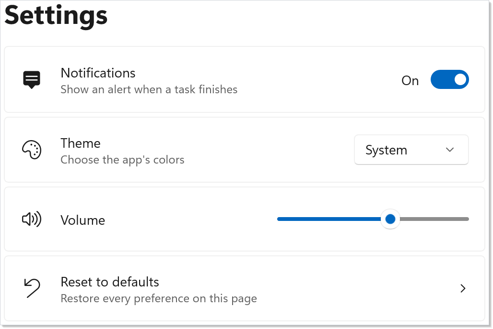

# Recipe: Settings page

A settings page is many small persisted prefs side-by-side. Each
preference is its own `UsePersisted` call with its own key — there's
no central settings object that needs migration when one preference
moves. Each row is a [`SettingsCard`](../settings-cards.md).

## Primitives

| Concern | API |
|---|---|
| Per-pref storage | `UsePersisted<T>(key, initial, scope)` |
| Scope | `PersistedScope.Window` / `Application` |
| Toggle | `ToggleSwitch(isOn, setOn)` |
| Choice | `ComboBox(items, index, setIndex)` |
| Range | `Slider(value, min, max, setValue)` |
| Row layout | `SettingsCard(header, description, icon, content)` |
| Action row | `SettingsCard(header, description, icon, onClick: ...)` |

### Persisted state

```csharp
// Each preference is a separate UsePersisted call with its own key.
// The window scope ties the values to the host's lifetime; flip to
// PersistedScope.Application when the prefs should survive across
// windows.
var (notify, setNotify) = UsePersisted("prefs/notify", true,
    PersistedScope.Window);
var (theme, setTheme) = UsePersisted("prefs/theme", 0,
    PersistedScope.Window);
var (volume, setVolume) = UsePersisted("prefs/volume", 60.0,
    PersistedScope.Window);
```

Three preferences, three keys. Each pref persists independently, so
adding a fourth is one line in `Render()` + one matching control. The
`PersistedScope.Window` scope keeps the values
inside the host window — flip to `PersistedScope.Application` for
process-wide preferences (auth, locale, theme) per the
[persistence](../persistence.md) page.

### Render

```csharp
// One SettingsCard per preference. Each card gives its control the
// header as its automation name, so Narrator announces "Theme".
return VStack(4,
    Heading("Settings").Margin(0, 0, 0, 12),
    SettingsCard("Notifications",
        description: "Show an alert when a task finishes",
        icon: FontIcon("\uE7E7"),
        content: ToggleSwitch(notify, setNotify)),
    SettingsCard("Theme",
        description: "Choose the app's colors",
        icon: FontIcon("\uE790"),
        content: ComboBox(["System", "Light", "Dark"], theme, setTheme)),
    SettingsCard("Volume",
        icon: FontIcon("\uE767"),
        content: Slider(volume, 0, 100, setVolume).Width(200)),
    reset
).Padding(20);
```



A `VStack` of `SettingsCard`s; each card is a header, an optional
description and icon, and the control. The card styles the control the
way Windows Settings does, lines the controls up on the right, and gives
each control the header as its automation name. The page re-renders from
the changed hook state, and the reconciler patches the existing controls
in place — the slider doesn't re-mount when you toggle notifications.

### Reset card

```csharp
// A clickable card runs an action instead of holding a control: it
// shows a chevron and is a button for the keyboard and Narrator.
var reset = SettingsCard("Reset to defaults",
    description: "Restore every preference on this page",
    icon: FontIcon("\uE7A7"),
    onClick: () =>
    {
        setNotify(true);
        setTheme(0);
        setVolume(60.0);
    });
```

A card with `onClick` and no control is a button: it shows a chevron,
takes keyboard focus, and Narrator reads it as a button named after the
header. Resetting calls each setter with its default, and each pref
saves under its own key as usual.

## Tips

**Use one key per pref, not one big record.** The single-key approach
avoids the [versioned-shape migration](../persistence.md) story for
the common case of adding a pref. If two prefs are genuinely
correlated (e.g. `theme` + `accentColor`), keep them in one record;
otherwise let them live alone.

**Group related prefs in a `SettingsExpander`.** When a page grows,
put the details of one area (display, sound) in the expander's `items`
and keep the most-used control in its header row; see
[Settings Cards](../settings-cards.md#settings-expanders).

**Don't reach for `UseReducer` here.** The Redux-style reducer is the
right shape for state with cross-field invariants; a settings page is
the opposite case — each pref is independent.

**Promote to `Application` scope only when prefs need to outlive the
window.** Window scope is the safer default; an Application-scoped
key shared across windows is a coordination problem the
[persistence](../persistence.md) page covers in detail.

## Next Steps

- **[Persistence](../persistence.md)** — Scope choice, migration story,
  and the disk-bridge pattern when prefs must survive a restart.
- **[Forms](../forms.md)** — Validation surface to apply to settings
  with constraints (port numbers, file paths).
- **[Styling](../styling.md)** — Wire the "Theme" pref to actual theme
  switching via `ApplicationTheme`.
- **[Recipe: Login](login.md)** — Sibling recipe for input-driven
  forms.
- **[Recipes index](index.md)** — Back to the gallery.
