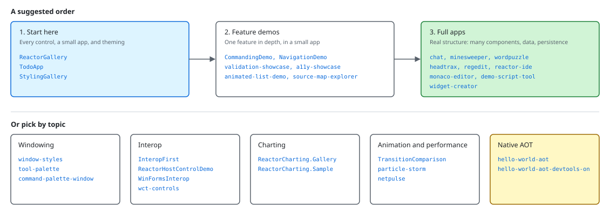

# Samples

The repository has more than 30 sample apps in its
[`samples/`](https://github.com/microsoft/microsoft-ui-reactor/tree/main/samples)
folder. Some are small and show one feature. Others are full apps with many
components, real data and saved settings. Every sample is a normal .NET project
that you start with `dotnet run`. This page lists the samples by group, says
what each one shows, and gives the command that runs it.



## Before you run a sample

The samples build Reactor from source. They reference `src/Reactor` as a
project, not the NuGet package, so you need a clone of the repository and the
tools that build it.

| You need | Why | How to get it |
| --- | --- | --- |
| A clone at a short path, such as `C:\src\microsoft-ui-reactor` | The Windows App SDK build tools have no long-path support. A deep or OneDrive-synced path fails with `MSB3073` or `PRI210`. | `git clone https://github.com/microsoft/microsoft-ui-reactor.git` |
| The .NET 11 SDK | `global.json` pins it, and Reactor uses C# 15. | Run `bootstrap.ps1` from the clone. |
| The .NET 10 Desktop runtime | The samples target `net10.0`. | `bootstrap.ps1` installs it with the SDK. |
| The Windows App Runtime 2.x | Most samples are framework-dependent, so they load the runtime that is installed on the PC. | `winget install Microsoft.WindowsAppRuntime.2` |
| A platform flag | `AnyCPU` is not a supported WinUI app platform. | Pass `-p:Platform=x64`, or `-p:Platform=ARM64` on an Arm PC. |

`bootstrap.ps1` checks for the two .NET pieces and installs them with winget
when they are missing. See
[Setting up a source checkout](https://github.com/microsoft/microsoft-ui-reactor/blob/main/CONTRIBUTING.md#setting-up-a-source-checkout).
Two samples, `minesweeper` and the internal `Reactor.TestApp`, are
self-contained. They carry the Windows App Runtime with them.

## Run a sample

Run each command from the root of the clone. Pass the sample's folder to
`--project`. When a folder holds more than one project, pass the `.csproj`
file instead.

```powershell
dotnet run --project samples/TodoApp -p:Platform=x64
```

The commands on this page use `x64`. On an Arm PC, use `ARM64`. A few
commands also set `-p:RuntimeIdentifier=win-x64`, as the sample's README does.
Change that value to `win-arm64` when you change the platform.

Debug builds of the samples also reference `Reactor.Devtools`, so you can add
a `--devtools` argument after `--`:

```powershell
dotnet run --project samples/TodoApp -p:Platform=x64 -- --devtools app
```

See [Devtools](devtools.md) for the other launch modes.

## Start here

These three samples cover the basics. Open ReactorGallery when you need a
control and want to copy working code for it.

| Sample | What it shows | Run |
| --- | --- | --- |
| [ReactorGallery](https://github.com/microsoft/microsoft-ui-reactor/tree/main/samples/ReactorGallery) | Every WinUI control, rebuilt with the Reactor DSL. It is the Reactor version of WinUI Gallery. See [Controls](controls.md). | `dotnet run --project samples/ReactorGallery -p:Platform=x64` |
| [TodoApp](https://github.com/microsoft/microsoft-ui-reactor/tree/main/samples/TodoApp) | A small to-do app: state in `UseReducer`, a `Command` with a keyboard accelerator, flex layout, theme tokens and a `TitleBar`. See [Your first app](getting-started.md). | `dotnet run --project samples/TodoApp -p:Platform=x64` |
| [StylingGallery](https://github.com/microsoft/microsoft-ui-reactor/tree/main/samples/StylingGallery) | One tab each for theme tokens, `RequestedTheme`, `UseColorScheme`, lightweight styling and style caching. See [Styling and Theming](styling.md). | `dotnet run --project samples/StylingGallery -p:Platform=x64` |

ReactorGallery can also build as an MSIX package with `-p:GalleryPackaged=true`.
Its
[README](https://github.com/microsoft/microsoft-ui-reactor/blob/main/samples/ReactorGallery/README.md)
has the details.

## Feature demos

Each of these samples shows one feature in depth, in a small app.

| Sample | What it shows | Run |
| --- | --- | --- |
| [CommandingDemo](https://github.com/microsoft/microsoft-ui-reactor/tree/main/samples/CommandingDemo) | `StandardCommand`, `Command`, `UseCommand` and `CommandHost`, commands that take a parameter in a menu, and commands shared through context. See [Commanding](commanding.md). | `dotnet run --project samples/CommandingDemo -p:Platform=x64` |
| [NavigationDemo](https://github.com/microsoft/microsoft-ui-reactor/tree/main/samples/NavigationDemo) | Navigation with a deep-link route map, required and optional parameters, query strings, wildcards and back stacks. See [Navigation](navigation.md). | `dotnet run --project samples/NavigationDemo -p:Platform=x64` |
| [validation-showcase](https://github.com/microsoft/microsoft-ui-reactor/tree/main/samples/apps/validation-showcase) | Form validation: `ValidationContext`, the built-in validators, error styling, `MaskedTextBox`, input formatters, rules that compare two fields, and an `InfoBar` that lists the errors. See [Forms and Input](forms.md). | `dotnet run --project samples/apps/validation-showcase -p:Platform=x64` |
| [a11y-showcase](https://github.com/microsoft/microsoft-ui-reactor/tree/main/samples/apps/a11y-showcase) | A task tracker with accessible names, heading levels, landmarks and live regions. It is written so that the `AccessibilityScanner` and the `REACTOR_A11Y` analyzers report no findings. See [Accessibility](accessibility.md). | `dotnet run --project samples/apps/a11y-showcase -p:Platform=x64` |
| [animated-list-demo](https://github.com/microsoft/microsoft-ui-reactor/tree/main/samples/apps/animated-list-demo) | Keyed list reconciliation, with animations when items are added, removed and moved in a `ListView`. See [Collections](collections.md). | `dotnet run --project samples/apps/animated-list-demo -p:Platform=x64` |
| [source-map-explorer](https://github.com/microsoft/microsoft-ui-reactor/tree/main/samples/apps/source-map-explorer) | Source mapping: each control reports the `file:line` of the DSL call that created it. You can turn mapping on and off while the app runs. See [Source Mapping](source-mapping.md). | `dotnet run --project samples/apps/source-map-explorer -c Debug -p:Platform=x64` |

## Full apps

These samples are complete apps. Read them to see how a larger Reactor app is
split into components and how it loads, shows and saves data.

| Sample | What it shows | Run |
| --- | --- | --- |
| [chat](https://github.com/microsoft/microsoft-ui-reactor/tree/main/samples/apps/chat) | A chat app with a sidebar, a message timeline and an input bar. An in-memory provider answers, so it needs no server or API key. The state and the UI live in separate projects (`Chat.Model`, `Chat.UI`) that another app can reuse. | `dotnet run --project samples/apps/chat/App/ChatSample.csproj -p:Platform=x64` |
| [minesweeper](https://github.com/microsoft/microsoft-ui-reactor/tree/main/samples/apps/minesweeper) | The classic game, with game state in a reducer, a timer, saved high scores, dialogs and support for light and dark themes. | `dotnet run --project samples/apps/minesweeper -p:Platform=x64` |
| [wordpuzzle](https://github.com/microsoft/microsoft-ui-reactor/tree/main/samples/apps/wordpuzzle) | A sliding tile puzzle, ported from a .NET MAUI sample. | `dotnet run --project samples/apps/wordpuzzle -p:Platform=x64` |
| [headtrax](https://github.com/microsoft/microsoft-ui-reactor/tree/main/samples/apps/headtrax) | A `DataGrid` that loads about 200,000 generated employee records on demand, from a SQLite file or a GraphQL service. It needs Node.js; see [Extra setup](#extra-setup). See [Data System](data-system.md). | `dotnet run --project samples/apps/headtrax/HeadTrax/HeadTrax.csproj -p:Platform=x64` |
| [regedit](https://github.com/microsoft/microsoft-ui-reactor/tree/main/samples/apps/regedit) | A registry editor modeled on `regedit.exe`. It reads, changes and deletes values in the real registry. | `dotnet run --project samples/apps/regedit/ReactorRegedit.csproj -p:Platform=x64` |
| [reactor-ide](https://github.com/microsoft/microsoft-ui-reactor/tree/main/samples/apps/reactor-ide) | A layout like Visual Studio, built with the docking system: Solution Explorer, an editor area, and Properties, Git Changes, Output, Terminal and Error List panes. See [Docking Windows](docking.md). | `dotnet run --project samples/apps/reactor-ide -p:Platform=x64` |
| [monaco-editor](https://github.com/microsoft/microsoft-ui-reactor/tree/main/samples/apps/monaco-editor) | A text editor that hosts the Monaco editor in WebView2 as a custom Reactor element. It opens and saves files, accepts dropped files and switches languages. See [WebView2](text-and-media.md#webview2). | `dotnet run --project samples/apps/monaco-editor -p:Platform=x64` |
| [demo-script-tool](https://github.com/microsoft/microsoft-ui-reactor/tree/main/samples/apps/demo-script-tool) | Writes a coding demo as one Markdown file. The GitHub Copilot SDK generates runnable code and speaker notes for each step. It needs a GitHub Copilot account. | `dotnet run --project samples/apps/demo-script-tool/App/DemoScriptTool.csproj -p:Platform=x64` |
| [widget-creator](https://github.com/microsoft/microsoft-ui-reactor/tree/main/samples/apps/widget-creator) | Turns a prompt into a single-file Reactor app, builds it, and runs it in a sandbox. It needs a GitHub Copilot account and locally packed Reactor packages. | `dotnet run --project samples/apps/widget-creator/widget-creator.csproj -p:Platform=x64` |

### Extra setup

- **headtrax** reads its data from `service/headtrax.db`. Create that file
  once. The service needs Node.js `^20.19.0`, `^22.13.0` or `^23.5.0`.

  ```powershell
  cd samples/apps/headtrax/service
  npm install
  npm run generate
  ```

  To use the GraphQL source, also run `npm start` in the same folder. The app
  connects to `http://localhost:4000/graphql`.
- **demo-script-tool** and **widget-creator** call GitHub Copilot. Sign in
  first with `gh auth login --web`, using an account that has Copilot.
- **widget-creator** builds the apps it creates against the packages in
  `local-nupkgs/`. Run `mur pack-local` (or `bootstrap.ps1`) first. Its
  [README](https://github.com/microsoft/microsoft-ui-reactor/blob/main/samples/apps/widget-creator/README.md)
  lists the full setup.
- **regedit** edits the real registry of your PC. Try it on keys you can
  lose, or in a virtual machine.

## Windowing

These samples show window styles and owned tool windows. See
[Windows](windows.md) for the APIs.

| Sample | What it shows | Run |
| --- | --- | --- |
| [window-styles](https://github.com/microsoft/microsoft-ui-reactor/tree/main/samples/apps/window-styles) | A playground for the window properties: style and chrome, resize mode, always-on-top level, taskbar options, sizing, backdrop and opacity. Change a setting and the window updates at once. | `dotnet run --project samples/apps/window-styles -p:Platform=x64 -p:RuntimeIdentifier=win-x64` |
| [tool-palette](https://github.com/microsoft/microsoft-ui-reactor/tree/main/samples/apps/tool-palette) | A tool palette window, owned by the main window, like the one in Photoshop. | `dotnet run --project samples/apps/tool-palette -p:Platform=x64 -p:RuntimeIdentifier=win-x64` |
| [command-palette-window](https://github.com/microsoft/microsoft-ui-reactor/tree/main/samples/apps/command-palette-window) | A command palette window like PowerToys Run. See also [Recipe: Command Palette](recipes/command-palette.md). | `dotnet run --project samples/apps/command-palette-window -p:Platform=x64 -p:RuntimeIdentifier=win-x64` |

## Interop

These samples mix Reactor with XAML, WinForms and third-party controls.

| Sample | What it shows | Run |
| --- | --- | --- |
| [InteropFirst](https://github.com/microsoft/microsoft-ui-reactor/tree/main/samples/InteropFirst) | A plain WinUI XAML and MVVM app that hosts a Reactor component in a `ReactorHostControl`. A XAML `ListView` and the Reactor component show the same `ObservableCollection` and use the same commands. See [Host Reactor in a XAML page](xaml-developers.md#host-reactor-in-a-xaml-page). | `dotnet run --project samples/InteropFirst/InteropFirst.csproj -p:Platform=x64` |
| [ReactorHostControlDemo](https://github.com/microsoft/microsoft-ui-reactor/tree/main/samples/ReactorHostControlDemo) | The smallest way to put a Reactor component in a XAML window: one `ReactorHostControl` with `ComponentType` set in markup. | `dotnet run --project samples/ReactorHostControlDemo -p:Platform=x64` |
| [WinFormsInterop](https://github.com/microsoft/microsoft-ui-reactor/tree/main/samples/WinFormsInterop) | A WinForms window that hosts a Reactor component through XAML Islands, next to native WinForms controls. Tab moves focus across both sides. See [WinForms Interop](winforms-interop.md). | `dotnet run --project samples/WinFormsInterop -p:Platform=x64` |
| [wct-controls](https://github.com/microsoft/microsoft-ui-reactor/tree/main/samples/apps/wct-controls) | 25 Windows Community Toolkit controls, wrapped with the Reactor wrapper generator and shown in a `NavigationView` gallery. See [Extending Reactor with Native Controls](extending-reactor-controls.md). | `dotnet run --project samples/apps/wct-controls -p:Platform=x64 -p:RuntimeIdentifier=win-x64` |

## Charting

Both samples use the charting library. See [Charting](charting.md).

| Sample | What it shows | Run |
| --- | --- | --- |
| [ReactorCharting.Gallery](https://github.com/microsoft/microsoft-ui-reactor/tree/main/samples/ReactorCharting.Gallery) | A gallery of chart samples, with a landing page and a page for each sample. | `dotnet run --project samples/ReactorCharting.Gallery -p:Platform=x64` |
| [ReactorCharting.Sample](https://github.com/microsoft/microsoft-ui-reactor/tree/main/samples/ReactorCharting.Sample) | One file with a tab for each chart type: line, bar, area and pie charts with live data, an organization chart that grows, and a force graph whose nodes you can drag. | `dotnet run --project samples/ReactorCharting.Sample -p:Platform=x64` |

## Animation and performance

These samples push animation and rendering hard. See
[Animation](animation.md) and [Performance](performance.md).

| Sample | What it shows | Run |
| --- | --- | --- |
| [TransitionComparison.Reactor](https://github.com/microsoft/microsoft-ui-reactor/tree/main/samples/TransitionComparison.Reactor) | Page transitions built with Reactor. Run it next to the XAML version to compare. | `dotnet run --project samples/TransitionComparison.Reactor -p:Platform=x64` |
| [TransitionComparison.Xaml](https://github.com/microsoft/microsoft-ui-reactor/tree/main/samples/TransitionComparison.Xaml) | The same page transitions built with a WinUI `Frame`. | `dotnet run --project samples/TransitionComparison.Xaml -p:Platform=x64` |
| [particle-storm](https://github.com/microsoft/microsoft-ui-reactor/tree/main/samples/apps/particle-storm) | Up to 100,000 particles drawn with Win2D in a `Win2DAnimatedCanvas`, while Reactor renders the sidebar. See [Win2D canvas](win2d-canvas.md). | `dotnet run --project samples/apps/particle-storm -p:Platform=x64` |
| [netpulse](https://github.com/microsoft/microsoft-ui-reactor/tree/main/samples/apps/netpulse) | A stress test for the reconciler. Four background threads read network data and update state off the UI thread, and keyed lists reorder often. See [Threading and Dispatch](threading-and-dispatch.md). | `dotnet run --project samples/apps/netpulse -p:Platform=x64` |

## Native AOT

These two apps are the smallest Reactor apps that publish with Native AOT.
`dotnet run` starts them as normal JIT apps. See [Native AOT](native-aot.md)
for the publish command and what each one shows.

| Sample | What it shows | Run |
| --- | --- | --- |
| [hello-world-aot](https://github.com/microsoft/microsoft-ui-reactor/tree/main/samples/apps/hello-world-aot) | A minimal app with devtools left out of the build. | `dotnet run --project samples/apps/hello-world-aot/HelloWorldAot.csproj -p:Platform=x64` |
| [hello-world-aot-devtools-on](https://github.com/microsoft/microsoft-ui-reactor/tree/main/samples/apps/hello-world-aot-devtools-on) | The same app with devtools kept in an AOT build. | `dotnet run --project samples/apps/hello-world-aot-devtools-on/HelloWorldAotDevtoolsOn.csproj -p:Platform=x64` |

## Internal test app

[Reactor.TestApp](https://github.com/microsoft/microsoft-ui-reactor/tree/main/samples/Reactor.TestApp)
is the interactive demo app that contributors use to try controls while they
work on Reactor. The repository's tests also use it. It is not a learning
sample, and it can change at any time.

## How a small sample is built

Most small samples follow the same shape as TodoApp. The code below is a
compiled doc app, not one of the samples, but it uses that shape. The entry
point is one line that opens a window with the root component:

```csharp
ReactorApp.Run<NotesApp>("Notes", width: 600, height: 520);
```

The app state is an immutable record. Each user action is a record too, and
a static reducer turns the old state and an action into the new state:

```csharp
record Note(string Id, string Text);

record NotesState(IReadOnlyList<Note> Notes, string Draft)
{
    public static readonly NotesState Initial = new([], "");
}

abstract record NotesAction;
record SetDraft(string Text) : NotesAction;
record AddNote : NotesAction;
record DeleteNote(string Id) : NotesAction;

static class NotesReducer
{
    public static NotesState Reduce(NotesState state, NotesAction action) => action switch
    {
        SetDraft d => state with { Draft = d.Text },
        AddNote when !string.IsNullOrWhiteSpace(state.Draft) => state with
        {
            Notes = [.. state.Notes, new(Guid.NewGuid().ToString(), state.Draft.Trim())],
            Draft = "",
        },
        DeleteNote d => state with { Notes = [.. state.Notes.Where(n => n.Id != d.Id)] },
        _ => state,
    };
}
```

The root component holds the state with `UseReducer` and passes data and
callbacks down to child components:

```csharp
class NotesApp : Component
{
    public override Element Render()
    {
        var (state, dispatch) = UseReducer<NotesState, NotesAction>(
            NotesReducer.Reduce, NotesState.Initial);

        return VStack(12,
            HStack(8,
                TextBox(state.Draft, text => dispatch(new SetDraft(text)),
                        placeholderText: "New note")
                    .AutomationName("New note")
                    .Width(320),
                Button("Add", () => dispatch(new AddNote()))
            ),
            Component<NoteList, NoteListProps>(
                new(state.Notes, id => dispatch(new DeleteNote(id))))
        ).Padding(16);
    }
}
```

A child component gets its data through a props record. It never changes the
state itself. It calls the callback that its parent passed in:

```csharp
record NoteListProps(IReadOnlyList<Note> Notes, Action<string> OnDelete);

class NoteList : Component<NoteListProps>
{
    public override Element Render() =>
        Props.Notes.Count == 0
            ? TextBlock("No notes yet")
            : VStack(4, ForEach(Props.Notes, note =>
                HStack(8,
                    TextBlock(note.Text).VAlign(VerticalAlignment.Center),
                    Button("Delete", () => Props.OnDelete(note.Id))
                        .AutomationName($"Delete {note.Text}")
                ).WithKey(note.Id)));
}
```

Read [Components](components.md) and [Hooks](hooks.md) for the details of
props and `UseReducer`.

## Tips

- **Start with the gallery.** ReactorGallery has a page for every control.
  Find the control there, then copy the code into your app.
- **Read the sample's README.** Many samples have a `README.md` with the run
  command, what to try, and design notes.
- **Run from a short path.** If a sample fails to build with `MSB3073` or
  `PRI210`, move the clone to a path such as `C:\src`. See
  [Troubleshooting](install.md#troubleshooting).
- **Expect analyzer warnings to be real.** The samples run the same Reactor
  analyzers that your app gets from the NuGet package. A warning in a sample
  you changed points to a real problem. See [Analyzers](analyzers.md).

## Next Steps

- **[Installation](install.md)** — Set up Reactor for your own app.
- **[Your first app](getting-started.md)** — Build a small app step by step.
- **[Controls](controls.md)** — The controls that ReactorGallery shows.
- **[Native AOT](native-aot.md)** — Publish the AOT samples as native binaries.
- **[Coming from XAML](xaml-developers.md)** — Use the interop samples to adopt Reactor in an existing app.
