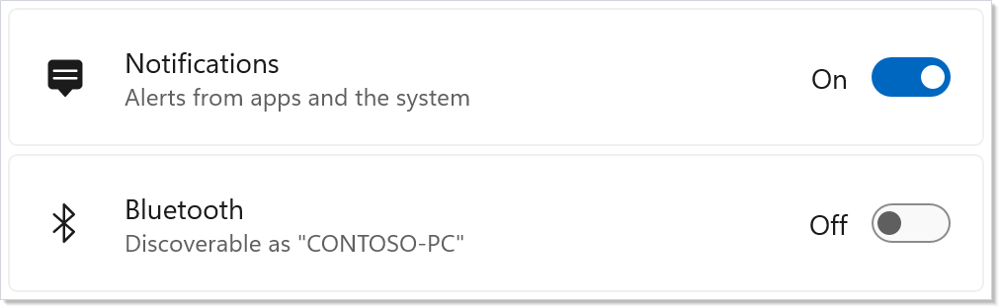
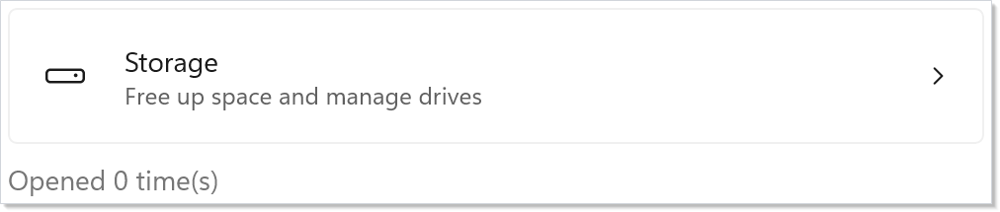
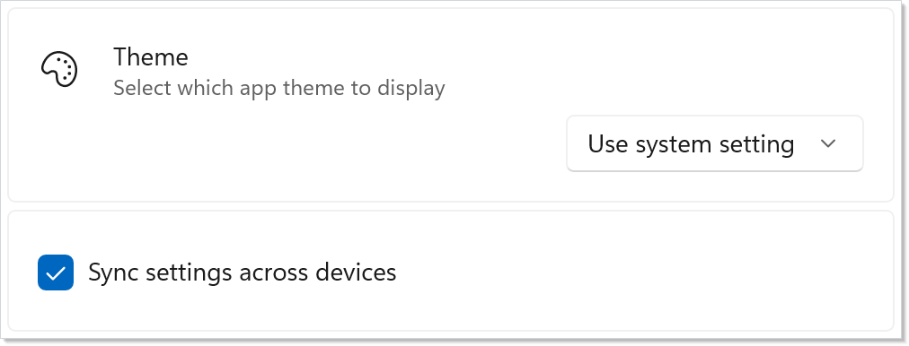
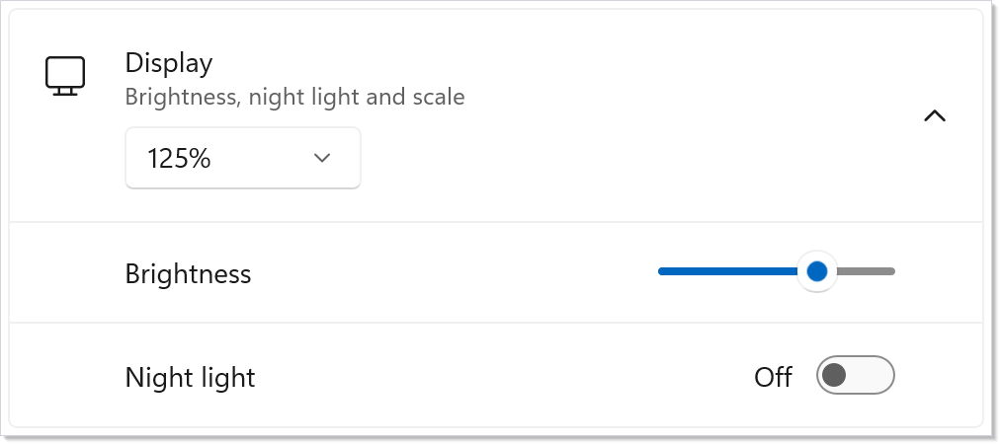
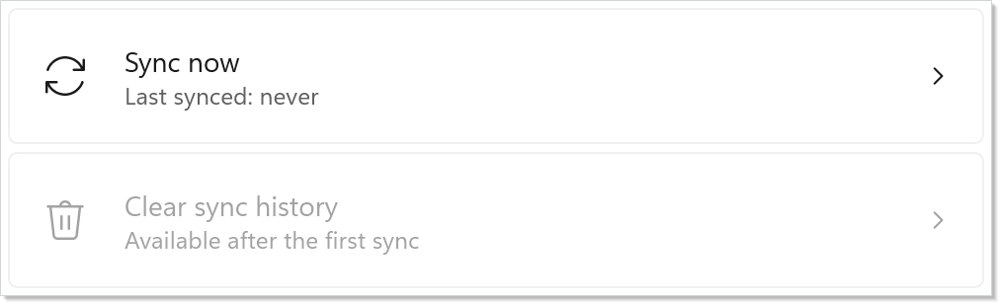

# Settings Cards

Windows 11 builds its settings pages from cards: a row with an icon, a
header, a description, and a control on the right. `SettingsCard`
is that row, and `SettingsExpander` is a card that expands to show
more cards. Both are native Reactor ports of the Windows Community Toolkit
controls of the same names. They look the same in light, dark, and contrast
themes, wrap the same way in narrow windows, and behave the same with the
keyboard and Narrator, without a dependency on the Toolkit.

## Reference

| Factory | Purpose |
|---|---|
| `SettingsCard(header, description?, icon?, content?, onClick?)` | A settings row. With `onClick`, the whole card is a button. |
| `SettingsCard(Element header, Element? description, …)` | Rich header or description content, such as text with a link. |
| `SettingsCard(Command)` | A clickable card driven by a [command](commanding.md). |
| `SettingsExpander(header, description?, icon?, content?, isExpanded?, onIsExpandedChanged?, items?)` | A card that expands to show more cards. |

| Modifier | Applies to | Effect |
|---|---|---|
| `.ContentAlignment(SettingsCardContentAlignment)` | `SettingsCard` | `Right` (default), `Left` (icon, header and description hidden), or `Vertical` (content below the header). |
| `.ActionIcon(IconData?)` | clickable `SettingsCard` | Replaces the chevron; `null` restores it. |
| `.ActionIconToolTip(string?)` | clickable `SettingsCard` | Tooltip on the action icon. |
| `.ActionIconVisible(bool)` | clickable `SettingsCard` | Shows or hides the action icon. |
| `.ItemsHeader(Element?)` | `SettingsExpander` | Content above the items, inside the expanding body. |
| `.ItemsFooter(Element?)` | `SettingsExpander` | Content below the items, inside the expanding body. |
| `.Click(Action?)`, `.IsExpandedChanged(Action<bool>?)` | `SettingsCard`, `SettingsExpander` | The fluent forms of `onClick` and `onIsExpandedChanged`. |

The usual [modifiers](modifier-system.md) work too: `.IsEnabled(false)`,
`.Margin(...)`, `.AutomationName(...)`, and the theme-token brushes
covered under [Theming](#theming).

## Settings cards

A card takes a header, and optionally a description, an icon (any
`IconData`, such as `FontIcon("\uE7E7")`), and the control it sets:

```csharp
class BasicCardDemo : Component
{
    public override Element Render()
    {
        var (notify, setNotify) = UseState(true);
        var (bluetooth, setBluetooth) = UseState(false);

        return VStack(4,
            SettingsCard("Notifications",
                description: "Alerts from apps and the system",
                icon: FontIcon("\uE7E7"),
                content: ToggleSwitch(notify, setNotify)),
            SettingsCard("Bluetooth",
                description: "Discoverable as \"CONTOSO-PC\"",
                icon: FontIcon("\uE702"),
                content: ToggleSwitch(bluetooth, setBluetooth))
        ).Padding(24);
    }
}
```



A card styles common content the way Windows Settings does. A toggle
switch shows its On/Off label on the left of the switch, and sliders,
combo boxes and text boxes are at least 120 pixels wide, so the controls
in a column of cards line up. A disabled card (`.IsEnabled(false)`) dims
its header, description and icon and disables its content; its background
does not change.

## Clickable cards

`onClick` turns the whole card into a button, for a setting that opens
another page or dialog. The card shows a chevron, hover and pressed
states, takes keyboard focus with Tab, and runs `onClick` on a click, on
Enter or Space, and on a UI Automation Invoke:

```csharp
class ClickableCardDemo : Component
{
    public override Element Render()
    {
        var (opened, setOpened) = UseState(0);

        // onClick makes the whole card a button: chevron, hover and pressed
        // states, Tab focus, Enter / Space, and a UI Automation Invoke.
        return VStack(8,
            SettingsCard("Storage",
                description: "Free up space and manage drives",
                icon: FontIcon("\uEDA2"),
                onClick: () => setOpened(opened + 1)),
            TextBlock($"Opened {opened} time(s)").Opacity(0.6)
        ).Padding(24);
    }
}
```



Replace the chevron with `.ActionIcon(FontIcon("\uE8A7"))` (for example,
an "open in new window" glyph), describe it with `.ActionIconToolTip(...)`,
or hide it with `.ActionIconVisible(false)`. Only clickable cards show the
action icon.

## Content alignment and narrow layouts

`.ContentAlignment(SettingsCardContentAlignment.Vertical)` puts the
control below the header, for wide controls. `Left` hides the icon,
header and description and left-aligns the control, for a control that
carries its own label, such as a check box:

```csharp
class ContentAlignmentDemo : Component
{
    public override Element Render()
    {
        var (theme, setTheme) = UseState(2);
        var (sync, setSync) = UseState(true);

        return VStack(4,
            // The control moves below the header and description.
            SettingsCard("Theme",
                description: "Select which app theme to display",
                icon: FontIcon("\uE790"),
                content: ComboBox(["Light", "Dark", "Use system setting"], theme, setTheme))
                .ContentAlignment(SettingsCardContentAlignment.Vertical),
            // The control is left-aligned and the header is hidden: for content
            // that carries its own label, like a check box.
            SettingsCard("Sync",
                content: CheckBox(sync, setSync, "Sync settings across devices"))
                .ContentAlignment(SettingsCardContentAlignment.Left)
        ).Padding(24);
    }
}
```



Cards also adapt to their own width, as in the Toolkit. Below 476 pixels
the control moves below the header and aligns left; below 286 pixels the
icon is hidden too. A narrow width wins over `Vertical` and `Left`, so a
narrow card always wraps.

## Settings expanders

A `SettingsExpander` has two places for content, and they are
easy to mix up. `content` is the control in the **header row**, next to
the expand button, and is always visible. `items` is the **expanding
body**, one row per item:

```csharp
class ExpanderDemo : Component
{
    public override Element Render()
    {
        var (open, setOpen) = UseState(true);
        var (scale, setScale) = UseState(1);
        var (brightness, setBrightness) = UseState(70.0);
        var (nightLight, setNightLight) = UseState(false);

        // content: the control in the header row. items: the expanding body.
        return VStack(4,
            SettingsExpander("Display",
                description: "Brightness, night light and scale",
                icon: FontIcon("\uE7F4"),
                content: ComboBox(["100%", "125%", "150%"], scale, setScale),
                isExpanded: open,
                onIsExpandedChanged: setOpen,
                items:
                [
                    SettingsCard("Brightness", content: Slider(brightness, 0, 100, setBrightness)),
                    SettingsCard("Night light", content: ToggleSwitch(nightLight, setNightLight)),
                ])
        ).Padding(24);
    }
}
```



Items that are `SettingsCard`s take the expander-item look: no outer
border, a divider line, and indented padding (less on the right for a
clickable item, which shows its chevron). Other elements render as you
give them. Give items that move or change a key with `.WithKey(...)`, as
in any list, so each card keeps its control. `.ItemsHeader(...)` and
`.ItemsFooter(...)` add content above or below the items.

`isExpanded` follows the controlled-value pattern of
`Expander`: omit it and the expander keeps its own state, or
pass your state with `onIsExpandedChanged` to control it.

## Commands

`SettingsCard(Command)` builds a clickable card from a
[`Command`](commanding.md): the label, description and icon fill the
header, description and icon, a click runs the command, and the card is
disabled while the command cannot run (`CanExecute` is false, or an async
command is still running). A command without an action makes a plain,
non-clickable card.

```csharp
class CommandCardDemo : Component
{
    public override Element Render()
    {
        var (lastSync, setLastSync) = UseState<string?>(null);
        var sync = new Command
        {
            Label = "Sync now",
            Description = $"Last synced: {lastSync ?? "never"}",
            Icon = FontIcon("\uE895"),
            Execute = () => setLastSync(DateTime.Now.ToShortTimeString()),
        };
        var clear = new Command
        {
            Label = "Clear sync history",
            Description = "Available after the first sync",
            Icon = FontIcon("\uE74D"),
            Execute = () => setLastSync(null),
            CanExecute = lastSync is not null,
        };

        // The command's label, description and icon fill the card; a click
        // runs it, and the card is disabled while the command cannot run.
        return VStack(4,
            SettingsCard(sync),
            SettingsCard(clear)
        ).Padding(24);
    }
}
```



## Rich header and description

The `Element` overloads of both factories take any element for the
header and the description. A plain text element renders exactly like the
string overload, so a card can keep a text header and give only the
description a link:

```csharp
class RichContentDemo : Component
{
    public override Element Render()
    {
        var (diagnostics, setDiagnostics) = UseState(false);

        // The Element overload takes rich header and description content.
        return VStack(4,
            SettingsCard("Diagnostic data",
                description: HStack(4,
                    TextBlock("Help improve the app."),
                    HyperlinkButton("Privacy statement", new Uri("https://privacy.microsoft.com/"))),
                icon: FontIcon("\uE9D9"),
                content: ToggleSwitch(diagnostics, setDiagnostics))
        ).Padding(24);
    }
}
```

## Accessibility

The cards report the same UI Automation tree as the Toolkit controls:

| Element | Role | Name | Patterns |
|---|---|---|---|
| Clickable `SettingsCard` | Button | The header text (or `.AutomationName(...)`) | Invoke |
| Other `SettingsCard` | Group | none: the card never takes focus | — |
| Content of a card | its own role | the header text, unless it has its own name | its own |
| `SettingsExpander` | Group | The header text (or `.AutomationName(...)`) | — |
| Expander's header button | Button | The header text | ExpandCollapse |

A non-clickable card stays unnamed because Narrator reaches its content
directly, and the content takes the header as its name: the toggle switch
in a "Notifications" card is named "Notifications". Only a text header
names the content, and a `Button` or a text block keeps its own name, as
does content you name yourself with `.AutomationName(...)`.

## Theming

The cards use the Windows theme resources that the Toolkit uses, so they
follow light, dark, an ancestor's `.RequestedTheme(...)`, and Windows
contrast themes, including turning a contrast theme on or off while the
app runs. Restyle them with [theme tokens](theming-tokens.md) and
modifiers, as any other element: for example,
`.Background(Theme.SolidBackground)` or `.Padding(...)`. The cards keep
their template, states and remaining defaults. The Toolkit's resource keys
(`SettingsCardBackground` and so on) are not a styling API in Reactor.

## Moving from the Toolkit

| Toolkit | Reactor |
|---|---|
| `Header`, `Description` | `header`, `description` (`string`, or an `Element` overload) |
| `HeaderIcon` | `icon` (`IconData`) |
| `Content` | `content` |
| `IsClickEnabled`, `Click`, `Command` | `onClick`, or `SettingsCard(Command)` |
| `ActionIcon`, `ActionIconToolTip`, `IsActionIconVisible` | `.ActionIcon(...)`, `.ActionIconToolTip(...)`, `.ActionIconVisible(...)` |
| `ContentAlignment` | `.ContentAlignment(...)` |
| `IsExpanded`, `Expanded`, `Collapsed` | `isExpanded`, `onIsExpandedChanged` |
| `Items`, `ItemsSource`, `ItemTemplate` | `items` (`Element[]`) |
| `ItemsHeader`, `ItemsFooter` | `.ItemsHeader(...)`, `.ItemsFooter(...)` |

## Tips

**Put the setting in the header, the effect in the description.** The
header names the setting ("Notifications"); the description says what it
does or its current state ("Alerts from apps and the system"). Narrator
reads the header as the control's name, so keep it short.

**Use `items` for the body, not `content`.** `content` on a
`SettingsExpander` is the control next to the expand button. A slider or a
list of options in `content` sits in the header row and never collapses.

**Reach for a clickable card to open more settings, a control to change
one.** A card with both `onClick` and `content` works, but users expect a
chevron card to navigate and a switch card to switch.

**Control `isExpanded` only when something else needs it.** An expander
that just opens and closes needs neither `isExpanded` nor
`onIsExpandedChanged`; control it when the app restores the state or
opens the expander from elsewhere.

## Next Steps

- **[Recipe: Settings page](recipes/settings-page.md)** — A persisted settings page built from these cards.
- **[Forms](forms.md)** — The controls that go inside the cards: toggle switches, combo boxes, sliders.
- **[Commanding](commanding.md)** — Commands that drive `SettingsCard(Command)`.
- **[Theming Tokens](theming-tokens.md)** — Restyle the cards with theme-aware brushes.
- **[Accessibility](accessibility.md)** — How Reactor exposes names, roles and patterns to Narrator.
