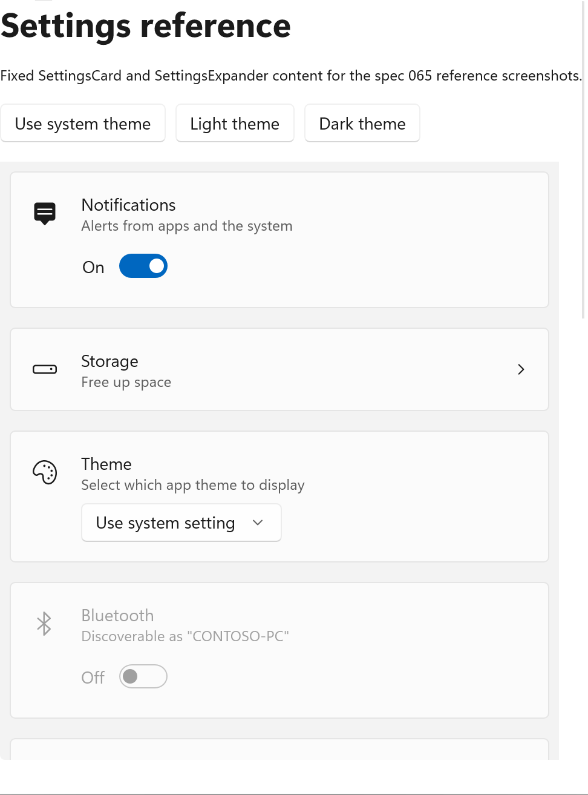
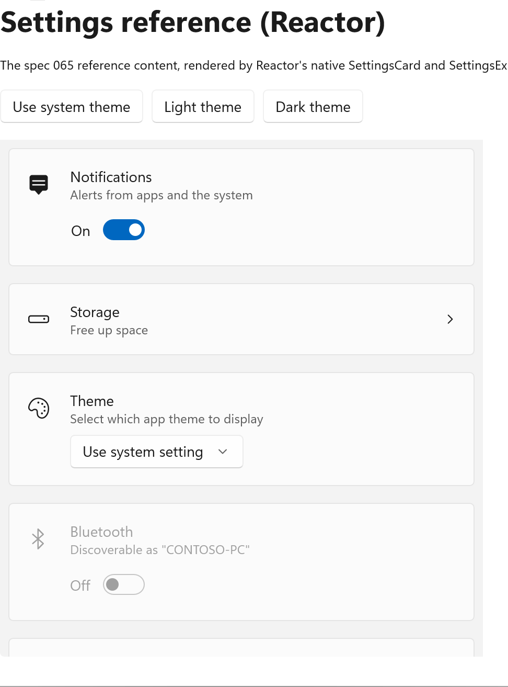
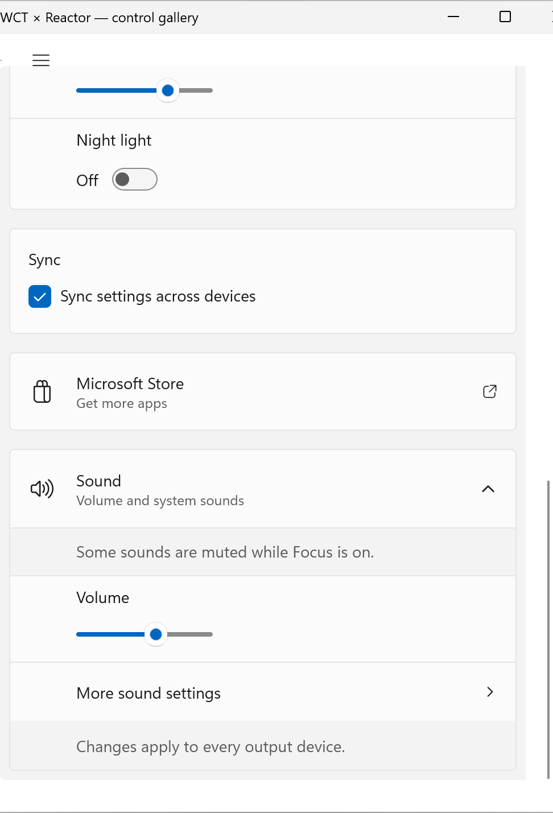
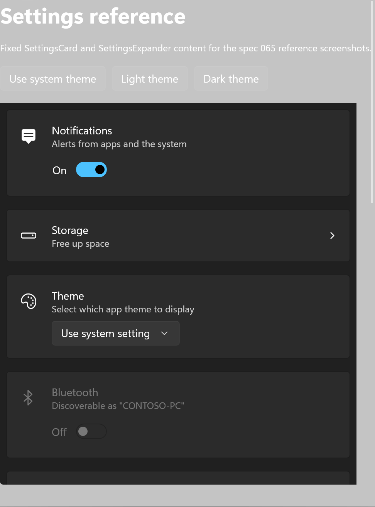
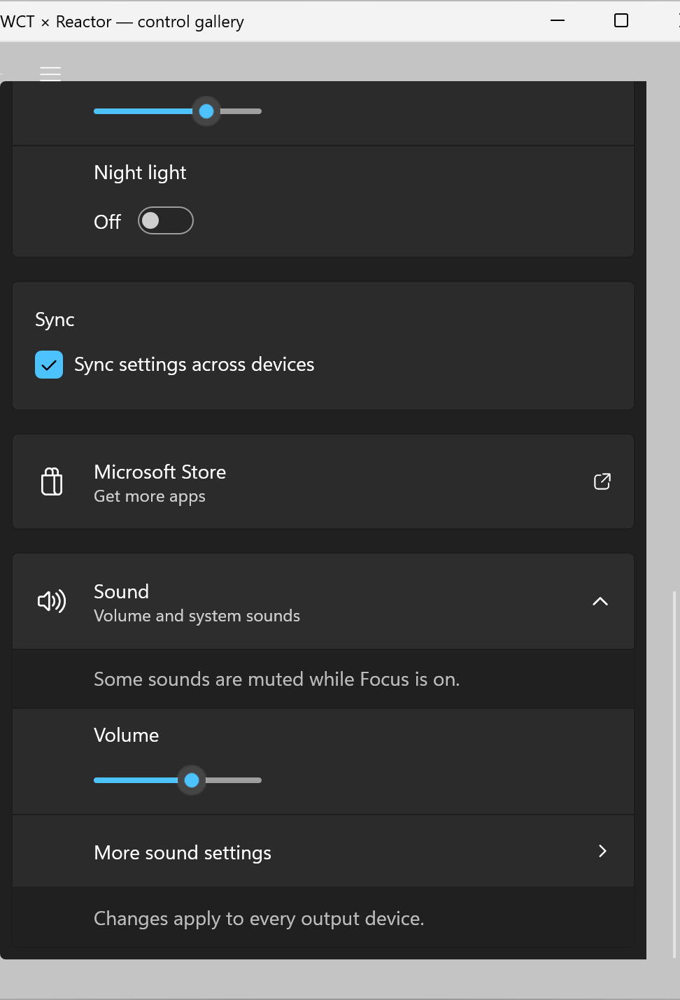

# Spec 065 — SettingsCard and SettingsExpander

> Status: implemented. Originating issue: [#1505](https://github.com/microsoft/microsoft-ui-reactor/issues/1505)
> (API sketch and [decisions](https://github.com/microsoft/microsoft-ui-reactor/issues/1505#issuecomment-6857040057)).
> Builds on [#1506](https://github.com/microsoft/microsoft-ui-reactor/issues/1506): theme tokens in
> high contrast ([#1509](https://github.com/microsoft/microsoft-ui-reactor/pull/1509)).

## 1. Summary

Windows 11 settings pages are built from cards. A card is a row with an icon, a header, a
description and a control. An expander is a card that opens to show more cards. The Windows
Community Toolkit has these as `SettingsCard` and `SettingsExpander`. Until now a Reactor app
could only use them through a `[GenerateReactorWrapper]` wrapper, which brings in the Toolkit
packages.

This spec adds native ports: the `SettingsCard(...)` and `SettingsExpander(...)` factories. They
are built from WinUI controls and the Toolkit's own markup, and they have no dependency on any
`CommunityToolkit.*` package. They are the first Toolkit ports. The goal is that Reactor apps do
not need the Toolkit.

Requirements:

- The same look as the Toolkit controls in light, dark and contrast themes, including the
  layout in narrow windows.
- The same keyboard and UI Automation behavior.
- A Reactor API: immutable elements, factories and modifiers. The API was approved in #1505.

## 2. API

```csharp
// A settings row.
SettingsCard("Notifications", description: "Alerts from apps and the system",
    icon: FontIcon("\uE7E7"), content: ToggleSwitch(notify, setNotify));

// A clickable card: a button with a chevron.
SettingsCard("Storage", description: "Free up space", icon: FontIcon("\uEDA2"), onClick: openStorage);

// Content below the header.
SettingsCard("Theme", content: ComboBox(["Light", "Dark", "Use system setting"], theme, setTheme))
    .ContentAlignment(SettingsCardContentAlignment.Vertical);

// A card driven by a Command.
SettingsCard(syncCommand);

// An expander. content: the control in the header row. items: the body.
SettingsExpander("Display", description: "Brightness, night light and scale", icon: FontIcon("\uE7F4"),
    content: ComboBox(["100%", "125%", "150%"], scale, setScale),
    isExpanded: open, onIsExpandedChanged: setOpen,
    items: [
        SettingsCard("Brightness", content: Slider(brightness, 0, 100, setBrightness)),
        SettingsCard("Night light", content: ToggleSwitch(nightLight, setNightLight)),
    ]);
```

| Factory | Notes |
| --- | --- |
| `SettingsCard(string header, string? description, IconData? icon, Element? content, Action? onClick)` | `onClick` makes the card clickable. |
| `SettingsCard(Element header, Element? description, …)` | Rich header or description. A plain text element renders exactly like the string overload. |
| `SettingsCard(Command command)` | Label, description and icon fill the card. A click runs the command. The card is disabled while the command cannot run (`Command.IsEnabled`), whatever an `.IsEnabled(...)` modifier says; `.IsEnabled(false)` still disables a card whose command can run, as with `Button(Command)`. A command without an action gives a plain card. The command's accelerator and access key are not applied to the card. |
| `SettingsExpander(string header, string? description, IconData? icon, Element? content, Optional<bool> isExpanded, Action<bool>? onIsExpandedChanged, Element[]? items)` | `content` is the control in the header row, next to the expand button. `items` is the body. |
| `SettingsExpander(Element header, Element? description, …)` | Rich header or description. |

| Modifier | Element | Notes |
| --- | --- | --- |
| `.ContentAlignment(SettingsCardContentAlignment)` | card | `Right` (default), `Left` (icon, header and description hidden) or `Vertical` (content below the header). |
| `.ActionIcon(IconData?)` | card | Replaces the chevron of a clickable card. `null` restores the chevron. |
| `.ActionIconToolTip(string?)` | card | Tooltip on the action icon. |
| `.ActionIconVisible(bool)` | card | Shows or hides the action icon. |
| `.ItemsHeader(Element?)`, `.ItemsFooter(Element?)` | expander | Content above or below the items, inside the body. |
| `.Click(Action?)`, `.IsExpandedChanged(Action<bool>?)` | card, expander | The fluent forms of `onClick` and `onIsExpandedChanged`, as on every element with a callback. |

Other choices from #1505:

- `isExpanded` follows Reactor's controlled-value pattern. Without it the expander keeps its own
  state. With it, each render sets the declared value, and `onIsExpandedChanged` reports the
  user's changes.
- Items that are `SettingsCard`s get the Toolkit's expander-item style: no outer border, a
  divider line and indented padding (less on the right for a clickable item). Other elements are
  shown as they are. Items are elements; there is no `ItemsSource` or `ItemTemplate`.
- Apps restyle a card with Reactor theme tokens and modifiers, for example
  `.Background(Theme.SolidBackground)`. The Toolkit's resource keys (`SettingsCardBackground` and
  others) are not an API in Reactor (§5.5). As in the Toolkit, an expander does not pass
  `Background`, `BorderBrush` or `Padding` to its header row and body; apps restyle the cards in
  its items.

The user guide page is [Settings Cards](../guide/settings-cards.md). The
[settings page recipe](../guide/recipes/settings-page.md) now uses the cards.

## 3. Comparison with the Toolkit

### 3.1 How the screenshots are taken

The reference app [`samples/apps/wct-controls`](../../samples/apps/wct-controls) has two pages
with the same nine samples, the same AutomationIds and the same layout: "Settings reference"
renders them with the Toolkit controls and "Settings port" with the Reactor port.
[`065/capture.ps1`](065/capture.ps1) drives both pages in the same way, in one session, at the
same display scale. The [capture runbook](065/capture-runbook.md) lists the samples, window sizes
and steps.

<!-- side-by-side:begin -->

#### Whole page, 540-pixel window

The current capture display is 540 DIPs wide at 200% scale, so these are whole-page captures of
both pages in a 540-DIP window, where every card is narrower than 476 px and uses the wrapped
layout. Each page and theme is captured from a fresh app instance (§3.3, last row), with
`winapp ui screenshot PART_ScrollPresenter` at the top and the bottom of the page. The per-sample
set in the [runbook](065/capture-runbook.md) (wide, narrow and extra-narrow windows, hover and
keyboard focus) needs a screen at least 1000 DIPs wide and is captured separately.

| | Toolkit | Reactor port | Pixels that differ |
| --- | --- | --- | --- |
| Light, top |  |  | 15,395 of 1,276,236: the page title and description text, which differ on purpose, and the scroll indicator. Below the header, 17 anti-aliasing pixels. |
| Light, bottom |  |  | 11 of 1,388,988, by at most one color step. |
| Dark, top |  |  | 15,378 of 1,276,236: the page title and description, and the scroll indicator. |
| Dark, bottom |  |  | 22 of 1,388,988, by at most one color step. |

<!-- side-by-side:end -->

### 3.2 UI Automation tree

The two pages give the same UI Automation tree: the same roles, names, states and bounds. This is
the tree of the Toolkit page from `winapp ui inspect` (window 540 px wide, so the cards wrap). The
port's tree is identical, line for line, apart from the generated element slugs:

```text
ref-card Group
  Text "Notifications" / Text "Alerts from apps and the system"
  Button "Notifications" [on]                      ← the ToggleSwitch, named after the header
ref-card-clickable Button "Storage"
  Text "Storage" / Text "Free up space"
ref-card-vertical Group
  Text "Theme" / Text "Select which app theme to display"
  ComboBox "Theme" [collapsed]
ref-card-disabled Group [disabled]
ref-expander Group "Display"
  Button "Display" [collapsed]                     ← the expander header: ExpandCollapse
    Group                                          ← the header card
      Text "Display" / Text "Brightness, night light and scale"
      ComboBox "Display" [collapsed]
ref-expander-expanded Group "Display"
  Button "Display" [expanded]
    Group …
    Group                                          ← an item card
      Text "Brightness" / Slider "Brightness"
    Group
      Text "Night light" / Button "Night light" [off]
```

### 3.3 Behavior checks

| Check | Toolkit | Port |
| --- | --- | --- |
| Hover on a card without a click action | No change. | No change. |
| UI Automation Invoke on a clickable card (`winapp ui invoke`) | Fails: "does not support any invoke pattern" (§6). | Runs `onClick`. |
| `ContentAlignment.Left` or `Vertical` in a card narrower than 476 px | The narrow layout wins: content below a visible header. | The same. |
| The new samples at 540 px (`ref-card-left`, `ref-card-actionicon`, `ref-expander-items`), whole viewport | — | 2,110 of 1,388,988 pixels differ: the overlay scroll indicator and a few anti-aliased pixels around the slider thumbs. |
| Theme switch while a card is disabled | The disabled toggle switch keeps the outline color of the theme it was disabled in (the template's color animations hold their value). | The same, from the same template. This is why every capture starts a fresh app instance. |

## 4. Behavior

### 4.1 Layout

The card is a grid with the icon, the header and description, the content and the action icon.
The Toolkit's size thresholds apply to the card's own width:

| Card width | State | Layout |
| --- | --- | --- |
| ≥ 476 px | `Right` | Content on the right of the header. |
| 286–475 px | `RightWrapped` | Content below the header, aligned left. |
| < 286 px | `RightWrappedNoIcon` | As `RightWrapped`, and the icon is hidden. |

The Toolkit sets these states with a `ControlSizeTrigger`, and a size trigger wins over its
`Left` and `Vertical` states. The port computes the same states in code
(`SettingsCardControl.ResolveContentAlignmentState`) with the same precedence (§3.3).

The card styles its content as the Toolkit does: a toggle switch shows its On/Off text to the
left of the switch, and sliders, combo boxes and text boxes are at least 120 px wide.

### 4.2 States

| State | Card | Notes |
| --- | --- | --- |
| Pointer over, pressed | Clickable cards only | Background, border and foreground from the Toolkit's brushes. |
| Disabled | All cards | Header, description and icons use the disabled foreground. The background does not change: the Toolkit defines `SettingsCardBackgroundDisabled` but no template uses it. |
| Keyboard focus | Clickable cards and the expander header | The system focus visual. |

The pressed state is not captured: `winapp ui` has no press-and-hold action.

### 4.3 Keyboard

A clickable card is a tab stop. Enter and Space click it, and it shows the pressed state while
the key is down. A card without a click action is not a tab stop; its content is. The expander
header is the WinUI `Expander` header button: Enter and Space open and close it. An E2E test
checks Tab, Enter and Space with real input.

### 4.4 Accessibility

The port matches the Toolkit's automation peers:

| Element | Control type | Name | Patterns and events |
| --- | --- | --- | --- |
| Clickable card | Button | `AutomationProperties.Name`, else the header text | Invoke |
| Other card | Group | none | — |
| Content of a card | its own | its own name; if it has none, the header text | its own |
| Expander | Group | `AutomationProperties.Name`, else the header text | raises ExpandCollapseState changes |
| Expander header | Button | the expander's name | ExpandCollapse |

Notes:

- Only a clickable card has a name. The Toolkit's peer says why: other cards never take focus,
  and the screen reader reaches their content directly. The content is named after the header
  instead, so a toggle switch in a "Notifications" card is called "Notifications".
- Content keeps its own name when it has one, when it is a direct `ButtonBase` subclass such as
  `Button` (named by its text) or when it is a `TextBlock`. A check box, radio button or
  hyperlink button is not a direct `ButtonBase` subclass, so it takes the header as its name
  even though it shows its own text, as in the Toolkit; the docs tell authors to name it.
- Only a text header names anything. With an element header, the clickable card, the expander
  and the content need `.AutomationName(...)`.
- Invoke on a disabled clickable card fails with `UIA_E_ELEMENTNOTENABLED`, as UI Automation
  requires.
- The expander's ExpandCollapseState change events are raised as in the Toolkit. The Toolkit
  notes that Narrator does not announce them
  ([microsoft-ui-xaml#3469](https://github.com/microsoft/microsoft-ui-xaml/issues/3469)).

### 4.5 Themes

The cards follow light and dark, an ancestor's `RequestedTheme` and the Windows contrast
themes, including a change while the app runs (§5.4). In a contrast theme they use the
Toolkit's contrast brushes, which differ from WinUI's own contrast values for the same
standard keys (for example the hover background).

## 5. Design

### 5.1 Elements and handlers

`SettingsCardElement` and `SettingsExpanderElement` are records in
[`Element.Settings.cs`](../../src/Reactor/Core/Element.Settings.cs). Their handlers
([`SettingsCardHandler.cs`](../../src/Reactor/Core/V1Protocol/Handlers/SettingsCardHandler.cs))
are hand-written `IElementHandler`s, registered lazily by the factories (`Reg<>`), and listed in
`ReactorApp.RegisterAllBuiltIns`.

- The child elements (header and description content, content, items header, items, items
  footer) use the `NamedSlots` children strategy, which mounts, updates and unmounts each slot.
- Both handlers tag the control with its element on every mount. The reconciler finds a
  handler's unmount through that tag, and an element without callbacks is not tagged otherwise.
- `BuildItems` puts the items in a `VStack(0, …)` and marks cards as expander items.

### 5.2 Controls

- `SettingsCardControl` is a `ButtonBase`, as the Toolkit's card is. It ports the Toolkit's code:
  visual states, pointer and key handling, the content-alignment states, content spacing,
  content naming and the automation peer.
- `SettingsExpanderControl` is a `UserControl` that hosts a WinUI `Expander` with the Toolkit's
  expander style. Its header is a `SettingsCardControl`, and its body is a grid with the items
  header, the items and the items footer. It mirrors corner radius, minimum size, content
  alignment and the automation name and help text onto the inner parts, as the Toolkit's
  template bindings do.

### 5.3 Markup

[`SettingsCardResources.cs`](../../src/Reactor/Controls/Settings/SettingsCardResources.cs) holds
the Toolkit's `SettingsCard.xaml` and `SettingsExpander.xaml` as strings and loads them with
`XamlReader` on first use. Reactor has no XAML compiler step, so the markup changes:

- Templates target built-in types (`ButtonBase`, `UserControl`), because `XamlReader` cannot
  resolve Reactor's types. Values the Toolkit bound to its own properties (header, description,
  icons) are set from code.
- The Toolkit's state triggers (`ControlSizeTrigger`, `IsEqualStateTrigger`,
  `IsNullOrEmptyStateTrigger`) become `VisualStateManager.GoToState` calls.
- `XamlReader` cannot resolve the attached `AnimatedIcon.State` in a Reactor app. The card
  template drops it (Reactor icons are not animated icons). The expander header's visual states
  set the chevron's `Tag` instead, and `SettingsExpanderControl` forwards the tag to
  `AnimatedIcon.SetState`.
- Implicit styles in a template's resources do not reach the `ContentPresenter`'s content. The
  Toolkit puts its content styles on each card with `StyleExtensions.Resources`; the port merges
  a copy of them into each card's own resources.
- Resource keys have a `Reactor` prefix, so an app that also uses the Toolkit (like
  `wct-controls`) never mixes the two controls' resources.

### 5.4 Theme brushes and contrast themes

The Toolkit's `SettingsCard*` brush keys are aliases of WinUI brushes, defined per theme. They
cannot be ported as aliases:

- A `StaticResource` alias loaded with `XamlReader` resolves once, in the app's theme, so a dark
  subtree in a light app gets light brushes.
- Building the aliases in code, by reading WinUI's theme dictionaries, breaks WinUI itself
  (§7).

So the markup names the WinUI brushes directly with `{ThemeResource}`, and WinUI resolves them
per element theme. `SettingsCardResources.ThemeBrushes` lists the eleven substitutions.

In the `HighContrast` theme the Toolkit maps the same keys to `SystemColor*` brushes. The port
loads a second copy of the markup with those brushes and `Contrast`-suffixed keys, on first use.
Each reconcile calls `SyncHighContrast()`, which switches a control to the copy for the current
contrast setting. A contrast change makes Reactor render every element again without skipping
any, so every card and expander switches while the app runs.

### 5.5 Restyling with theme tokens

`.Background(Theme.X)` and the other theme-token modifiers work by setting a generated style,
which would replace the card's own style, and with it the template, the visual states and the
defaults. A new internal interface, `IReactorBaseStyleHost`
([`IReactorBaseStyleHost.cs`](../../src/Reactor/Core/IReactorBaseStyleHost.cs)), lets a control
name the style that themed styles must be based on, and the key that style is cached under.
`Reconciler.ApplyThemeBindings` and `ClearThemeBindings` use it. The card's template is a local
value, so setting a style never re-templates the card.

### 5.6 Commands and the enabled state

A command that cannot run must disable the card even when an `.IsEnabled(...)` modifier says
otherwise, but the reconciler applies modifiers after the handler, and only when they change.
So the handler does not write the command's state over `IsEnabled`. It sets
`SettingsCardControl.CommandBlocked`, and the card keeps itself disabled while that flag is set,
whatever is written to `IsEnabled` later in the same pass. When the command can run again, the
handler hands `IsEnabled` back to the modifier or to its default.

### 5.7 Attribution

The markup and parts of the code are ported from the Toolkit (MIT) at commit
[`a2fa47ad`](https://github.com/CommunityToolkit/Windows/tree/a2fa47ad72cb95ed81f3ff0885da627a5fd6c14e/components/SettingsControls/src).
The ported files carry the Toolkit's notice; `cgmanifest.json` and `ThirdPartyNoticeText.txt`
list the source.

## 6. Differences from the Toolkit

| Toolkit | Port | Why |
| --- | --- | --- |
| A clickable card's peer returns itself for the Invoke pattern but does not implement `IInvokeProvider`, so UI Automation clients cannot invoke it. | The peer implements `IInvokeProvider`. | Narrator, Voice Access and test tools can activate the card. |
| `HeaderIcon` and `ActionIcon` take any `IconElement`. | `IconData` (`FontIcon(...)`, `SymbolIcon(...)` and the other Reactor icons). | Reactor elements describe icons as data. |
| `Items`, `ItemsSource`, `ItemTemplate`. | `items: Element[]`. | Elements are the template. |
| `IsClickEnabled`, `Click`, `Command`, `CommandParameter`. | `onClick`, or `SettingsCard(Command)`. | Reactor's `Command`. |
| Public `SettingsCard*` resource keys. | Internal, prefixed keys. | Restyle with theme tokens (§5.5). |
| An `AnimatedIcon` header or action icon follows the pointer states. | Not supported. | Reactor's `IconData` has no animated icon, and `XamlReader` cannot set `AnimatedIcon.State` (§5.3). |

## 7. Finding: reading WinUI theme dictionaries from code

While building §5.4 we found that reading a WinUI theme-dictionary entry from code, for a theme
that is not the app's theme, changes that entry for the whole app. In a light app, a
`ThemeRef.Resolve("ControlFillColorSecondaryBrush", isDark: true)` call, made before any dark
element used the key, returned `#80F9F9F9`, the light value (dark is `#15FFFFFF`). Every dark
element then also rendered `#80F9F9F9` for that key.

The port does not read theme dictionaries from code, and its selftests check theme colors with
probe elements instead. `ThemeRef.Resolve` with a theme other than the app's theme has the
problem today; it needs its own issue.

## 8. Tests

| Tier | What | Where |
| --- | --- | --- |
| Unit (27) | The content-alignment and spacing states, the factories and modifiers, `Command` mapping, expander items, and the markup substitution | [`tests/Reactor.Tests/SettingsCardTests.cs`](../../tests/Reactor.Tests/SettingsCardTests.cs) |
| Selftest (6 fixtures, 62 checks) | Mount and update on real controls: templates, layout states, the narrow thresholds, clickable behavior and Invoke, `Command`, theme brushes in light, dark and contrast (with a simulated contrast setting), restyling, expander items, slots, unmount | [`SettingsCardFixtures.cs`](../../tests/Reactor.AppTests.Host/SelfTest/Fixtures/SettingsCardFixtures.cs) |
| E2E (4) | Real click, Tab, Enter and Space on a clickable card; the expander with a real click and Space; roles and names from an out-of-process UI Automation client | [`SettingsCardInteractionTests.cs`](../../tests/Reactor.AppTests/Tests/SettingsCardInteractionTests.cs) |
| Docs | The doc app builds with the consumer analyzers as errors; screenshots captured by the doc pipeline | [`docs/_pipeline/apps/settings-cards`](../_pipeline/apps/settings-cards) |

## 9. Checked by hand

- **High contrast.** Turn on a contrast theme while the app runs, check the cards and the
  expander (rest, hover, pressed, disabled, keyboard focus), and turn it off again.
- **Narrator.** Names and roles from §4.4, Invoke on a clickable card, and opening and closing
  the expander.
