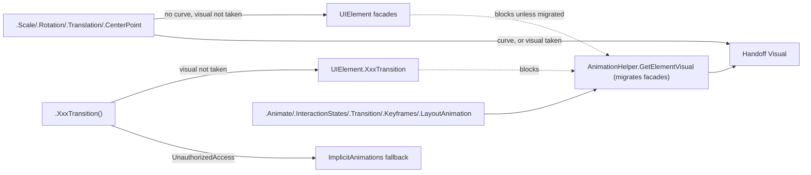
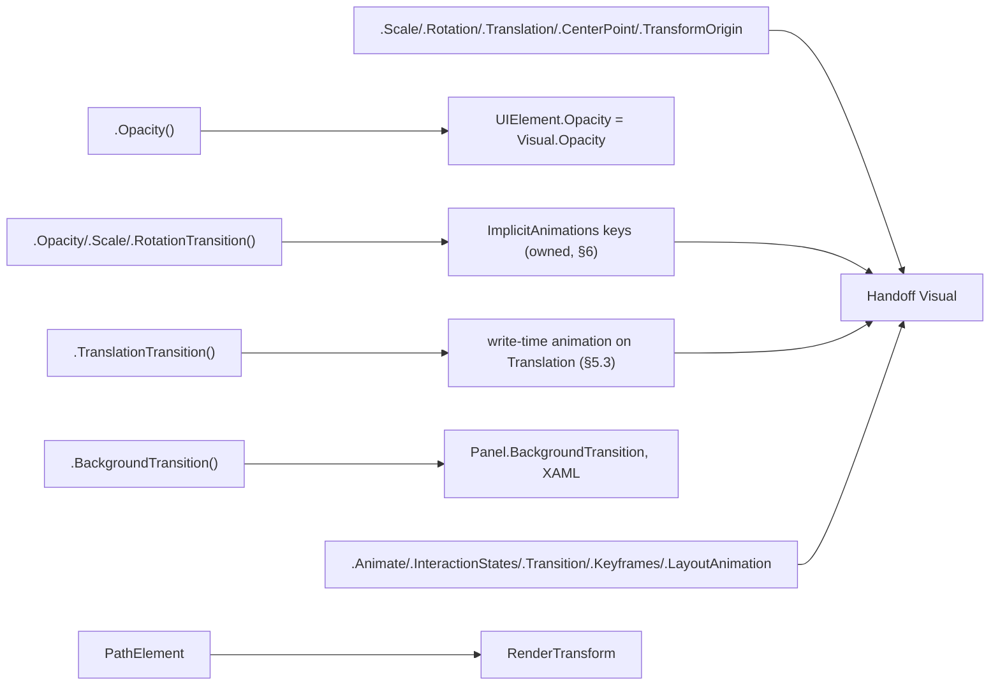

# Spec 066 — Transform modifiers on the composition visual

> Status: **accepted** (2026-11-20), not yet implemented. Rollout in §13. Originating issue: [#1630](https://github.com/microsoft/microsoft-ui-reactor/issues/1630).
> Plans fixes for [#1623](https://github.com/microsoft/microsoft-ui-reactor/issues/1623),
> [#1624](https://github.com/microsoft/microsoft-ui-reactor/issues/1624),
> [#1625](https://github.com/microsoft/microsoft-ui-reactor/issues/1625),
> [#1626](https://github.com/microsoft/microsoft-ui-reactor/issues/1626),
> [#1639](https://github.com/microsoft/microsoft-ui-reactor/issues/1639),
> [#1640](https://github.com/microsoft/microsoft-ui-reactor/issues/1640),
> [#1641](https://github.com/microsoft/microsoft-ui-reactor/issues/1641),
> [#1642](https://github.com/microsoft/microsoft-ui-reactor/issues/1642),
> [#1643](https://github.com/microsoft/microsoft-ui-reactor/issues/1643) and
> [#773](https://github.com/microsoft/microsoft-ui-reactor/issues/773). §13 maps each issue to its layer.
> Builds on #1553, #1620, #1621 and #1627 (all on `main` @ `0c5edca6b`).
> Every runtime claim below was measured by a scratch selftest spike against that commit. The spike
> was not committed. §11 summarises its results, and Appendix A defines every measurement label.

## Table of contents

- [§1 Problem](#1-problem)
- [§2 Goals and non-goals](#2-goals-and-non-goals)
- [§3 Channel model](#3-channel-model)
- [§4 Modifier behaviour](#4-modifier-behaviour)
- [§5 Implicit transitions, compositor only](#5-implicit-transitions-compositor-only)
- [§6 ImplicitAnimations ownership](#6-implicitanimations-ownership)
- [§7 Pooling elements whose visual was taken](#7-pooling-elements-whose-visual-was-taken)
- [§8 `.TransformOrigin(x, y)`](#8-transformoriginx-y)
- [§9 Compatibility and breaking changes](#9-compatibility-and-breaking-changes)
- [§10 AOT and trimming](#10-aot-and-trimming)
- [§11 Measurements](#11-measurements)
- [§12 Test plan](#12-test-plan)
- [§13 Rollout](#13-rollout)
- [§14 Rejected alternatives](#14-rejected-alternatives)
- [§15 Open questions](#15-open-questions)
- [§16 Other defects found by the spike](#16-other-defects-found-by-the-spike)
- [Appendix A Measurement labels](#appendix-a-measurement-labels)

---

## §1 Problem

Reactor writes transforms through three WinUI channels.

| Channel | Used by today |
|---|---|
| `UIElement` facades (`Scale`, `Rotation`, `Translation`, `CenterPoint`) and the XAML implicit transitions (`OpacityTransition`, `ScaleTransition`, `RotationTransition`, `TranslationTransition`) | `.Scale()`, `.Rotation()`, `.Translation()`, `.CenterPoint()` without a curve, and the four `.XxxTransition()` modifiers |
| The handoff `Visual` from `ElementCompositionPreview.GetElementVisual` | `.Animate()`, `.InteractionStates()`, `.Transition()`, `.Keyframes()`, `.LayoutAnimation()`, `.Stagger()`, navigation transitions, and the transform modifiers once the visual has been taken (#1553) |
| `RenderTransform` | `PathElement` only (the D3 chart helpers) |

WinUI makes the first channel mutually exclusive with the other two and enforces it with
`UnauthorizedAccessException` (microsoft/microsoft-ui-xaml#2424, #4931, #9190). #1620 and #1627 work
around that at each handoff site. `AnimationHelper.GetElementVisual` moves non-identity facade values
to the visual before taking it, and the pool resets facades and refuses tainted controls. Two
channels stay alive, and every new compositor feature has to remember the migration.

Four open bugs still come from that split.

- **#1623.** Any XAML implicit transition blocks `GetElementVisual`, so `.OpacityTransition()` plus
  `.LayoutAnimation()`, `.Animate()`, `.Transition()`, `.InteractionStates()` or `.Keyframes()` throws.
- **#1624.** The pool never resets `OpacityTransition` or `BackgroundTransition`, so they leak to the next renter.
- **#1625.** `ApplyLayoutAnimation` replaces `Visual.ImplicitAnimations` and drops the transition fallback keys.
- **#1626.** Removing `.OpacityTransition()`, `.ScaleTransition()` or `.RotationTransition()` never removes the transition.

#773 asks for a size-relative transform origin. That origin is an expression on `Visual.Size`, and the
facade channel can't run one (the earlier #773 investigation, E5 in Appendix A).

## §2 Goals and non-goals

Goals:

1. One channel for every transform Reactor writes, the handoff visual, as the Windows Community
   Toolkit does with `VisualExtensions` and the Composition layer of `AnimationBuilder`.
2. One implementation of the implicit transitions on the compositor. It matches the XAML transitions'
   curve, duration, axis mask and reduced-motion behaviour (§5).
3. Implicit-animation keys that several features can share and remove independently (#1625, #1626).
4. Controls whose visual was taken can go back to the pool (#1624 and §7).
5. A `.TransformOrigin(x, y)` modifier (#773).
6. No change in rendering, hit-testing, UIA bounds or RTL for an app that uses only modifiers (§11).

Non-goals:

- `RenderTransform` stays as it is. `PathElement` keeps using it. It coexists with the visual (#1630
  measurements, P1f) and offers skew and `TransformGroup`, which the visual lacks.
- No change of the default pivot. It stays at (0,0) (§15).
- `BackgroundTransition` stays a XAML transition (§5.6).
- `ThemeTransitions` (`ChildrenTransitions` and friends) are unaffected (Q16).
- The `Curve.Linear` easing defect (§16) is tracked separately.

## §3 Channel model

### Before



### After



Invariants:

1. Reactor never writes `UIElement.Scale`, `Rotation`, `CenterPoint`, `RotationAxis`,
   `TransformMatrix` or any `UIElement.*Transition` property. `Translation` is covered in §4.3.
2. Reactor takes the handoff visual lazily. The first transform write that changes the *effective*
   value, the first transition declaration, or the first compositor feature takes it, and nothing else
   does. A `.Rotation(isOpen ? 90 : 0)` that has only ever been 0 on an untouched control costs nothing
   and stays in the plain pool lane (§7). "Effective" matters. If a setter left a facade non-identity,
   for example `.Set(b => b.Scale = new(2)).Scale(1)`, the identity write still takes the visual (the
   handoff migrates the setter's value) and then overwrites it, so the modifier keeps winning as it
   does today.
3. `AnimationHelper.GetElementVisual` stays the single place that takes the visual. Every successful
   handoff through it marks the control (a permanent `ReactorState` flag on the native control, §7.2,
   #1643). `CompositorProvider.EnsureCompositor` and `ApplyStaggerDelays` go through it as well, so no
   handoff goes unmarked. Its facade migration (#1627) stays, but its job becomes moving a
   `Scale`/`Rotation`/`CenterPoint` value that *user code* wrote through `.Set(...)` before the
   handoff. Reactor no longer writes those facades itself. `Translation` is migrated only when a Reactor
   Translation channel is declared (§4.3).
4. `UIElement.Opacity` stays the opacity channel. The two opacities don't multiply (Q4d). XAML pushes
   `UIElement.Opacity` into the handoff visual's `Opacity` when it commits a change, which overwrites an
   earlier direct visual write (Q4d: UIElement 0.5 then visual 1 settles at 0.5). Writing it fires the
   visual's implicit `Opacity` animation (Q4c). So static `.Opacity()` doesn't need the visual, and
   Reactor must not keep an independent opacity value on the visual. A later `UIElement.Opacity` write
   would replace it. Q4d did not test both write orders against both getters after a second commit, so
   §12 adds that test before anything relies on a stronger equivalence.

## §4 Modifier behaviour

All four transform modifiers share one write path in `AnimationHelper`. `SetScalarDirect` and
`SetVector3Direct` lose their facade branch, and `ShouldWriteToVisual` disappears.

| Modifier | Set | Update | Unset | With a curve (`.Animate`, `WithAnimation`) |
|---|---|---|---|---|
| `.Scale(v)` | `Visual.Scale = v` | same | `Visual.Scale = One` after `StopAnimation("Scale")` | explicit animation on `Scale` (unchanged) |
| `.Rotation(deg)` | `Visual.RotationAngle = rad(deg)` | same | `RotationAngle = 0` | explicit animation on `RotationAngle`, radians (#1621, unchanged) |
| `.Translation(x,y,z)` | `SetIsTranslationEnabled(true)` once, then `Properties["Translation"] = v` | same | `Properties["Translation"] = Zero` | explicit animation on `Translation` (unchanged) |
| `.CenterPoint(v)` | static `Visual.CenterPoint = v`, or the origin expression's offset when `.TransformOrigin` is set (§8) | same | `Zero`, or offset `Zero` | explicit animation on `CenterPoint`, or on the `ReactorOriginOffset` property when an origin is set, so the expression survives (§8.2) |
| `.Opacity(o)` | `UIElement.Opacity = o` (no handoff). If Reactor has animated or written the visual's `Opacity` on this control (recorded in `CompositionModifierProperties`), also `StopAnimation("Opacity")` and write `Visual.Opacity = o`. A `UIElement.Opacity` write that doesn't change the value commits nothing, so without this the visual would stay at the animated value | same | `ClearValue(Opacity)`, plus the same visual stop-and-write when recorded | explicit animation on `Opacity` (unchanged) |

Details:

- **Rotation writes `RotationAngle`, never `RotationAngleInDegrees`.** An implicit `RotationAngle` key
  doesn't fire for a `RotationAngleInDegrees` write, and the reverse is also true (Q3c, Q3e). Every
  Reactor write and key therefore uses `RotationAngle`, as the code has done since #1621.
- **Identity writes are skipped only when the effective value is already identity.** That holds when the
  visual hasn't been taken, the value is the identity (`Scale` One, `Rotation` 0, `Translation` Zero,
  `CenterPoint` Zero), *and* the matching facade still reads identity. When a user setter left the
  facade non-identity, the write takes the visual so the modifier overrides the setter (§3 invariant 2).
  Once the visual is taken, every write goes to it, including identity.
- **Rest values.** `ReactorState.TransformRest` (#1627) keeps the declared values that hover-out,
  `Transition.Scale` and `Keyframes` restore. It works unchanged, because it already reads values from
  declarations and not from the facades.
- **Decorators and keyed `Memo`.** `FindRemainingModifierOwner` and `GetRetainedModifierAnimationSource`
  keep working as they do now. Only the write target changes.
- **`ResetCompositionModifier`** loses its facade branch and its
  `catch (UnauthorizedAccessException)`. It keeps the `StopAnimation` + direct-write + suspended
  `ImplicitAnimations` sequence (P4 shows `StopAnimation` alone leaves the last animated value) and the
  loop-keyframe deferral.
- **`CompositionModifierProperties` / `PropertyFlag`.** They stay, but only to record which
  channels Reactor wrote, so the unset and pool reset know what to restore. They no longer pick a
  channel.

### §4.3 Translation

`UIElement.Translation` behaves differently from the other facades. It stays writable after the
handoff (Q8a), and it's a *separate* channel from the visual's `Translation` property, which is why the
two add up (Q8c). But once `SetIsTranslationEnabled(true)` has been applied and the element has
rendered, a later facade write is **silently ignored** (F1a, F1c). Without that flag, facade writes keep
working after the handoff (F1b).

Rules:

1. Reactor calls `SetIsTranslationEnabled(true)` only when `.Translation()` or a Translation channel
   (`Keyframes` `translation:`, `TranslationTransition`) is declared. That includes the handoff's
   facade migration. `GetElementVisual` stops migrating `UIElement.Translation` unless one of those is
   declared. Translation doesn't block the handoff and stays writable after it (Q8a). Otherwise a drag
   card that writes `fe.Translation` from a handler would lose those writes as soon as it gained a
   `.Scale(pressed ? 0.97f : 1)` (#1642).
2. Reactor stops zeroing `UIElement.Translation` when it writes the visual
   (`AnimationHelper.SetVector3Direct`/`SetOrAnimateVector3`). When a Translation channel *is* declared,
   a user facade value written before the handoff still gets migrated by `GetElementVisual`.
3. Docs warn that `fe.Translation` from user code doesn't combine with `.Translation()` (§9 row 3), and
   `REACTOR_ANIM_004` flags the `.Set` form (§9.1).

## §5 Implicit transitions, compositor only

`ApplyTransitions` stops writing `UIElement.OpacityTransition`, `ScaleTransition`, `RotationTransition`
and `TranslationTransition`. Its `catch (UnauthorizedAccessException)` fallback becomes the only path,
and §6 rewrites it on top of the key-ownership helper. Because the XAML properties are never set, the
handoff is never blocked, which fixes **#1623**.

### §5.1 Curve and duration parity

| | XAML transition (measured) | Fallback today | Proposed |
|---|---|---|---|
| Default duration | 300 ms (`ScalarTransition`, `Vector3Transition`) | the transition's `Duration` | the transition's `Duration` |
| Easing | cubic-bezier **(0.8, 0, 0.2, 1)**. `Q2a`, `Q2b` and `F4a` match `Q2e` sample for sample | none, so the compositor default (an ease-out, Q2c). It is *not* linear as #1630 assumed. Layer E (#1640) makes it linear | `CubicBezierEasingFunction((0.8,0),(0.2,1))`, created once per compositor and cached |
| Start value | current presented value | `this.StartingValue` (implicit) | same |
| Fires for a write made before the element entered the tree | yes (F3) | yes (Q6f) | yes, parity |
| Fires when attached and written in the same tick | yes (F3b) | yes (F3c) | yes, parity |

### §5.2 `Components` (axis mask)

`Vector3Transition.Components` is honoured by XAML. With `Components = X`, X animates and Y jumps
(Q2f, Q2g). The fallback ignores it today. The proposal is a two-keyframe implicit animation. Keyframe
0 is `Vector3(c.X ? this.StartingValue.X : this.FinalValue.X, …)` and keyframe 1 is
`this.FinalValue` with the easing. Y jumped (F4c: `JUMPED`). X reached its final value but was only at
0.01 progress 0.25 s in (F4b). That reads `UNCLEAR` under §11's early-sample verdict, which is what the
eased start predicts, but it isn't proof of motion on its own. Layer V re-measures it with the
mid-duration verdict from §12.1 A. When `Components` is `X|Y|Z`, Reactor uses the single-keyframe form.

### §5.3 TranslationTransition

The XAML `TranslationTransition` animates writes to `UIElement.Translation` (Q1a) and does **not**
animate layout moves (Q1b). The fallback maps it to the visual's `Offset` key, so it animates layout
moves (Q1e) and not `.Translation()` (Q1d, Q1g). That's the wrong property.

The fix can't use an implicit key either. An implicit `"Translation"` key never fires for
`Properties.InsertVector3("Translation", …)`, neither on the first write nor on later ones (Q1c, F1d,
F1e). So `TranslationTransition` becomes a **write-time animation**. `AnimationHelper.ResolveCurve`
becomes `ResolvePolicy`, which returns a curve and a component mask. The source order is unchanged
(ambient `WithAnimation` scope, then `.Animate()`), with a declared `TranslationTransition` added last.
It yields `EaseCurve(Duration, 0.8,0,0.2,1)` with the transition's `Components`, so an explicit
`WithAnimation` or `.Animate()` still wins, as today. `ResolvePolicy` honours the `.Animate()`
property flags for the channel being written, which the current `ResolveCurve` does only when
`respectPropertyFlags` is set (AnimationHelper.cs ~495-507). So `.Animate(AnimateProperty.Opacity, c)`
no longer overrides a declared Scale or Translation transition. That's the same per-key precedence §6.1
uses for implicit keys. `SetOrAnimateVector3("Translation", …)` then
starts an explicit animation, as `.Animate()` already does. When the mask isn't `X|Y|Z`, the
animation gets a keyframe 0 of `Vector3(mask.X ? this.StartingValue.X : final.X, …)`, with `final`
passed as a parameter, so masked axes jump, as in §5.2. F4b/F4c validated the masked form only for an
implicit Scale key, so §12 adds an end-to-end Translation mask test. The explicit animation itself
reached its target (F1f), but its early sample reads `UNCLEAR` for the same eased-start reason as F4b,
so layer V re-measures it. Retargeting mid-flight starts from
the presented value (F1g: 151 → 152 px), which matches XAML.

One difference remains. XAML animates *any* write to `UIElement.Translation`, including a write
from user code, while the write-time animation only covers Reactor's writes. That's acceptable,
because §4.3 already says user facade Translation and `.Translation()` don't mix.

### §5.4 Opacity and Rotation

- **Opacity.** An implicit `"Opacity"` key fires for both `Visual.Opacity` and `UIElement.Opacity` writes
  (Q4b, Q4c). So `.Opacity()` stays a plain `UIElement.Opacity` write and `.OpacityTransition()` installs
  the key. User code that writes `fe.Opacity` animates too, which is XAML parity.
- **Rotation.** The key is `"RotationAngle"` (Q3b) and every Reactor rotation write targets
  `RotationAngle` (§4).

### §5.5 Reduced motion

XAML implicit transitions honour the system "Animation effects" setting
(`SPI_GETCLIENTAREAANIMATION`/`UISettings.AnimationsEnabled`). With the setting off, all of them jump
(the `transitions-screen` run). With it on, they animate (`transitions-screen-anim-on`). Composition
implicit animations ignore the setting and animate either way. So a straight move would quietly break
reduced motion for every `.XxxTransition()` user.

`ApplyTransitions` therefore reads `TransitionEngine.AnimationsEnabled`, which navigation transitions
already use. When animations are off it installs no transition keys and resolves no
`TranslationTransition` curve. A change of the setting takes effect at the element's next
transition apply. Live re-application is an open question (§15). The other compositor
features (`.Animate()`, `.LayoutAnimation()`, `.Transition()`, `.Keyframes()`) already ignore the
setting today. This spec doesn't change them.

### §5.6 BackgroundTransition

`Grid/StackPanel/ContentPresenter.BackgroundTransition` doesn't block `GetElementVisual` in either order
(Q5a, Q5c, Q5d), and it still animates after the handoff (F2). A brush animation has no
equivalent on the handoff visual, so it stays a XAML property. Two changes are needed. The pool clears
it (§7), and an update that drops `.BackgroundTransition()` sets it back to null (§6.3).

## §6 ImplicitAnimations ownership

### §6.1 Rules

Measured platform facts:

- `Visual.ImplicitAnimations` returns the assigned instance (Q6a), and the collection is **live**.
  Adding a key (Q6c) or removing one (Q6b) takes effect without reassignment.
- One collection can be assigned to two visuals (Q6d). Reactor won't do that, because keys are per element.
- A `CompositionAnimationGroup` works as a key's value (Q6e).

Design: a small internal `ImplicitAnimationSlots` helper owns every write to
`Visual.ImplicitAnimations`. No Reactor code assigns the property or creates a collection anywhere
else.

```csharp
internal enum ImplicitFeature : byte { Transition = 1, Animate = 2, Layout = 3 } // higher wins
internal static class ImplicitAnimationSlots
{
    // Claim `key` for (`feature`, `declaration`). A lower-priority claim never replaces a higher one;
    // it is remembered and restored when the higher claim is released.
    public static void Claim(UIElement e, Visual v, string key, ImplicitFeature feature, Element declaration, CompositionAnimation anim);
    // Release only that claim. Restores the next effective claim, or removes the key.
    public static void Release(UIElement e, Visual v, string key, ImplicitFeature feature, Element declaration);
    public static void ReleaseAll(UIElement e, Visual v); // pool reset
}
```

The claims are kept in `ReactorState`, keyed by `(key, feature, declaration slot)`. The *feature*
(Transition < Animate < Layout) sets priority between features. The *declaration slot* is the position
in the shared-target chain that declared the feature, not the `Element` record. On one native control,
that can be the target itself or a transparent decorator or keyed `Memo` at some depth over it. Element
records are immutable and are replaced on every reconcile, so keying by record would leave the old
record's claim behind after a value-only update. Removing the feature later would then restore an
obsolete animation, and the claim would keep the old element graph alive. Every update therefore
re-claims each retained feature under the same slot, which replaces the previous claim's animation in
place, and releases the slots whose feature is gone. Within one feature, the effective declaration is
resolved across the chain the same way `FindRemainingModifierOwner` resolves modifiers, with the
outermost winning, and removing it restores the inner one. The live collection is always derived from
the claims. It's created on first claim, mutated in place, and set to `null` when the last claim goes
away.

The precedence keeps today's ordering. `LayoutAnimation` wins `Offset` and `Size` over `.Animate(Offset)`,
as `ApplyPropertyAnimation` does now. `.Animate()` wins `Opacity`, `Scale` and `RotationAngle` over a
transition, because today `ApplyPropertyAnimation` runs after `ApplyTransitions` and overwrites them.
When the winner leaves, the loser's animation comes back. Today it's simply lost.

### §6.2 Call sites

| Site | Today | Proposed |
|---|---|---|
| `ApplyLayoutAnimation` | assigns a fresh collection (#1625) | `Claim(Offset/Size, Layout, el)`, and `Release` for the channel that was turned off |
| `ClearLayoutAnimation` | `ImplicitAnimations = null` (#1625) | `Release(Offset, Layout, el)`, `Release(Size, Layout, el)` |
| `ApplyPropertyAnimation` / `ClearPropertyAnimation` | merge, or remove by key (removes others' keys too) | `Claim/Release(…, Animate, el)` |
| `ApplyTransitions` (Opacity/Scale/Rotation) | XAML, or the merging fallback, never removes (#1626) | `Claim/Release(…, Transition, el)` |
| `ResetCompositionModifier` | suspends the collection around the write | unchanged. It saves the instance, sets `null`, writes, then restores it |
| `ApplyStaggerDelays` | reads keys, mutates `DelayTime` | unchanged. It mutates animation objects, not the collection |

### §6.3 Removal (#1626) and ordering

`Reconciler.Update.cs` (~line 412) calls `ApplyTransitions` only when the *new* element declares
transitions. The gate becomes `oldEl.ImplicitTransitions is not null || newEl.ImplicitTransitions is not
null || newEl.ThemeTransitions is not null`, which keeps the theme-only updates that reach it today.
`ApplyTransitions(uie, old, new)` releases each channel that `old` had and `new` lacks. For Background,
that means `BackgroundTransition = null`.

**Ordering.** On update, setters and `ApplyModifiers` run *before* `ApplyTransitions`. If a reconcile
drops `.ScaleTransition()` and changes `.Scale()` together, the write would animate with the removed key,
and releasing the key afterwards can't undo an animation that already started. So on update the
transition policy runs **before** setters and modifier writes, both releases and new claims, the way
`ClearRemovedTransformModifiers` already releases departing transforms early. The same applies to the
reduced-motion gate. That also gives XAML parity for attach-and-write in one reconcile (F3b, F3c). On
mount the order stays as it is (modifiers, then transitions), so a declared initial value should not
animate in. That's unmeasured, though. Every spike probe attached the transition before writing, and
Reactor's mount writes first. Layer V adds a write-then-attach probe (in the same tick, before entering
the tree) for both XAML on `main` and the compositor path. If they differ, it gets a §9 row before
layer 2 lands. §12 tests removal and addition together with a value change in the same reconcile.

## §7 Pooling elements whose visual was taken

### §7.1 What a taken visual leaves behind

| Fact | Measured |
|---|---|
| The handoff visual survives detach and re-add to another tree, same instance | P3 |
| The reset list below makes a reused control **pixel-identical** to a fresh one | P1: diff 0 with reset, 11,724 px without |
| After the reset, writes don't animate (implicit cleared) and transforms still work | P1b, P1c |
| `Offset` and `Size` belong to XAML layout. A direct `Offset` write is re-applied by the next arrange | P2a, P2b |
| `StopAnimation` leaves the last animated value, so each reset must write the identity after stopping | P4: 0.90 progress left |
| `SetIsTranslationEnabled(false)` works after the reset and keeps pixel identity | P1h, P1i |
| **Lasting difference:** facade `Rotation/Scale/CenterPoint/RotationAxis/TransformMatrix` writes (even identity) and every `UIElement.*Transition` write still throw | P1d, P1e, Q8a |
| `RenderTransform`, `Opacity` and facade `Translation` stay writable | P1f, P1g, Q8a |

### §7.2 Two pool lanes

After this spec, Reactor never uses the APIs that still throw, but *user code* can, through `.Set(...)`.
A plain `Border()` that rents a visual-taken control and then runs `.Set(b => b.Rotation = 10)` would
throw, while a fresh control wouldn't. So the pool keeps two lanes per type.

- **Plain lane.** Controls whose visual was never taken. This is today's pool, unchanged.
- **Visual lane.** Controls whose visual was taken and then reset with the list below.

`TryRent(type, lane)` picks the lane from the declarations of the element being mounted. That covers the
target plus any transparent decorators or keyed `Memo` resolved over it, and `RentControl` gets that
context as a new argument. The **visual lane** is eligible only when both of these hold.

- *Demand.* The element declares a feature that takes the visual **in the layers landed so far**, that
  is, one listed in `VisualOwningModifiers` (§9.1, the same table the analyzer uses). Background-only
  and theme-only transitions never count. Because layer 3 lands before layers 2 and 4, a
  `TranslationTransition`-only or `.Scale()`-only element doesn't count as demand until the layer that
  moves it to the visual has landed. Before that, it would get a visual-taken control while fresh
  controls still take the XAML path, and it would pick up the readback and setter restrictions early.
  A transform counts only when its effective value isn't identity, the same rule as §3 invariant 2.
  An identity-only chain such as `Border().Scale(1).Ref(r)` would never take the visual on a fresh
  control, so it must not get a visual-lane control that would throw on a later facade write
  through the ref.
- *Compatibility.* No declaration in the chain carries setters (`.Set`, `.OnMount`-style callbacks) and
  the control isn't a custom or third-party handler. A setter could write a facade that throws on a
  rented visual-taken control but works on a fresh one. Example: `.Set(b => b.Rotation = 10).Scale(2)`
  succeeds on a fresh control because the handoff migrates the setter's rotation (§9 row 1).

An eligible element takes from the visual lane first and falls back to the plain lane. Every other
element, and any element whose context isn't known, **only** takes from the plain lane. So user code
never meets a control it couldn't have met fresh, and most transformed elements become poolable again.
They aren't pooled today, because `_compositorTainted` excludes them. Each lane keeps its own cap of 32.

**The lane marker lives on the native control (#1643).** `Return` decides the lane from a permanent
`VisualTaken` flag in the native control's attached `ReactorState`. Every successful
`AnimationHelper.GetElementVisual` sets it (§3 invariant 3), and pool cleanup never clears it. Today's
`_compositorTainted` can't do this job, for two reasons. It's a `ConditionalWeakTable` keyed by the
managed wrapper, which another RCW for the same control doesn't see (the duplicate-RCW problem
`ReactorAttached.StateProperty` exists for, `Reconciler.cs` ~1606-1615). And some handoffs never set it
(`ApplyStaggerDelays`, `CompositorProvider.EnsureCompositor`). The forced-visual perf run saw only
83–356 of 1000 children marked (`rperf.txt`). Layer 3 replaces the table with the flag.

### §7.3 Reset list (visual lane)

Applied in `CleanElement` when the control's `VisualTaken` flag is set. Measured cost is in §11.

1. `StopAnimation` for `Opacity`, `Scale`, `RotationAngle`, `RotationAngleInDegrees`, `CenterPoint`,
   `Offset`, `Size`, `Orientation`, `AnchorPoint` and `TransformMatrix`. Stop `Translation` **only if the
   property exists** (`Properties.TryGetVector3("Translation")`). `StopAnimation` on a property-set entry
   that was never inserted throws `ArgumentException` (measured in the perf run). Step 1 also stops a
   `.TransformOrigin` expression and looping keyframes.
2. `ImplicitAnimationSlots.ReleaseAll` (`ImplicitAnimations = null`).
3. Identity writes. `Opacity = 1`, `Scale = One`, `RotationAngle = 0`, `RotationAxis = UnitZ`,
   `CenterPoint = Zero`, `AnchorPoint = Zero`, `Orientation = Identity`, `TransformMatrix = Identity`,
   `Clip = null`, and `Properties["Translation"] = Zero` when the property exists. Then `SetIsTranslationEnabled(false)`,
   and then `UIElement.Translation = Zero` when it isn't already. That facade stays writable after the
   handoff (Q8a, P1g). §4.3 leaves it to user code when no Reactor Translation channel is declared, so
   a control mounted with `.Set(b => b.Translation = …).Scale(2)` would otherwise carry its offset to
   the next renter.
   `Offset` and `Size` are left to layout (P2).
4. Clear the `ReactorState` composition bookkeeping. That covers `CompositionModifierProperties`,
   `TransformRest`, `KeyframeChannelOwners`, `DeferredModifierResets`, the implicit-slot claims, the
   origin bookkeeping, and the keyframe trigger table entries for the control. The origin itself is put
   into the §8.2 inactive state, because the property set can't drop its entries.
5. The plain-lane steps stay as they are (#1620 facade resets, `RenderTransform`, `FlowDirection`, …). The
   `Rotation`, `Scale`, `CenterPoint`, `RotationAxis` and `TransformMatrix` facade writes are skipped
   for `VisualTaken` controls, because they would throw (Q8a). `Translation` is reset in step 3.

The reset doesn't cover these, so such controls still aren't pooled. A control whose exit `.Transition()` is
still running is already handled, because removal waits for the batch. Controls whose reset throws
are caught and dropped, as #1620 does.

### §7.4 #1624

Both lanes also clear `BackgroundTransition` (Grid, StackPanel, ContentPresenter). By inspection they
should clear `ChildrenTransitions`/`ChildTransitions` too, because `CleanElement` resets neither today
(§16). The XAML transform-transition check in `Return` (#1620) goes away once Reactor never sets those
properties. It only stays as a guard for user `.Set` writes, so it moves into the catch-and-drop path.

## §8 `.TransformOrigin(x, y)`

### §8.1 API

```csharp
public static T TransformOrigin<T>(this T el, float x, float y) where T : Element;  // (0.5f, 0.5f) = centre
```

- `x` and `y` are fractions of the element's laid-out size. (0,0) is the leading top corner.
- The pivot is `Size × origin + CenterPoint`. `.CenterPoint(v)` keeps its meaning (pixels), and
  combined with an origin it becomes an offset, as in CSS `calc(50% + 10px)`. One model, no precedence rules.
- Without `.TransformOrigin`, the pivot is the static `.CenterPoint` value (or 0,0) as today.

### §8.2 Implementation

On the handoff visual:

```text
visual.Properties["ReactorOrigin"]        : Vector2 (x, y)
visual.Properties["ReactorOriginOffset"]  : Vector3 (the .CenterPoint value, or Zero)
CenterPoint ← ExpressionAnimation("Vector3(t.Size.X * t.ReactorOrigin.X + t.ReactorOriginOffset.X,
                                           t.Size.Y * t.ReactorOrigin.Y + t.ReactorOriginOffset.Y,
                                           t.ReactorOriginOffset.Z)")  with t = visual
```

The expression starts once per element. Changing the origin or the offset only writes a property, so
nothing restarts. That generalises `TransitionEngine.BindCenterPointToVisualSize` (TransitionEngine.cs:818),
and navigation should switch to it.

**Ownership of `CenterPoint`.** While an origin is declared, the expression owns `Visual.CenterPoint`, and
nothing else may start an animation on that property or write it.

- A `.CenterPoint` change under a curve (`.Animate()`, `WithAnimation`) animates the
  `ReactorOriginOffset` property (`visual.Properties.StartAnimation`) instead of `CenterPoint`.
- An implicit `CenterPoint` key from `.Animate(AnimateProperty.CenterPoint)` never fires, because no
  write happens. The offset animation above replaces it.
- `ResetCompositionModifier("CenterPoint")` is origin-aware. It resets the offset, not the property.
- Navigation's `NormalizeVisual` stops `"CenterPoint"` unconditionally. After a transition it calls
  `EnsureOrigin(visual)`, which restarts the expression when the element still declares an origin
  (`ReactorState` records that).

Measured (the earlier #773 investigation and this spike, see Appendix A):

- It works when started before first layout, it tracks resizes (#773 E7a/E7c), and it centres scale and
  3D rotation (V2, V4).
- Hit-testing, `TransformToVisual` and UIA bounds all honour it. Q10 `VisualExprOrigin` shows a scale of 2
  about the centre, so (110,150) hits, (320,170) misses and `TransformToVisual(100,0)` = (300,130).
- RTL. The transform space is flow-relative (#773 E10a/V1, and Q9 here). `x = 0` is the *leading* edge,
  which matches SwiftUI's `.leading` and WinUI's own behaviour.
- **During a `.LayoutAnimation()` size animation**, the expression follows the *animating* `Visual.Size`
  while the content renders at its final layout size (Q12b: the pivot implies a 240 px width, the
  content 300 px). At rest it's exact (Q12c). This is documented, not fixed. The alternative, binding
  to a `SizeChanged`-fed property, costs a managed callback per resize and lags a frame.

**Inactive state.** `CompositionPropertySet` has no delete operation, so the two properties can't be
removed once inserted. Unset and pool cleanup instead put the origin into a defined inactive state.
`visual.Properties.StopAnimation("ReactorOriginOffset")` stops an offset animation started under a curve.
Then `StopAnimation("CenterPoint")` on the visual stops the expression, `ReactorOrigin = (0,0)` and
`ReactorOriginOffset = Zero` are written, and the static `.CenterPoint` value (or Zero) is written to
`Visual.CenterPoint`. `ReactorState` records whether the origin is active, so a later `.TransformOrigin`
restarts the expression rather than assuming it runs. §7.3 step 4 uses the same sequence.

### §8.3 Seams

`VisualModifiers`/`ElementModifiers` field (`TransformOrigin: Vector2?`), equality, `Merge`, skip,
`ApplyModifiers`, unset arm, `AppliedModifierMap`, `ModifierTable` (analyzers), both `reactor.api.txt`
copies (`mur --regen-api`), `animation.md.dt` and `modifier-system.md.dt`, the gallery samples (hover,
pulse, pinch/rotate) that currently pivot on the top-left corner, and the shipped agent kit:
`skills/dsl-reference.md`, which is a hand-written modifier list, and the pinch/rotate snippets in
`skills/input.md` and `plugins/reactor/skills/reactor-input/SKILL.md`.

## §9 Compatibility and breaking changes

| # | Change | Who notices | Mitigation |
|---|---|---|---|
| 1 | A user `.Set(fe => fe.Rotation / Scale / CenterPoint / RotationAxis / TransformMatrix = …)` on an element that **also** uses a Reactor transform modifier, a transition or a compositor feature. Reachable from layer 2 for elements with a transition (for example `.Set(b => b.Scale = new(2)).ScaleTransition()`), and from layer 4 for transform-only elements. **Mount:** setters run before modifiers, and `GetElementVisual` migrates `Scale`, `Rotation`, `Translation` and `CenterPoint` (#1627), so those still work. It does **not** migrate `RotationAxis` or `TransformMatrix`, so a non-identity value there makes the handoff throw, even on a fresh control. **Update:** a setter that writes any of these facades after the handoff throws (Q8a). Today all of this works as long as no compositor feature is present | Apps mixing `.Set` facade writes with modifiers | Breaking. CHANGELOG `Changed`. Supported: the four migrated facades on mount. Rejected with a diagnostic: everything else. A `DiagnosticLog.Warning` names the modifier to use when the reconcile catches `UnauthorizedAccessException` from a setter **or from the handoff** on a Reactor-owned element. `REACTOR_ANIM_004` catches it at build time and suggests the modifier (§9.1) |
| 2 | Reading `fe.Scale`/`fe.Rotation`/`fe.CenterPoint` returns identity for values set by modifiers (Q8b). From layer 2 on elements with an implicit transition (it takes the visual), from layer 4 on every transformed element | Code reading facades back | Breaking (minor). Documented. Read `ElementCompositionPreview.GetElementVisual(fe).Scale` instead |
| 3 | `fe.Translation` from user code is ignored once `.Translation()` (or a Translation channel) enabled translation on that element and it has rendered (F1a). It still works on elements that don't use those modifiers, which covers the existing drag samples (`InputGesturesDemo`, `PointerInputPage`) | Apps mixing both, and agents following the shipped input skills, which show the `.Translation(…)` pan pattern next to a 60 Hz `el.Translation = …` ref pattern | Documented as "don't mix" in `animation.md.dt` and next to that pattern in both input skills (layer 4). Reactor stops zeroing the facade (§4.3), and `REACTOR_ANIM_004` flags the `.Set` form (#1642) |
| 4 | A user `.Set(fe => fe.OpacityTransition = …)`/`ScaleTransition`/… blocks the handoff (#1623's mechanism). On mount the setter runs first, so any Reactor transition, transform or compositor feature on the same element then throws at the handoff, even on a fresh control. After the handoff, the setter itself throws | Rare | Use the modifiers. `REACTOR_ANIM_004` (§9.1) catches it at build time. Same runtime diagnostic as row 1, which lands in layer 2, the first layer that makes this reachable without a compositor feature |
| 5 | The `TranslationTransition` fallback animated layout moves (`Offset`). Now `TranslationTransition` animates `.Translation()` on every path, as XAML does | Apps relying on the fallback quirk | `Fixed`. `.LayoutAnimation()` is the API for layout moves |
| 6 | The transition fallback curve goes from linear (the compositor default ease-out before layer E, #1640) to the XAML curve | Visual only | `Fixed` (parity) |
| 7 | Transforms no longer exclude a control from the pool. Visual-lane controls are reused | none visible (P1 pixel-identical) | — |
| 8 | Rendering, RTL, hit-testing, `TransformToVisual` and UIA bounds | none: identical (Q9, Q10, Q18) | — |
| 9 | Reduced motion keeps disabling `.XxxTransition()` | none | §5.5 |
| 10 | `PathElement.RenderTransform` | none, unchanged | — |
| 11 | Third-party handlers that write facades on Reactor-owned controls | none in the repo (grep: only `AnimationHelper` and `ElementPool` write facades) | Same diagnostic as row 1 |

### §9.1 Analyzers

The runtime diagnostic in row 1 only fires once the code runs. A build-time diagnostic catches the
same mistakes at compile time and points to the modifier that works with the composition visual.

**`REACTOR_ANIM_004` (Warning, `Reactor.Animation`). A facade transform is written through `.Set` on an
element that uses the composition visual.**

- *Matches.* A `.Set(...)` lambda, expression-bodied or block, that does one of these:
  - assigns `Rotation`, `Scale`, `CenterPoint`, `RotationAxis`, `TransformMatrix`, `OpacityTransition`,
    `ScaleTransition`, `RotationTransition` or `TranslationTransition`;
  - calls `StartAnimation` on the facade (`StopAnimation` is excluded, because WinUI exempts it from
    facade strictness, so cleanup such as `.Set(b => b.StopAnimation(a)).LayoutAnimation()` is valid);
  - assigns `Translation`, but only when the chain also declares `.Translation()` (§4.3: the write would be silently ignored).

  The target must be the lambda's parameter, and the member must resolve through the semantic model to
  `Microsoft.UI.Xaml.UIElement`. A user type with its own `Rotation` property doesn't match, and neither
  does a write to some other control. Lambda inspection reuses `SetLambdaHelpers`, as
  `PoolResetSetAnalyzer` does.
- *And.* The same fluent chain declares a modifier that takes the visual. The analyzer walks the chain
  with `DuplicateAtomicModifierAnalyzer.GetReceiverInvocation` in both directions from the `.Set`. The
  trigger set is a `VisualOwningModifiers` table in `ModifierTable`, and it grows with the rollout:
  - **today:** `.Animate`, `.InteractionStates`, `.Transition`, `.Keyframes`, `.LayoutAnimation`,
    `.ScrollLinked` (`ApplyScrollAnimation` takes the visual through `AnimationHelper.GetElementVisual`,
    `Reconciler.cs` ~6580);
  - **layer 2:** the four `.XxxTransition()`;
  - **layer 4:** `.Scale`, `.Rotation`, `.Translation`, `.CenterPoint`;
  - **layer 5:** `.TransformOrigin`.
- *Valid on `main` today.* With the current trigger set the diagnosed code already fails. A setter
  re-running on update throws after the handoff (Q8a). `RotationAxis`/`TransformMatrix` and the XAML
  transitions block the handoff at mount (#1623, §9 rows 1 and 4). So the rule can ship ahead of the
  stack (layer 0 in §13).
- *Message.* It names the modifier when one exists: `Rotation` → `.Rotation(…)`, `Scale` → `.Scale(…)`,
  `CenterPoint` → `.CenterPoint(…)`, `OpacityTransition` →
  `.OpacityTransition(duration)`, `ScaleTransition` and `TranslationTransition` → the same-named modifier,
  and `RotationTransition` → `.RotationTransition(duration)`. `RotationAxis`, `TransformMatrix` and
  `StartAnimation` have no modifier. Their message points to `.Keyframes`/`.Animate`, or to taking the
  visual with `ElementCompositionPreview.GetElementVisual` in `.OnMount`. The `Translation` arm only
  fires when the chain already declares `.Translation()`, so it gets its own message instead of a
  suggestion: "this write is ignored because `.Translation(…)` owns translation on this element; remove
  it or merge the value into the existing `.Translation(…)`" (#1642).
- *Code fix.* Mechanical rewrites only, under the same constraints as `PoolResetSetCodeFix`. The
  assignment must be the lambda's only statement, and the right-hand side must map to the modifier's
  parameters without evaluating anything twice:
  - `fe.Rotation = e` → `.Rotation(e)`, and the same for `Scale` and `CenterPoint`;
  - `fe.OpacityTransition = new ScalarTransition { Duration = d }` → `.OpacityTransition(d)`, and the same for `RotationTransition`;
  - `fe.ScaleTransition = t` → `.ScaleTransition(t)`, and the same for `TranslationTransition`.

  The `Translation` arm has no rewrite. Adding `.Translation(…)` would duplicate the existing call,
  and `ModifyVisual` merges last-wins, so the added call would be dead code. Any other shape also gets
  the diagnostic without a fix.
- *Accepted false negatives.* The rule misses three shapes, because none of them is visible from the
  `.Set` chain:
  - a visual-owning modifier on a wrapper (keyed `Memo`, a decorator) or in a chain split across variables;
  - facade writes through `ElementRef.Current` or in event handlers (the drag samples);
  - `.OnMount` callbacks. These could be added later if the matching proves as clean.

**No `REACTOR_MOD_002` widening.** `Scale`, `Rotation` and `CenterPoint` stay in `ModifierTable.DeliberatelyExcluded`,
with the reason updated to: "the modifier takes the composition visual, which locks the facades for the
control's lifetime; `REACTOR_ANIM_004` covers the harmful combination". A blanket suggestion would
rewrite working code on a plain element into code that takes the visual, costs about 100 µs per
element (§11.3), and makes any later facade write from an event handler or `ElementRef.Current` throw.
The analyzer can't see those writes. Keeping the rows excluded also means one `.Set` write never gets
both an `ANIM_004` and a `MOD_002` diagnostic. The four `*Transition` and the `Translation` rows stay
excluded for their existing reasons.

`ANIM_004` belongs in `src/Reactor.Analyzers`. It has no `mur check` mirror, the same as the rest of
the `.Set` family (`POOL_001`, `MOD_002`). Before implementation, the `analyzer-dym` workflow runs an FP
spike. Positives are the shapes above, and the deliberate fixture writes in
`PooledFacadeTransformFixtures`, `TransformModifierFixtures` and `ItemsViewParkingFixtures` get
`#pragma warning disable` with a reason. Negatives:

- `fe.Opacity`;
- `RenderTransform` (`PathElement`);
- a user type with `Rotation`/`Scale` properties;
- a write to a captured control other than the lambda parameter;
- a `.Set` on a chain with no visual-owning modifier (today);
- a `Translation` write without `.Translation()`.

## §10 AOT and trimming

No reflection, no new generic instantiation over user types, and no `dynamic`. The expressions are
string literals, `CompositionPropertySet` writes are typed, and `ImplicitAnimationSlots` is a plain
internal class. Nothing new needs annotations. The diagnostic in §9 row 1 uses `DiagnosticLog.Warning`
behind `IsWarningEnabled`. `ReactorSourcePublisher` isn't touched, so the AOT trim proof is unaffected.

## §11 Measurements

Setup. The scratch fixtures `ZzT_*` (not committed) ran in `Reactor.AppTests.Host`, Release x64, on
`main` @ `0c5edca6b`. The target is a 100×40 red `Border` at (150,150) in a 400×400 white canvas. Two oracles
were used. `RenderTargetBitmap` sees compositor animations (Q2c/Q2d progress) but **not** XAML facade
transitions in flight. `PrintWindow(PW_RENDERFULLCONTENT)` sees both once animations are enabled. The
animation verdict samples about 0.25 s into a 1.5 s animation and again after it must have ended.
`JUMPED` means early progress ≥ 0.95, `ANIMATING` means early progress between 0.03 and 0.95 with the
final at 1, and `UNCLEAR` means early progress < 0.03 with the final at 1 (the slow start of the XAML ease
at 0.25 s). The (0.8,0,0.2,1) curve is at 0.018 at that point, so this verdict can't return `ANIMATING`
for it. Every eased case reads `UNCLEAR`, the positive controls PC1/F0b included. The eased results
cited as motion below therefore rest on the curve traces (Q2a, Q2b, F4a), not on the verdict, and
§12.1 A replaces the early sample with a mid-duration one. The positive controls are PC0 (no
transition, `JUMPED`) and PC1/F0b (XAML transition, which animates only when system animations are on).

The two oracles also **disagree at rest** in one case. A facade `Translation` written after
`SetIsTranslationEnabled` + render ends at 1.00 under RTB but at 0.00 on screen (Q1f, animations off
in both runs). The screen is what users see. RTB results for facade `Translation` are therefore not
trusted, and §4.3 / §9 row 3 rest on the PrintWindow runs (F1a–F1c).

The machine had "Animation effects" off (an RDP session). The XAML rows therefore ran twice, once as
found (everything jumped) and once with `SPI_SETCLIENTAREAANIMATION` turned on for that session only
and restored afterwards.

### §11.1 Answers to #1630's open questions

| Question | Answer | Evidence |
|---|---|---|
| Does `TranslationTransition` map to the right property? | No. The fallback animates `Offset` (layout moves), and XAML animates `Translation`. An implicit `"Translation"` key never fires, so use write-time animation | Q1a, Q1b, Q1d, Q1e, Q1g, Q1c, F1d, F1e, F1f |
| Is the fallback linear? | No. It uses the compositor default ease-out. XAML uses (0.8,0,0.2,1) | Q2a–Q2e, F4a |
| Does a `RotationAngle` implicit animation fire for `RotationAngleInDegrees` writes? | No, and the reverse is also no. Use `RotationAngle` everywhere | Q3b–Q3e |
| Do `UIElement.Opacity` writes reach the visual's implicit `Opacity`? | Yes. The two opacities don't multiply, and XAML pushes `UIElement.Opacity` into the visual when it commits a change | Q4b–Q4e |
| Can tainted elements be pooled? | Yes, with the §7.3 reset list. Pixel-identical. Plain renters must not get them (facade and XAML-transition APIs still throw) | P1–P4 |
| Cost of one `GetElementVisual` per transformed element | See §11.3 | Perf |
| Ordering with #1627 | #1627's helper stays as the single handoff and keeps migrating user facade writes. Its Reactor-side role ends | §3 invariant 3 |

### §11.2 New findings

| Finding | Evidence |
|---|---|
| XAML transitions honour "Animation effects", and composition implicit animations don't | transitions-screen vs -anim-on, §5.5 |
| `Components` is honoured by XAML and can be emulated on the compositor | Q2f, Q2g, F4b, F4c |
| Facade `Translation` + visual `Translation` add up before first render. After `SetIsTranslationEnabled` + render, facade writes are ignored | Q8c, F1a, F1b, F1c |
| `BackgroundTransition` coexists with the handoff in both orders and still animates | Q5a, Q5c, Q5d, F2 |
| `ImplicitAnimationCollection` is live. In-place add and remove take effect | Q6a–Q6c |
| Theme transitions (Entrance, Reposition) coexist with a visual-scaled child | Q16a–Q16d |
| Taking the visual doesn't change pixels (text, rounded border, identity writes) | Q18: diff 0, positive control 453 |
| Origin expression + `LayoutAnimation` size: the pivot follows the animated size | Q12b |
| Reactor's `Curve.Linear` is not linear (§16) | Q2h, Q2i vs Q2d |
| RTL: facade and visual give identical rotation, translation and scale | Q9 (6/6 equal) |
| UIA bounds, hit-testing and `TransformToVisual` are identical for facade and visual | Q10 |

### §11.3 Performance

Two microbenchmarks ran in the selftest host, Release x64, on the same machine. Other sessions were
idle, but it was a shared RDP desktop, so the spread is wide. Minima are given next to medians because they
are the least disturbed. The `/perf` stress workload has no transforms, so it can't measure this
change.

**Raw WinUI.** 2000 `Border`s (6×6) were added to a `Canvas` with properties set, then
`UpdateLayout()`. That's UI-thread synchronous time. There were 7 reps, the variant order was shuffled
per rep, and GC plus 1 s of quiet ran between variants (`perf4.txt`).

| Variant | Mount, ms / 2000 (median, min) | Update, ms / 2000 | Private bytes, KB / element |
|---|---|---|---|
| none | 95, **57** | 3.9 | 1.7 |
| facade `Scale` | 72, **61** | 2.3 | 1.5 |
| facade `Scale`+`Rotation`+`CenterPoint` | 95, **78** | 3.5 | 4.2 |
| `GetElementVisual` only | 379, **251** | 4.3 | 5.0 |
| visual `Scale` | 276, **251** | 0.9 | 5.1 |
| visual `RotationAngle` | 362, **247** | 1.1 | 4.2 |
| visual `Scale`+`RotationAngle`+`CenterPoint` | 403, **272** | 2.4 | 4.8 |
| the same + `.TransformOrigin` expression | 394, **324** | **47** | 8.2 |

| Micro-cost (µs / element) | Median | Min |
|---|---|---|
| First `GetElementVisual` on a laid-out element | 426 | 259 |
| Repeat `GetElementVisual` (already taken) | 1.35 | 1.0 |
| §7.3 reset list | 18.6 | 12.8 |

**Reactor.** 1000 `Border().Width(6).Height(6).Scale(1.2f).Rotation(10)` in a `VStack`, mount →
update (`Scale(1.3f).Rotation(12)`) → three remove-all/remount cycles. The facade path is `main`, and the visual
path is `main` with a scratch switch that forces `ShouldWriteToVisual` (reverted). 7 reps (`rperf.txt`).

| Mode | Mount, ms (median, min) | Update, ms | Remove + remount cycle, ms |
|---|---|---|---|
| plain (no transform) | 32, 25 | 48 | 91 |
| facade (today) | 55, 31 | 50 | 100 |
| visual (forced) | 185, 150 | 65 | **582** |

Reading:

1. **The handoff costs about 100–130 µs per element the first time** (raw: (251−57)/2000 ≈ 97 µs.
   Reactor: (185−55)/1000 ≈ 130 µs), plus about 3 KB of private memory. Writes afterwards are cheaper than facade
   writes (0.9 vs 2.3 ms per 2000). That's acceptable for the tens of transformed elements a typical
   UI has (100 elements ≈ 10–13 ms on first mount), but not free. Two rules follow, and both are
   already in the design. The handoff must stay lazy (§3 invariant 2), so identity transforms and
   untransformed elements never pay. And it must happen once per control lifetime, which the pool lanes
   provide.
2. **Pooling is the dominant term.** Today a visual-taken control can't be pooled, so every remove and
   remount pays construction plus a new handoff (582 vs 100 ms per 1000). Layer 3 (pool lanes) must
   land **before** layer 4, as §13 orders it. A recycled visual-lane control keeps its visual (P3) and pays
   only the reset list (about 15 µs). Otherwise layer 4 would be a churn regression for every transformed
   list item that is pooled today (#1620).
3. **`.TransformOrigin` costs about 25 µs more per element at mount**, and while its expression runs,
   writing other properties on the same visual costs about 20 µs per element (47 ms vs 2.4 ms per 2000).
   That's acceptable for an opt-in modifier, but it rules out putting an origin expression on every
   transformed element by default (§15 Q2).
4. The `ApplyStaggerDelays` behaviour in §16 item 3 is worth fixing on cost grounds alone. It pays the
   first-handoff cost for every child of a staggered panel.

Re-run the raw benchmark on the layer-4 PR, and `/perf` to confirm the untransformed path is unchanged.

## §12 Test plan

Every new oracle gets a positive control that fails when the mechanism is removed. Each layer
mutation-checks its gating assertion (delete or no-op the code, confirm the check fails, revert).

### §12.1 Validation strategy

The fixtures in §12.2 test each fix. This section answers three broader questions for the whole
stack.

1. **Do the animations actually run?** Every case observes motion in flight, not just the end state.
2. **Do features compound correctly?** A combinatorial matrix checks each case against an analytic
   composition model.
3. **Are we only breaking things on purpose?** A behaviour ledger captured on `main` before any
   change is diffed on every layer. Each difference must be declared and tied to a §9 row or an issue.

#### A. What each case records

| Field | Oracle |
|---|---|
| `threw` | Exception type and lifecycle step, or none |
| `pose` | RTB bounding box of the red target at rest, ±2 px, compared with the model in B |
| `motion` | Per animated channel: `JUMPED` / `ANIMATING` / `NOT-APPLIED`, plus progress at 0/50/100%. The controller-driven path is the default: the harness pauses the channel's `AnimationController` (`Visual.TryGetAnimationController`) and sets `Progress`, as `TransformVisualHandoffFixture` already does. Layer V first checks whether implicit animations expose a controller. The wall-clock fallback samples at **mid-duration**: `ANIMATING` means progress between 0.2 and 0.8 there and 1 at the end, and anything inconclusive (§11's `UNCLEAR`) is a failure, not a pass. Facade `Translation` cases use PrintWindow (§12.2) |
| `curve` | For transition cases: requires the controller-driven path. Wall-clock samples are compared in the time domain instead: invert the curve, then allow one frame (±17 ms) of the measured time. A ±0.05 progress band at 50% is under one frame, because the curve's slope there is about 5 |
| `hit`, `uia`, `ttv` | Hit-test at three probe points, the UIA bounding rectangle, and `TransformToVisual` of one corner |
| `channel` | Which channel holds each value (facade getters vs visual properties). Layer 4 flips this on purpose |
| `pool` | Recycled or not, which lane, pixel diff of the rented control against a fresh one, and residual implicit keys or running animations (`TryGetAnimationController` for every channel) |
| `diag` | `DiagnosticLog` warnings emitted |

#### B. The matrix and the composition model

| Dimension | Values |
|---|---|
| Transforms | none, identity (`.Rotation(0)`, `.Scale(1)`, which must not take the visual, §3 invariant 2), `Scale`, `Rotation`, `Translation`, `CenterPoint`, `Scale+Rotation+CenterPoint`, and `TransformOrigin` from layer 5 |
| Implicit transition | none, Opacity, Scale, Rotation, Translation (also `Components = X`), Background |
| Compositor feature | none, `.Animate(curve)`, `WithAnimation`, `InteractionStates` hover, `.Transition` enter and exit, `.Keyframes` (scale, opacity, translation, rotation; one-shot and looping), `.LayoutAnimation` (offset + size), `.Stagger` parent |
| Wrapper | direct, keyed `Memo`, `ModifiedElement` decorator |
| Environment | LTR / RTL, animations enabled / disabled (`TransitionEngine.OverrideAnimationsEnabled`) |
| User code | none, a `.Set` facade write (the §9 cases), a `fe.Translation` drag write |

Each case runs one scripted lifecycle. Mount, change the declared values, add a feature, remove a
feature, remove a modifier, then unmount, rent from the pool as a plain element and as a transformed
one. One case covers every step. The full product is far too large, so the generator combines two
sets. One is **all triples of Transforms × Transition × Feature**, the axis behind every bug so far
(#1613, #1623, #1625): 8 × 6 × 9 = 432 cases (Keyframes counts once, with one-shot and looping as sub-variants). The other is **pairwise coverage** of the remaining dimensions on top. The
generator is seeded and case ids are stable, so ledger diffs stay readable. **Budget.** Controller-driven
cases settle in a few frames per step. Wall-clock cases cost about 2.5 s per motion verdict, so a
lifecycle with five motion steps is over 10 s. Layer V measures the real per-case time and sets the
budget from that, not from this estimate. The matrix runs in its own CI job, never inside the sharded
selftest corpus (900 s cap per shard, TESTING.md). It runs in full on every layer PR (label-triggered
job) and nightly. Every PR's normal CI runs a fixed seeded sample sized to fit a single shard, plus the
§12.2 fixtures.

The model writes down what "compounds properly" means, so the oracle has something to check
against:

- **Pose.** `Translation · T(pivot) · R(rotation, axis) · S(scale) · T(−pivot)`, where
  `pivot = Size × origin + CenterPoint`. The transform space is flow-relative (Q9).
- **Per-channel precedence**, highest first. A playing `.Keyframes` entry on that channel, then the active
  `InteractionStates` state, then a running `.Transition` enter or exit (scale relative to the
  declared value, #1627), then the declared modifier. When a temporary owner ends, the channel returns to
  the declared value (`TransformRest`). How the declared value moves is decided by `WithAnimation`,
  then `.Animate()`, then the implicit transition, else it jumps (§5.3).
- **Opacity** is a single channel (§3 invariant 4).
- **Implicit keys.** `LayoutAnimation` beats `.Animate` beats transitions, per key. Releasing the winner
  restores the next (§6.1).
- **Reduced motion.** Transitions jump. Other compositor features are unchanged (§5.5).

If `main` already disagrees with the model in some case, that's recorded in the ledger as a known
pre-existing difference with an issue link. The model isn't bent to fit it.

#### C. The behaviour ledger

1. **Layer V** lands first. It adds the harness and
   `tests/Reactor.AppTests.Host/SelfTest/Baselines/transforms-ledger.json`, which holds one record per
   case, captured on `main` with no product change.
2. **Baseline.** CI always diffs against the ledger committed on the PR's **base** commit. That file is
   immutable for the PR, and the PR's own regenerated ledger is never the comparison baseline.
   Every differing field must match an entry in `transforms-ledger.expected.json`
   (`{ case selector, field, before, after, reason: "§9 row N" | "fixes #NNNN" }`). An unmatched
   difference fails, and so does an expectation that matches no base-to-head difference, because it's
   stale. Separately, CI checks that the PR's committed ledger equals the head's observations. The
   ledger's own diff in the PR then shows reviewers exactly which behaviours changed.
   **Expectations are per PR.** Once the PR merges, the new ledger becomes the next PR's base, and that
   PR starts with an empty expectations file. Expectations that haven't been cleared fail as stale
   against the new base. **Nightly** runs on `main` compare observations with `main`'s committed ledger
   and allow no expectations: any difference there is a regression or a flaky case.
3. **Control group.** Cases with no transform, transition or compositor feature must stay
   byte-identical across every layer. That covers every step except the "rent as a transformed
   element" step, whose fields are excluded from the control group because layer 4 changes them on
   purpose.
4. Expected changes per layer:
   - **L1:** the #1625 and #1626 cases go from not animating, or still animating after removal, to correct.
   - **L2:** the #1623 cases go from `threw` to passing, the fallback curve changes, and Translation-transition semantics change. On elements with a transition, `channel` flips, facade readback becomes identity, and the §9 row 1 setter cases start to throw (rows 1–2, with the diagnostic from this layer).
   - **L3:** `pool.recycled` flips for compositor-feature cases.
   - **L4:** `channel` flips for the remaining transform-only cases, and their §9 row 1 setter cases start to throw.
   - **L5:** only additions.
5. **Noise.** Poses compare within ±2 px and motion compares by verdict, not raw progress. A
   mismatch reruns three times before it fails. Quarantining a case needs an explicit ledger entry.

#### D. Validating the instruments

- Before recording, a run executes the positive and negative controls for every oracle (PC0/PC1 style
  from §11). If one fails, the run aborts instead of writing a ledger. One example is a pose oracle that
  can't see a known transform.
- **XAML transitions on `main` are invisible to RTB in flight** (§11). The baseline therefore records
  their motion as `unobservable` and compares only their end state. Layer V attaches a one-time
  PrintWindow capture, with animations enabled, of the transition cases on `main`, as evidence for the
  §5.1 parity claims that layer 2 relies on.
- **Mutation checks.** Each layer breaks its key lines, reruns the matrix, and records in the PR which
  cases turned red. Examples: skip a `Claim`, drop the easing, skip one reset step, write the facade
  instead of the visual, skip the identity check, set `VisualTaken` on only one handoff path. A mutation
  that no case catches gets a new case before the layer merges.

#### E. Beyond the matrix

- **Pool soak.** A seeded random churn of 500 elements with random features over 2,000
  mount/update/unmount steps. After every step it asserts: no exception, every rented control passes
  the §7.3 reset invariants (identity visual properties, no implicit keys, no running animation on any
  channel), and the lane rules of §7.2 hold.
- **Real-world pixels.** Before and after each layer, the docs pipeline captures screenshots of the
  gallery pages that use transforms and animations (Animation, Interaction states, Pointer input,
  Transitions) at rest, and diffs them pixel for pixel. Any difference needs a ledger reason.
- **Real input.** The E2E test in §12.2.
- **Perf.** §12.2.
- **Review.** Each layer gets a `pr-review` pass, plus a cross-model check where one is available.

**Exit criteria for every layer.** The matrix passes with only declared differences. The control
group is unchanged. Mutation results are recorded. The soak is clean (layers 3–5). Perf is re-measured
(layers 3–4). CHANGELOG lines cite the §9 rows they introduce.

### §12.2 Fixtures per layer

**Unit (`tests/Reactor.Tests`, headless).**
- `ImplicitAnimationSlots` claim/release precedence as a pure-managed state machine. The collection
  writes go behind an interface so the logic can be tested without WinUI. Cases: lower owner hidden
  then restored; release of a non-owner is a no-op; last release yields an empty set.
- `TransformOrigin` modifier equality, `Merge`, skip and unset (pure records).
- The `ResolvePolicy` source order with `TranslationTransition`, including that `.Animate()` only
  beats a transition on channels its `AnimateProperty` flags include (pure).
- `ModifierTable`/analyzer parity for the new modifier.
- `REACTOR_ANIM_004` analyzer and code-fix tests (`tests/Reactor.Tests/AnalyzerTests/`): each §9.1
  positive and negative, the code fix for every mechanical shape, no fix for multi-statement lambdas
  or for the `Translation` arm, and the `Translation` arm's own message.
- `ModifierTableIntegrityTests` still passes with `Scale/Rotation/CenterPoint` in
  `DeliberatelyExcluded` under the updated reason (§9.1). One `.Set` write never gets both `ANIM_004`
  and `MOD_002`.

**Selftests (`tests/Reactor.AppTests.Host/SelfTest/Fixtures/`).** RTB is enough for compositor-side
motion, but **not** for facade `Translation` after `SetIsTranslationEnabled`. Q1f ends at 1.00 under
RTB and at 0.00 on screen, with animations off in both runs. Cases that write facade `Translation`
(§4.3, §9 row 3, #1642) therefore use PrintWindow with an interactive-desktop guard (`H.Skip` without
one), and its positive control must reproduce Q1f's `NOT-APPLIED`.
- `VisualOwningModifiers` parity: for each modifier in `ModifierTable`, mount a fresh `Border` with a
  non-identity value, **run the feature's acquisition lifecycle**, and only then read the `VisualTaken`
  flag. Some features take the visual lazily. `InteractionStates` takes it in `TransitionToState`
  (`Reconciler.cs` ~6064-6100, 6182), so the fixture simulates pointer-over
  (`SimulatePointerOverForTests`). Keyframes need their trigger, an exit `.Transition()` needs a
  removal, and `.ScrollLinked` needs a scroll. The observed set must equal the table. The
  mutation check removes one table entry and expects red. This is a selftest, because the call is
  runtime behaviour that headless tests can't observe.
- Visual-lane demand: an identity-only renter (`Border().Scale(1).Ref(r)`) with the visual lane
  pre-populated gets a plain-lane or fresh control, and a facade write through the ref succeeds.
- `.TransformOrigin` unset and pool cleanup leave the inactive state from §8.2: no running animation on
  `CenterPoint` or `ReactorOriginOffset`, and a later `.TransformOrigin` works again.
- Opacity lifecycle (H1 of the PR review): `.Opacity(1)`, then a `WithAnimation` fade to 0, then a static
  `.Opacity(1)`. The control must render fully opaque. Run it once more with the static write as an
  unset.
- Lazy handoff: mount and update `.Rotation(0)`, `.Scale(1)`, `.Translation(0,0,0)` and `.CenterPoint(0)` on
  a fresh `Border`. `VisualTaken` must stay false (after layer 3, the control returns to the plain lane),
  and a following `.Set(b => b.Rotation = 10)` must succeed. Pixel oracles can't see this (Q18).
- Handoff marker (#1643): a staggered child with no animations of its own returns to the visual lane,
  never the plain one. A control whose handoff happened through one RCW is still classified correctly
  when the pool reaches it through another (release the wrapper, force GC, reacquire through the parent).
- Extend `TransformVisualHandoffFixture` with a channel assertion (the facade getters stay identity, and
  the visual holds the value) plus #1623's matrix: each `.XxxTransition()` × LayoutAnimation, Animate,
  Transition, InteractionStates and Keyframes, in Mount, Update and FeatureFirst orders.
- Transition parity: controller-driven curve samples at 25/50/75% match (0.8,0,0.2,1) within one frame of time (§12.1 A), `Components = X`,
  `TranslationTransition` animates `.Translation()` and not a layout move, and the reduced-motion
  gate via `TransitionEngine.OverrideAnimationsEnabled(false)` gives `JUMPED`.
- #1625: `.OpacityTransition().LayoutAnimation()` animates opacity, and dropping `.LayoutAnimation()`
  keeps it animating.
- #1626: dropping each transition stops the animation. For Background, assert `panel.BackgroundTransition == null` after the update. That's a deterministic property read. A motion check would be vacuous, because RTB can't see XAML transitions in flight and CI may run with animations off. Dropping or adding a transition
  and changing the value in the **same** reconcile honours the new policy (§6.3).
- Claim identity: a transition declared on both a keyed `Memo` and its target. Removing the outer one
  restores the inner one (§6.1). Repeated value-only updates followed by removal of the feature leave
  no claim and no animation behind, and no reference to an old element record.
- Theme-only `.WithTransitions()` updates still apply (§6.3 gate).
- `TranslationTransition` with `Components = X` animates X and jumps Y end to end, and `WithAnimation`
  still takes precedence over it (§5.3).
- Opacity: both write orders, both getters, after a second XAML commit (§3 invariant 4).
- `.TransformOrigin` survives `.Animate(CenterPoint)`, a `.CenterPoint` change under `WithAnimation`,
  removal of `.CenterPoint`, and a navigation transition (§8.2).
- Identity precedence: `.Set(b => b.Scale = new(2)).Scale(1)` renders at scale 1 (§4).
- Pool lanes: a transformed control returns, a transformed renter gets the same instance, and the
  result is pixel-identical to fresh with writes that don't animate. A control mounted with
  `.Set(b => b.Translation = …).Scale(2)` comes back with a zero facade `Translation` (§7.3 step 3). A
  `TranslationTransition`-only renter doesn't take from the visual lane before layer 2 lands (§7.2
  demand). A plain renter never gets it, and
  its `.Set(b => b.Rotation = 10)` doesn't throw. A transformed renter **with** a setter never gets it
  either (§7.2 compatibility). #1624: `BackgroundTransition` and
  `ChildrenTransitions` are cleared. Reuse `PooledFacadeTransformFixtures` for the plain lane.
- `.TransformOrigin`: centre scale and rotation, resize tracking, RTL leading edge, hit-test, unset,
  and a combination with `.CenterPoint` offset.
- §9 row 1: the warning is emitted, and the reconcile error shape is unchanged.

**Packaged tier.** No identity-dependent behaviour, so no packaged fixtures.

**E2E.** One `winapp ui` test that hovers a `.TransformOrigin(0.5f,0.5f).InteractionStates(scale)`
element with real input and reads the UIA bounding rectangle. It's the only path that covers real
pointer input.

**Perf.** Run `/perf` on layer 4. The stress workload has no transforms, so it guards the untransformed
path only. The §11.3 microbenchmark covers the transformed path and should be re-run on the layer-4 PR.

## §13 Rollout

Stacked PRs. Each one passes CI alone and carries its own CHANGELOG lines (`Fixed` or `Changed`, citing
this spec and the issue). Sizes are product lines excluding tests and docs.

| # | Layer | Fixes | Size | Depends on | Docs and agent kit |
|---|---|---|---|---|---|
| E | Early standalone fixes, one small PR each, both before layer V so the ledger records fixed behaviour. **#1640:** pass `CreateLinearEasingFunction()` on every `LinearCurve` arm (`CreateScalar/Vector3ImplicitAnimation`, `CreateScalar/Vector3TargetAnimation`, `SetOrAnimate`/`SetOrAnimateVector3`). **#1641:** make each `StopAnimation` in the keyframe cleanup (`Reconciler.cs` ~6564-6568) independent, and skip `Translation` when the property doesn't exist (§7.3 step 1 rule) | #1640, #1641 | S (~40 each) | — | CHANGELOG only |
| V | Validation harness (§12.1): matrix generator, observation recorder, composition model, positive controls, pool soak, and the ledger captured on `main`. Test-only, no product change | — | M (~900, tests only) | E | `TESTING.md` section on the matrix job and ledger |
| 0 | `REACTOR_ANIM_004` with today's trigger set and its code fix (§9.1). Independent, valid on `main` now. Its `Translation` arm covers #1642 at build time | #1613/#1623-shaped user code, #1642 (build-time half) | S (~250 incl. fix) | — | `AnalyzerReleases.Unshipped.md`, `analyzer-architecture.md.dt`, the `reactor-build-and-check` skill cheat table |
| 1 | `ImplicitAnimationSlots`. Route LayoutAnimation, Animate and the transition fallback through it, and widen the Update gate for removals | #1625, #1626 (the fallback and XAML removal arms) | S (~200) | V | `animation-pipeline.md.dt` (shared implicit keys) |
| 3 | Pool lanes, the native `VisualTaken` marker and the visual reset list. Clears `ChildrenTransitions`/`ChildTransitions`/`ContentTransitions` in both lanes | #1624 (rest), #1639, #1643; restores pooling for compositor-feature elements | M (~250) | 1 | `element-pool.md.dt` (remove "permanently un-poolable", the "prefer `.OpacityTransition()` over `.Animate()`" tip and the one-way transform-transition note) |
| 2 | Compositor-only transitions. Fluent curve, `Components`, write-time `TranslationTransition` (with mask), reduced-motion gate, transition policy before setters on update, `BackgroundTransition` unset arm and pool clear, the §9 handoff diagnostic, and `.XxxTransition()` added to `VisualOwningModifiers` | #1623, #1624 (Opacity, Background), #1626 (Background arm) | M (~350) | 3 (so `.OpacityTransition()` elements, which take the visual from here on, never lose pooling) | `animation.md.dt` (`TranslationTransition` semantics, the XAML curve, reduced motion, and the §9 rows 1–2 readback and setter notes for elements with transitions) |
| 4 | Transforms always on the visual. Remove the facade branches, lazy handoff with the effective-identity rule, stop zeroing `UIElement.Translation`, enable translation only for declared Translation channels (§4.3), extend the diagnostic to setter facade writes, and transform modifiers added to `VisualOwningModifiers`. Subject to the decision gate in §15 Q8 | #1630, #1642 (runtime half, §4.3) | M (~200 net, mostly deletions) | 2 | `modifier-system.md.dt` caveat; §9 rows 2–3 warnings in `animation.md.dt`; "don't mix `fe.Translation` with `.Translation()`" next to the 60 Hz pan pattern in `plugins/reactor/skills/reactor-input/SKILL.md` and `skills/input.md` |
| 5 | `.TransformOrigin(x, y)`, the origin property set and `CenterPoint` ownership, navigation reuses it, api.txt ×2, docs templates, gallery samples | #773 | M (~300) | 4 | §8.3 list, plus `skills/dsl-reference.md` and the pinch/rotate snippets in `skills/input.md` and `reactor-input/SKILL.md`; the `reactor-design` and `reactor-dsl` skills that teach `.CenterPoint()` pivots |

**Landing order: E, V, 0, 1, 3, 2, 4, 5.** Layer numbers name the change. The table lists them in the
order they land. Layer 3 goes before layer 2, because layer 2 makes `.OpacityTransition()` take the
visual, and without the lanes those controls would leave the pool, which `main` pools today. Layer 3
only needs layer 1's `ReleaseAll`, and a reset visual-lane control is valid before layer 2, because it
never carries XAML transform transitions.

Layer E (#1640, #1641) lands first, so the ledger records the fixed curves and cleanup. Layer 0 doesn't
depend on any layer, and its `VisualOwningModifiers` table grows in layers 2, 4 and 5. Layers 1–5 all
depend on layer V. Its ledger must be captured on `main` before the first behaviour change, otherwise
the "only on purpose" check has no baseline. An early fix that misses the window before layer V has to
declare its own ledger entries.

**Issue map.**

| Issue | Layer |
|---|---|
| #1640 `Curve.Linear` isn't linear | E |
| #1641 `StopAnimation("Translation")` throws and skips the `RotationAngle` stop | E |
| #1642 `UIElement.Translation` ignored after `SetIsTranslationEnabled` | 0 (build time), 4 (runtime, §4.3) |
| #1625 `ApplyLayoutAnimation` drops transition keys | 1 |
| #1626 removed transitions never clear | 1 (fallback and XAML arms), 2 (Background) |
| #1623 XAML transitions block every compositor modifier | 2 |
| #1624 pool leaks `OpacityTransition`/`BackgroundTransition` | 2 (Opacity, Background), 3 (the rest) |
| #1639 pool leaks theme transitions | 3 |
| #1643 pool handoff marker misses handoffs | 3 |
| #1630 transforms on the visual | 4 |
| #773 `.TransformOrigin` | 5 |

## §14 Rejected alternatives

| Alternative | Why not |
|---|---|
| Keep facades for static transforms and migrate at each handoff (#1627, the status quo) | Not rejected outright. It's the fallback if layer 4 fails its decision gate (§15 Q8). Once layers 1, 2, 3 and 5 land, #1623, #1625, #1626 and #773 are fixed without layer 4. And the handoff migration plus `ShouldWriteToVisual` already route every later write to the visual once anything takes it, so adding a feature on update works. What layer 4 adds is one channel. That means no migration on the Reactor side, no facade unset arms, the same pose and pooling behaviour whether or not a compositor feature is present, and `.Set` facade conflicts that surface at mount instead of when a feature is added later. It costs about 100–130 µs and 3 KB per transformed element (§11.3) and the §9 rows 1–3 breaks |
| Move to `RenderTransform`/`CompositeTransform` (the Toolkit's XAML layer) | It also blocks the facades, has no size-relative centre for compositor animations, and Storyboards run outside Reactor's compositor animations |
| Choose the channel per element (facade until a compositor feature appears) | Same as the first row. It's the layer-4 fallback, not a rejected design. The XAML-transition blocker it used to have goes away with layer 2 |
| Hybrid transitions (XAML when possible) | Same failure. A later compositor feature throws (#1623) |
| Implicit `"Translation"` key for `TranslationTransition` | Never fires for `InsertVector3` writes (Q1c, F1d, F1e) |
| Facade `CenterPoint` expression on `ActualSize` for #773 | Evaluated once, stale after resize, hit-testing stale (#773 E5) |
| `SizeChanged` → static `CenterPoint` for #773 | Managed callback per resize, a frame late, and still facade-bound |
| Keep an independent opacity on the visual next to `UIElement.Opacity` | XAML overwrites it with `UIElement.Opacity` on the next commit (Q4d). The values don't multiply |
| Pool tainted controls in a single lane | Plain renters would inherit APIs that throw (P1d, P1e) |

## §15 Open questions

1. **Naming and offset.** `.TransformOrigin(x, y)` plus `.CenterPoint` as the pixel offset, or a
   single `.TransformOrigin(Vector2 relative, Vector3 offset = default)`?
2. **Default pivot.** CSS, SwiftUI, Compose and Flutter default to the centre, Reactor to (0,0).
   Changing it breaks every existing `.Scale`/`.Rotation` layout, so it's out of scope here, but it's
   worth a separate discussion once `.TransformOrigin` ships.
3. **Live reduced-motion changes.** Re-apply transitions on `AnimationsEnabledChanged` (the host already
   listens, `ReactorHost.cs:1591`), or wait for the next render?
4. **Reduced motion for the other compositor features.** `.Animate()`, `.LayoutAnimation()`, `.Transition()`
   and `.Keyframes()` ignore the setting today. That's a separate decision.
5. **`AnimateProperty.Offset`** is documented as "Translation" but animates layout `Offset`. Rename,
   or add a real `Translation` flag?
6. **Analyzer scope.** §9.1 limits `REACTOR_ANIM_004` to `.Set` lambdas. Should it also cover `.OnMount`
   callbacks and `ElementRef.Current` writes, which are harder to tie to a chain?
7. **Pool lane caps.** Same 32 per lane, or a shared 32 per type?
8. **Layer 4 decision gate.** Layers 1, 2, 3 and 5 fix every listed bug without layer 4 (§14 first row).
   Layer 4 is still planned, but it goes ahead only after layer 3 has landed and the §12.1 matrix has
   been re-run. Two questions decide it. Do any ledger cases still fail, or keep two-channel complexity,
   that only layer 4 removes? And is the measured cost (§11.3) acceptable in the gallery and `/perf`?
   If not, the facade-until-handoff routing stays. Then §9 rows 1–3 don't happen for **transform-only**
   elements. Elements with an implicit transition get rows 1–2 from layer 2 either way, because layer 2
   makes every `.XxxTransition()` take the visual (§9 rows 1–2).

## §16 Other defects found by the spike

Each of these is filed and assigned to a layer in §13.

1. **#1640 `Curve.Linear` is not linear (layer E).** `AnimationHelper.CreateScalarImplicitAnimation`,
   `CreateVector3ImplicitAnimation`, `CreateScalar/Vector3TargetAnimation` and the `LinearCurve` arms
   of `SetOrAnimate`/`SetOrAnimateVector3` insert their keyframes without an easing function, so the
   compositor default ease-out applies. With `Curve.Linear(3000)`, the scale reached 65% of its travel
   at 29% of the duration (Q2h, Q2i). With an explicit `LinearEasingFunction` it reached 27% (Q2d).
   The fix is to pass `compositor.CreateLinearEasingFunction()`.
2. **#1639 `CleanElement` never resets `ChildrenTransitions`/`ChildTransitions`/`ContentTransitions`
   (layer 3).** Found by inspection of `ElementPool.cs`. A pooled panel keeps the previous renter's theme
   transitions.
3. **#1641 `StopAnimation("Translation")` throws when the property doesn't exist (layer E).** It throws
   `ArgumentException`, which the perf run hit in the spike's reset list. The keyframe cleanup
   (`Reconciler.cs` ~6564-6568) runs four stops inside one `try`, so a throwing `Translation` stop skips
   the `RotationAngle` stop after it. The fix makes each stop independent and skips `Translation`
   unless the property exists, the same rule as §7.3 step 1.
4. **#1642 `UIElement.Translation` writes are silently ignored after `SetIsTranslationEnabled` (layers 0
   and 4).** This is F1a/F1c (§4.3). Layer 0's `REACTOR_ANIM_004` catches the `.Set` form at build time.
   Layer 4 enables translation only for declared Translation channels and stops migrating or zeroing
   the facade otherwise (§4.3).
5. **#1643 the pool's handoff marker misses handoffs (layer 3).** `AnimationHelper.GetElementVisual`
   taints only on its facade-migration path, so `ApplyStaggerDelays` (`Reconciler.cs` ~6316) and
   `CompositorProvider.EnsureCompositor` take a visual without tainting. Those controls are pooled today
   with their visual taken. The marker is also a `ConditionalWeakTable` keyed by the managed wrapper,
   which a different RCW for the same control doesn't see. Layer 3 replaces it with a permanent flag on
   the native control's `ReactorState`, set on every handoff (§7.2).


## Appendix A Measurement labels

Every label the spec cites, with its scenario and the observed result. The target is a 100×40 red
`Border` at (150,150) in a 400×400 white canvas. "PW" is PrintWindow and "RTB" is RenderTargetBitmap
(§11). "Anim on" means the run with system animations enabled. The raw logs and the spike source were
kept outside the repository, because the spike was a throwaway, so this table is the record.

| Label | Scenario | Result |
|---|---|---|
| PC0 | No transition, facade `Scale` 2 | `JUMPED` (both oracles) |
| PC1, F0b | XAML `ScaleTransition` 1.5 s, facade `Scale` 2 | Animations off: `JUMPED`. Anim on (PW): reaches the final value with an eased start (0.01 at 0.25 s, `UNCLEAR`) |
| Q1a | XAML `TranslationTransition`, facade `Translation` x+100 | Anim on (PW): reaches the final value with an eased start (`UNCLEAR`) |
| Q1b | XAML `TranslationTransition`, layout move (`Canvas.Left` +100) | `JUMPED`: layout moves don't animate |
| Q1c | Visual implicit key `"Translation"`, `InsertVector3("Translation")` | `JUMPED`: the key never fires |
| Q1d | Implicit key `"Offset"` (today's fallback), visual `Translation` write | `JUMPED` |
| Q1e | Implicit key `"Offset"`, layout move | `ANIMATING` (0.20–0.25 at 0.25 s) |
| Q1f | Key `"Translation"` + translation enabled + rendered, then facade `Translation` x+100 | RTB: final 1.00. PW: `NOT-APPLIED`, final 0.00. The oracles disagree at rest |
| Q1g | Today's fallback: `.TranslationTransition()` + `.Translation(100)` on a tainted element | `JUMPED` |
| Q2a, Q2b | XAML `ScaleTransition` / `OpacityTransition` curve, 3 s (anim on, PW) | Same as Q2e sample for sample (0.51→0.44, 0.58→0.74, 0.73→0.93) |
| Q2c | Visual implicit `Scale`, keyframe without easing | Ease-out: 0.30→0.68, 0.51→0.90 |
| Q2d | Same with `LinearEasingFunction` | Linear: 0.29→0.27, 0.51→0.49 |
| Q2e | Same with cubic-bezier (0.8,0,0.2,1) | 0.51→0.44, 0.58→0.74, 0.73→0.93 |
| Q2f, Q2g | XAML `ScaleTransition` with `Components = X` (anim on) | X reaches its final value with an eased start. Y `JUMPED`. The final Y extent is applied |
| Q2h, Q2i | Reactor `LinearCurve` implicit / `WithAnimation(Curve.Linear(3000))` | Ease-out, 0.29→0.65 (#1640) |
| Q3a | XAML `RotationTransition`, facade `Rotation` 90 | Anim on: reaches the final value with an eased start |
| Q3b / Q3c | Key `"RotationAngle"`, write `RotationAngle` / `RotationAngleInDegrees` | `ANIMATING` / `JUMPED` |
| Q3d / Q3e | Key `"RotationAngleInDegrees"`, write `RotationAngleInDegrees` / `RotationAngle` | `ANIMATING` / `JUMPED` |
| Q4a | XAML `OpacityTransition` | Anim on: reaches the final value with an eased start |
| Q4b / Q4c | Key `"Opacity"`, write `Visual.Opacity` / `UIElement.Opacity` | `ANIMATING` / `ANIMATING` |
| Q4d | `UIElement.Opacity` then `Visual.Opacity`: (1,1), (0.5,1), (1,0.5), (0.5,0.5) | Effective 1, 0.5, 0.5, 0.5. The visual getter reads the effective value. No multiplication |
| Q4e | Reactor `.Opacity(0.5).LayoutAnimation()`, then `.Opacity(0.6)` | 0.50, then 0.60. No double application |
| Q5a, Q5c, Q5d | `Grid.BackgroundTransition` and the handoff, in both orders, and after a visual `Scale` | No throw |
| F2 | `BackgroundTransition` after the handoff, red→white (anim on, PW) | `ANIMATING` |
| Q6a | `Visual.ImplicitAnimations` getter | Returns the assigned instance |
| Q6b / Q6c | Remove / add a key on the assigned collection, without reassigning | Takes effect: `JUMPED` / `ANIMATING` |
| Q6d | One collection assigned to two visuals | No throw |
| Q6e | `CompositionAnimationGroup` as a key's value | `ANIMATING` |
| Q6f | Compositor key present, write before the element enters the tree | Animates on entry (0.24 at about 0.3 s) |
| Q6g, F3 | XAML `ScaleTransition`, write before the element enters the tree | Animations off: jumps. Anim on: animates on entry (eased, 0.01 at 0.3 s) |
| F3b / F3c | Attach and write in the same tick: XAML / compositor | Both animate |
| Q8a | Facade writes after the handoff | `Rotation`, `Scale`, `CenterPoint`, `RotationAxis`, `TransformMatrix` (even identity) throw 0x80070005. `Translation`, `Opacity` and `RenderTransform` don't |
| Q8b | Facade getters after visual writes | Identity |
| Q8c, Q8d | Facade and visual `Translation`, both written before the first render | They add up |
| F1a | Handoff, translation enabled, rendered, then facade `Translation` x+100 (PW) | `NOT-APPLIED` |
| F1b | Handoff without enabling translation, facade `Translation` x+100 | Applied (`JUMPED`) |
| F1c | Handoff, translation enabled, key `"Translation"`, facade write (PW) | `NOT-APPLIED` |
| F1d, F1e | Key `"Translation"`, second write / fresh collection | `JUMPED` |
| F1f | Explicit `StartAnimation("Translation")` with the (0.8,0,0.2,1) ease | Reaches the final value with an eased start (`UNCLEAR` early) |
| F1g | Explicit `Translation` animation retargeted mid-flight | 151 px before, 152 px right after: continuous |
| F4a | XAML `RotationTransition` curve (anim on, PW) | Matches (0.8,0,0.2,1) |
| F4b / F4c | Compositor `Components = X` emulation, X / Y | X reaches its final value with an eased start (`UNCLEAR` early). Y `JUMPED` |
| Q9 | Facade vs visual: rotation 30 about (50,20), translation (30,10), scale 1.5, in LTR and RTL | Identical in 6 of 6 |
| Q10 | UIA bounds, hit-test, `TransformToVisual`: none / facade / visual / visual + centre expression | Facade and visual identical. The centre expression is honoured by all three |
| Q11 | Visual `Scale` and `Translation` written before the element enters the tree | Honoured |
| Q12a–c | Centre expression + 90° rotation + implicit `Size` animation 100→300 | Exact at rest. Mid-animation the pivot follows the animated size (240) while the content renders at 300 |
| Q16a–d | Entrance/Reposition theme transitions with a visual-scaled child | No throw, correct poses |
| Q18 | Text + rounded border, with and without the handoff, and with identity writes | Pixel diff 0. Positive control (one character changed): 453 |
| P0, P1 | Dirty visual (scale, rotation, translation, centre expression, looping opacity, clip, implicit keys), with and without the §7.3 reset, then rented | Diff 0 with the reset, 11,724 px without |
| P1b, P1c | Writes after the reset | `JUMPED` (no implicit keys left) |
| P1d–P1i | APIs after the reset | Facade `Rotation` and `ScaleTransition` throw. `RenderTransform`, facade `Translation` and `SetIsTranslationEnabled(false)` work. Diff 0 afterwards |
| P2a, P2b | Direct `Visual.Offset` write after layout | Layout re-applies its offset |
| P3 | Handoff visual after detach and after reparenting to another tree | Same instance |
| P4 | `StopAnimation` mid-flight | Leaves the last value (0.90 progress) |
| `perf4.txt`, `rperf.txt` | Raw WinUI and Reactor microbenchmarks | §11.3 |
| E5 (earlier #773 investigation, `main` @ `7e3d0254b`) | Facade `CenterPoint` expression on `ActualSize` | Evaluated once: 0 before layout, stale after a resize, stale hit-testing |
| E7a, E7c | Handoff-visual expression on `Size` | Tracks a resize and works when started before layout |
| E10a, V1 | The same in RTL | The transform space is flow-relative |
| V2, V4, H1 | The expression with a visual `Scale` animation, a Y-axis rotation, and hit-testing | Centred, and hit-testing honours it |