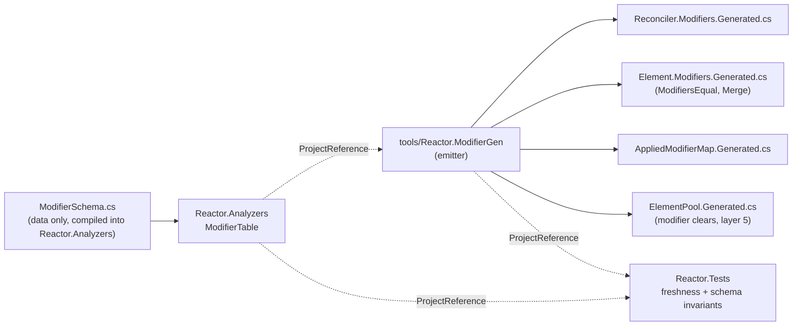

# Spec 067 — Table-driven common modifiers

> Status: **proposed** (2026-11-25). Design only. No product code changes with this spec.
> Builds on #1706, which moved `ApplyModifiers` into `src/Reactor/Core/Reconciler.Modifiers.cs`.
> File and line references are to `azchohfi-split-reconciler-partials` @ `4e8fdb05f` unless noted.
> Related: spec 034 (modifier buckets), spec 047 / 048 (control descriptors), spec 058 (wrapper
> generator), spec 060 / 061 (analyzer suite), spec 066 (composition-visual transforms).

## Table of contents

- [§1 Problem](#1-problem)
- [§2 Goals and non-goals](#2-goals-and-non-goals)
- [§3 Inventory: the shapes modifiers come in](#3-inventory-the-shapes-modifiers-come-in)
- [§4 Design](#4-design)
- [§5 Ordering](#5-ordering)
- [§6 Interactions with the rest of the reconciler](#6-interactions-with-the-rest-of-the-reconciler)
- [§7 Performance](#7-performance)
- [§8 AOT and trimming](#8-aot-and-trimming)
- [§9 What the drift tests become](#9-what-the-drift-tests-become)
- [§10 Test plan](#10-test-plan)
- [§11 Rollout](#11-rollout)
- [§12 Alternatives considered](#12-alternatives-considered)
- [§13 Open questions](#13-open-questions)
- [§14 Defects found while writing this spec](#14-defects-found-while-writing-this-spec)

---

## §1 Problem

A common-element modifier (`.Padding(...)`, `.IsEnabled(...)`, `.Foreground(...)`, …) is one
fact about the framework: *this record field is written to this WinUI property, on these control
types, cleared with `ClearValue` when it goes away*. Today that fact is hand-copied into a dozen
places, and `AGENTS.md:343` warns contributors that "a new common-element modifier touches every
seam".

### §1.1 The seams

| # | Seam | Where | What it encodes |
|---|---|---|---|
| 1 | Storage | `ElementModifiers` (`src/Reactor/Core/Element.cs:2142`), `LayoutModifiers` (`:2531`), `VisualModifiers` (`:2594`), `AccessibilityModifiers` (`:2636`) | the field, its bucket, the shim `init` that writes into the bucket |
| 2 | Merge | `ElementModifiers.Merge` (`Element.cs:2439`), `LayoutModifiers.Merge`, `VisualModifiers.Merge` | `other.X ?? X`, one line per field |
| 3 | Skip equality | `ModifiersEqualCore` (`Element.cs:1280`), `VisualModifiersEqual` (`:1401`), `ModifiersVisiblyEqual` | which fields block the shallow skip and how they compare (value, brush colour, reference, presence) |
| 4 | Apply | `ApplyModifiers` (`Reconciler.Modifiers.cs:237-780`), `ApplyAccessibilityModifiers` (`Reconciler.Accessibility.cs:165`), `ClearRemovedTransformModifiers` (`Reconciler.Modifiers.cs:212`), `ApplyModifierReferenceEdges` (`Reconciler.ReferenceEdges.cs:166`) | diff guard, receiver type gate, write, matching type-gated `ClearValue` |
| 5 | Fluent API | `ElementExtensions` (`src/Reactor/Elements/ElementExtensions.cs`) | the public overloads |
| 6 | Diagnostics | `AppliedModifierMap.Entries` (`src/Reactor/Core/Diagnostics/AppliedModifierMap.cs:82`) | modifier → owning WinUI property per control type |
| 7 | ThemeRef path | `GetDependencyPropertyName` (`Reconciler.ThemeBindings.cs:568`) | which receivers a `ThemeRef` brush overload reaches |
| 8 | Pool reset | `ElementPool.CleanElement` (`ElementPool.cs:279`), `PoolableTypes` (`:79`) | which modifier-backed DPs are cleared on pool return, on which receivers |
| 9 | Visual lane / restore | `DeclaresTransform` (`Reconciler.Pooling.cs:128`), `HasRestorableModifier` (`Reconciler.Modifiers.cs:101`), `ModifierTable.VisualOwningModifiers` (`ModifierTable.cs:725`) | three *different* sets: five transforms that take the visual at mount when not identity, six presence-checked fields (adds `Opacity`) that make a shared target record its edge, and the analyzer's visual-owning list |
| 10 | Analyzer | `ModifierTable` (`src/Reactor.Analyzers/ModifierTable.cs:278`), `GateOnlyInReconciler` (`:612`), `NoOpModifierAnalyzer.DescriptorAppliedModifiers` (`NoOpModifierAnalyzer.cs:159`) | receiver gates, theme gates, pool-reset gates, poolable type names |
| 11 | Agent skill prose | `plugins/reactor/skills/reactor-build-and-check/SKILL.md` | the `REACTOR_MOD_003` gate list, in English |
| 12 | Caption default | `UpdateDefaultAutomationName` call after `ApplyModifiers` (`Reconciler.Update.cs:523-529`) | an unset `AutomationName` falls back to a caption-derived local name |

The receiver list for `Padding` alone (`Control`, `Border`, `StackPanel`, `Grid`, `RelativePanel`,
`TextBlock`) appears in **eight** places: the write chain (`Reconciler.Modifiers.cs:332-337`), the
clear chain (`:345-350`), the inline-overlay base `switch` (`:309-317`), `AppliedModifierMap.PaddingOwner`
(`AppliedModifierMap.cs:40-47`), `ModifierTable.ControlBorderGridStackRelativeText` and its
pool-reset narrowing `ControlBorderGridStackText`, the `CleanElement` receiver chain
(`ElementPool.cs:394` onward), and the skill prose. `BorderBrush` adds a ninth copy in
`GetDependencyPropertyName`.

### §1.2 Drift is policed after the fact

Because nothing derives these copies from each other, the repo has grown an impressive set of
source-parsing tests that read the hand-written `if` chains with Roslyn and compare them against
each other:

| Test file | Lines | What it re-derives |
|---|---:|---|
| `tests/Reactor.Tests/AnalyzerTests/ModifierTableIntegrityTests.cs` | 1316 | `ControlGate` vs the `fe is T` tests in `ApplyModifiers`, descriptor `Customize` hooks vs `DescriptorAppliedModifiers`, attached setters vs DPs |
| `ModifierUnsetClearValueTests.cs` | 1443 | every unset arm uses `ClearValue` (#952), exists at all (#986), has a type gate matching its write; `CleanElement` releases every modifier-backed DP; pool-reset gates match the poolable intersection (#1051) |
| `CleanElementScan.cs` + `CleanElementScanIntegrityTests.cs` | 563 + 348 | every reset in `CleanElement`, attributed to its receiver (#1193) |
| `PoolResetSetConsistencyTests.cs` | 811 | `REACTOR_POOL_001` rows vs `CleanElement` |
| `ModifierGateIdentifierTests.cs` + `ModifierGateSource.cs` | 393 + 269 | the text matcher used where no typed property is reachable (#1062) |
| `ModifierGateProseParityTests.cs` | 161 | skill prose vs `ModifierTable` |

That is about 5,300 lines whose job is to prove that hand-copied lists agree. They work, and they
have caught real bugs, but each one is bounded by what it knows to parse. Nothing parses
`ModifiersEqualCore` for completeness, and the same class of defect keeps landing there:
`IsDragRegion` was missing from `Merge` and from `ModifiersEqual` (spec 059, regression tests in
`tests/Reactor.Tests/ElementModifiersCoverageTests.cs`), `OnUpdateAction` was missing from
`ModifiersEqual` (#976), and `XYFocusKeyboardNavigation` is missing from it today (§14).

### §1.3 Controls already solved this

Controls moved from hand-written `MountXxx` / `UpdateXxx` pairs to declarative
`ControlDescriptor<TElement, TControl>` (spec 047 §6, spec 048). The descriptor entry
`OneWayClearValuePropEntry` (`src/Reactor/Core/V1Protocol/Descriptor/PropEntry.cs:113-169`) is
*exactly* the common-modifier contract: write on set, skip on equal, `ClearValue(dp)` on unset,
never write a default. Modifiers are the last large hand-written diff in the reconciler.

---

## §2 Goals and non-goals

**Goals**

- **G1. One declaration per modifier.** Name, storage bucket, value type, receivers (ordered),
  target property and DP owner per receiver, clear policy, theme receivers, skip equality, write
  equality, merge policy, ordering phase, composition channel. Nothing else restates these.
- **G2. Derive, don't police.** Apply arms, unset arms, skip equality, `Merge`, `AppliedModifierMap`,
  the `ThemeRef` DP map and the modifier half of `CleanElement` come from the declaration. The
  analyzer's gates live in the declaration too, as declared facts, because they are not a function
  of the apply receivers (§4.5).
- **G3. Zero hot-path cost.** The derived apply code has the same shape as today's: straight-line
  diff guards, `is` type tests, direct property sets. No delegates, closures, boxing or
  allocations are introduced on `ApplyModifiers`.
- **G4. AOT and trim clean.** No reflection in product code. `IsAotCompatible` stays true and the
  core library's trim warnings-as-errors keep passing.
- **G5. Incremental and revertible.** Each migration step is one PR that changes no observable
  behaviour, is guarded by tests written *before* the step, and can be reverted alone.
- **G6. One source for the analyzer.** `src/Reactor.Analyzers` (`netstandard2.0`, cannot
  reference Reactor) reads the same declaration, not a copy.

**Non-goals**

- Changing any modifier's behaviour, receivers or apply order. Every layer in §11 is
  behaviour-preserving. Behaviour fixes (§14) ship separately.
- Changing public API. The fluent extensions, the modifier records and their properties stay.
  Records may gain `partial`, which is source- and binary-compatible.
- Third-party extensible modifiers. `ElementModifiers` is a closed record today and stays so.
- Rewriting the irregular modifiers (§3, rows E and F). They keep their hand-written logic and
  gain a declaration for their *metadata* only.
- Replacing `ControlDescriptor`. Descriptors describe per-control props. This spec describes the
  common bag every element carries.

---

## §3 Inventory: the shapes modifiers come in

Read from `ApplyModifiers` (`Reconciler.Modifiers.cs:237-780`). The unset-arm floors in
`ModifierUnsetClearValueTests.cs:60-63` record 37 set arms and 36 unset arms there, plus 12 / 12 in
`ApplyAccessibilityModifiers`.

| Row | Shape | Members | Notes |
|---|---|---|---|
| A | Simple, on `FrameworkElement` / `UIElement` | `RequestedTheme`, `Width`, `Height`, `MinWidth`, `MinHeight`, `MaxWidth`, `MaxHeight`, `HorizontalAlignment`, `VerticalAlignment`, `IsTabStop`, `IsHitTestVisible`, `AccessKey`, `XYFocusKeyboardNavigation` | `if (set && changed) fe.X = v; else if (!set && wasSet) fe.ClearValue(XProperty);` |
| B | Simple, type-gated | `IsEnabled`, `ElementSoundMode`, `TabIndex`, `HorizontalContentAlignment`, `VerticalContentAlignment` (`Control`); `CornerRadius` (5 receivers); `Foreground`, `FontFamily`, `FontSize`, `FontWeight` (`Control`, `TextBlock`) | same arms behind an ordered `is` chain, with a matching `is` chain on the clear side (#986) |
| C | Converted | `IsVisible` (`bool` → `Visibility`) | a pure value conversion before the write |
| D | Attached | `AutomationName`, `AutomationId`, `HeadingLevel` (`AutomationProperties`), `IsDragRegion` (`TitleBar`), `ToolTipPlacement` (`ToolTipService`) | static `SetX(fe, v)` and `ClearValue(Owner.XProperty)` |
| E | Composite | `Margin` + `MarginInlineStart/End`; `Padding` + `PaddingInlineStart/End`; `BorderThickness` + `BorderInlineStart` | several fields resolve, against `FlowDirection` and the previous overlay (#965), to one DP |
| F | Hand-coded with cross-system state | `Opacity`, `Scale`, `Rotation`, `Translation`, `CenterPoint`, `TransformOrigin` (composition, remaining-owner restore, spec 066); `BorderBrush` (interaction-state tracker, `:499-507`); `Background` (`keepRemovedBackground`, `:581`); `ToolTip` / `RichToolTip`, `AttachedFlyout`, `ContextFlyout` (mount child elements) | real logic, not a table row |
| G | Behaviour, not a property write | 20 routed-event handlers, 4 gestures, 2 drag-drop configs, `OnMountAction`, `OnUpdateAction` (internal), `OnUnmountAction`, `Ref`, `OnAccessKeyDisplayRequested`, `Backdrop` (read by the host) | these still need merge and skip-equality declarations |
| G′ | Reference edge (hand-coded property writer) | the four `XYFocus*Ref`, `ToolTipPlacementTargetRef` | written by `ApplyModifierReferenceEdges` (`Reconciler.ReferenceEdges.cs:166`) once the target resolves, but they *are* DP writes: `AppliedModifierMap` reports them (`AppliedModifierMap.cs:113, 134-137`) and `CleanElement` clears them (`ElementPool.cs:519-529`). Their wiring stays hand-written; receivers, reporting and pool reset come from the schema |
| H | Accessibility sub-record | 16 `AccessibilityModifiers` fields (`Element.cs:2636`), 12 arms in `ApplyAccessibilityModifiers` | 11 fields are A/D shapes. `LabeledBy` is row F (deferred `FindByAutomationId` plus `Loaded` resolution with `PendingLabeledBy` state, `Reconciler.Accessibility.cs:224` onward). `LabeledByRef`, `DescribedByRefs`, `FlowsToRefs` and `FlowsFromRefs` are row G′ (reference edges that write `LabeledBy` / `DescribedBy` / `FlowsTo` / `FlowsFrom`) |

Rows A–D are 29 of the property-writing modifiers on the main bag, and all of them are mechanical.
Row E is mechanical around one hand-written resolver per family. Row F is not mechanical and this
spec does not pretend it is.

Two row A/D members carry exceptions the schema has to state, not derive. `RequestedTheme` has a
set and an unset arm but `CleanElement` never clears it on pool return, and `AutomationName` on a
captioned control is replaced by a caption-derived local name right after `ApplyModifiers` runs
(`Reconciler.Update.cs:523-529`), so "unset leaves no local value" is not true for it.

---

## §4 Design

### §4.1 Shape of the solution



1. **A schema file** declares every modifier as plain data: strings, enums and arrays. It is
   `netstandard2.0`-safe and compiles into exactly one assembly, the analyzer (§4.2).
2. **A generator tool** reads the schema and emits checked-in C# into `src/Reactor` (§4.3).
3. **A freshness test** in `Reactor.Tests` runs the same emitter in-process and byte-compares its
   output against the checked-in files, the way `SearchIndexGeneratorTests` gates the search index
   today (`AGENTS.md`, "ReactorGallery search index").
4. **The analyzer** derives its gates from the schema it already contains (§4.5).

### §4.2 The schema

Location: `src/Reactor.Analyzers/Modifiers/ModifierSchema.cs`. The analyzer owns it because the
analyzer is the strictest consumer (`netstandard2.0`, no Reactor reference). The file is compiled
into the analyzer only. It is **not** linked into other projects. `Reactor.Tests` already
references `Reactor.Analyzers` and sees its internals (`Reactor.Analyzers.csproj:44`,
`InternalsVisibleTo Reactor.Tests`), so a linked copy would define every schema type twice and
fail the Release build with CS0436. Instead:

- `tools/Reactor.ModifierGen` takes a `ProjectReference` on `Reactor.Analyzers`, and the analyzer
  adds `InternalsVisibleTo` for the tool.
- `Reactor.Tests` takes a `ProjectReference` on the tool, as it does on `tools/Reactor.SearchIndex`
  and `tools/Reactor.ApiIndex` today, and the tool grants `InternalsVisibleTo` to `Reactor.Tests`
  for its emitter.

Every schema type then has one definition, the analyzer's.

Illustrative shape (names are not final):

```csharp
namespace Microsoft.UI.Reactor.Analyzers.Modifiers;

internal enum ModifierBucket { Root, Layout, Visual, Accessibility }

// A grouping label for migration PRs and for readers. Not an apply block: today's arms interleave
// families (§5), so apply order is the array order, never the phase order.
internal enum ModifierFamily { Theme, Box, Size, Alignment, Composition, Visibility, ToolTip, Flyout,
    ControlState, Border, Brush, Automation, Focus, Accessibility, Typography, Behavior, Lifecycle }

internal enum ApplyShape { Simple, Converted, Attached, Composite, HandCoded, ReferenceEdge, Behavior }

// How the shallow-skip gate compares the field (ModifiersEqualCore and ModifiersVisiblyEqual).
internal enum SkipEquality
{
    Value,             // the bucket's current comparison: record Equals for Layout/Accessibility
                       // (NaN == NaN), == for Visual and root fields (NaN != NaN)
    BrushValue,        // BrushesEqual (Element.cs:1197)
    FontFamilyValue,   // FontFamiliesEqual (Element.cs:1221)
    Reference,
    BlocksSkipWhenSet, // full mode: equal only when both sides are null; visible mode: presence
                       // only. RichToolTip, AttachedFlyout, ContextFlyout (Element.cs:1332-1338)
    NotCompared,       // requires a reason
}

// How the apply arm decides a field changed. Brushes and FontFamily are compared by reference
// here today but by value in the skip gate (§6.6), and the schema has to say both.
internal enum WriteEquality { Value, Reference }

// What CleanElement does for one (slot, poolable receiver arm). Declared, never derived (§6.2).
internal enum PoolReset { None, ClearValue, WriteDefault, NotReset }

// Which consumers a receiver row feeds. The three reaches differ today: Foreground is applied to
// Control/TextBlock, themed on RichTextBlock too, and CleanElement clears RichTextBlock.Foreground
// (ElementPool.cs:618). A row can be theme- or pool-only without widening the plain apply path.
[Flags] internal enum ReceiverRole { Apply = 1, Theme = 2, Pool = 4 }

internal sealed class ModifierReceiver
{
    public string Type;          // "Microsoft.UI.Xaml.Controls.Control"
    public string Property;      // "Padding"
    public string DpOwner;       // "Microsoft.UI.Xaml.Controls.Control" → Control.PaddingProperty
    public ReceiverRole Roles;   // Apply | Theme | Pool
    public PoolReset Pool;       // what CleanElement does on this arm (rows with the Pool role)
    public string PoolDefault;   // WriteDefault only: "14" for TextBlock.FontSize (ElementPool.cs:587-601)
    public string PoolReason;    // NotReset and WriteDefault require a reason
}

internal sealed class ModifierSlot
{
    public string Name;                        // record property name (ElementModifiers / bucket)
    public string[] FluentNames;               // public modifier names; defaults to { Name }.
                                               // ElementSoundMode → "SoundMode", AttachedFlyout →
                                               // "WithFlyout", RichToolTip → "WithToolTip", …
    public ModifierBucket Bucket;
    public string ClrType;                     // "Microsoft.UI.Xaml.Thickness"
    public bool IsReferenceType;
    public ModifierFamily Family;
    public ApplyShape Shape;
    public ModifierReceiver[] Receivers;       // ordered per role; empty for Behavior
    public string AttachedOwner;               // row D
    public string Converter;                   // row C: a static method in ModifierConverters
    public string CompositeFamily;             // row E: the apply family this field feeds, e.g.
                                               // "Border" for both BorderThickness (Visual,
                                               // Thickness?) and BorderInlineStart (Layout,
                                               // Thickness?). Each field is its own slot with
                                               // its own bucket, type and analyzer facts.
    public string HandCodedMethod;             // rows E/F: the Reconciler method that owns the arm
    public SkipEquality Skip; public string SkipReason;
    public WriteEquality Write;
    public bool CallbackSlot;                  // ignored by ModifiersVisiblyEqual
    // AppliedModifierMap reporting (§4.3). Defaults to "<DpOwner>.<Property>" per Apply receiver.
    public string ReportTarget;                // non-DP targets: "Visual.RotationAngle" for
                                               // Rotation, "Visual.CenterPoint" for TransformOrigin
    public string ReportSuppressedBy;          // "RichToolTip" for ToolTip (AppliedModifierMap.cs:111)
    public bool ReportHandWritten;             // an entry whose owner logic stays hand-written,
                                               // e.g. AttachedFlyout's ResolveFlyoutSlot mirror
    // Analyzer editorial facts (§4.5). Not derived from Receivers.
    public string[] AnalyzerControlGate;       // null where the analyzer deliberately has no gate
    public string GateOnlyInReconcilerReason;  // non-null puts the slot in GateOnlyInReconciler
    public string[] AnalyzerPoolResetGate;     // today's assignability-derived list, pinned (§4.5)
    // Composition metadata (spec 066). Two independent facts, see §6.2.
    public bool RestorableOwner;               // HasRestorableModifier: presence records a shared edge
    public bool TakesVisualAtMount;            // DeclaresTransform, and the five transform rows of
                                               // VisualOwningModifiers (§6.2)
    public string IdentityValue;               // with TakesVisualAtMount: the value that does not
}

internal static partial class ModifierSchema
{
    // Array order IS apply order, and layer 0 pins it to today's ApplyModifiers line order.
    internal static readonly ModifierSlot[] Slots =
    {
        Simple("RequestedTheme", Layout, "Microsoft.UI.Xaml.ElementTheme", Family.Theme)
            .OnFrameworkElement(pool: NotReset("not cleared by CleanElement today")),
        // One composite family = one apply call, fed by several slots, each with full metadata.
        CompositeFamily("Margin", target: "Margin", method: "ApplyMarginFamily").OnFrameworkElement(),
        Composite("Margin", Layout, Thickness, Family.Box, family: "Margin"),
        Composite("MarginInlineStart", Layout, "double", Family.Box, family: "Margin"),
        Composite("MarginInlineEnd", Layout, "double", Family.Box, family: "Margin"),
        CompositeFamily("Padding", target: "Padding", method: "ApplyPaddingFamily")
            .On(Control, Border, StackPanel, Grid, RelativePanel, TextBlock),
        Composite("Padding", Layout, Thickness, Family.Box, family: "Padding"),
        Composite("PaddingInlineStart", Layout, "double", Family.Box, family: "Padding")
            .Analyzer(gateOnlyReason: "Reactor-only BiDi logical modifier; folds into the Padding write …"),
        Simple("Width", Layout, "double", Family.Size).OnFrameworkElement(),
        // … Height … MaxHeight, HorizontalAlignment, VerticalAlignment, then the content-alignment
        // pair on Control (Reconciler.Modifiers.cs:368-379) …
        HandCoded("Opacity", Visual, "double", Family.Composition, method: "ApplyOpacityModifier")
            .RestorableOwner(),                                         // not TakesVisualAtMount
        HandCoded("Scale", Visual, "System.Numerics.Vector3", Family.Composition, method: "ApplyScaleModifier")
            .RestorableOwner().TakesVisualAtMount(identity: "Vector3.One"),
        // … Rotation, Translation, TransformOrigin, CenterPoint …
        Converted("IsVisible", Layout, "bool", Family.Visibility, property: "Visibility", converter: "ToVisibility"),
        // … tooltips, flyouts …
        Simple("IsEnabled", Root, "bool", Family.ControlState).On(Control)
            .Analyzer(controlGate: null, gateOnlyReason: "WinUI declares IsEnabled on Control only …"),
        // … CornerRadius, BorderBrush, the Border family (BorderThickness in Visual,
        //   BorderInlineStart in Layout), Background …
        Simple("Foreground", Visual, Brush, Family.Brush)
            .On(Control, TextBlock)                              // Apply | Pool (ClearValue)
            .Theme(RichTextBlock)                                // Theme only, no plain write
            .Pool(RichTextBlock, ClearValue)                     // Pool only (ElementPool.cs:618)
            .Equality(skip: BrushValue, write: Reference),
        Attached("AutomationName", Root, "string", Family.Automation,
            owner: "Microsoft.UI.Xaml.Automation.AutomationProperties", property: "Name"),
        // … AutomationId, IsDragRegion, ElementSoundMode (fluent "SoundMode"), HeadingLevel, …
        Behavior("OnMountAction").NotCompared("fires once at mount (oldM is null); a later change is inert"),
        Behavior("OnPointerPressed").Equality(skip: Reference).Callback(),
        // …
    };
}
```

Rules the schema enforces about itself (unit tests over the data, §10.1):

- **Completeness, per bucket.** Every instance property of `LayoutModifiers`, `VisualModifiers`
  and `AccessibilityModifiers`, public or internal, is exactly one slot of that bucket. A
  composite field such as `BorderInlineStart` is a slot like any other, in its own bucket, with
  its own type and analyzer facts. Its `CompositeFamily` only says which apply call consumes it. Every root property of `ElementModifiers`, public or internal (so
  `OnUpdateAction` counts), is one `Root` slot. Every `Layout` / `Visual` slot has a root shim of
  the same name and type on `ElementModifiers`, because the fluent methods write through the shims.
  The `Layout`, `Visual` and `Accessibility` container properties are excluded by name. The check
  is a reflection test, so a field with no declaration fails the test run before it ships
  half-wired.
- **Reasons are mandatory** for `NotCompared`, `PoolReset.NotReset`, `PoolReset.WriteDefault` and
  `GateOnlyInReconcilerReason`. "This field does not block the skip" becomes a decision someone
  wrote down, not an omission (§14).
- **Receivers resolve.** Every receiver type and DP owner resolves to a real type with a real
  `XProperty` (reflection in `Reactor.Tests`; `typeof` of a WinUI projection type is safe
  headless).
- **Order is pinned.** The array order equals the order of arms in today's `ApplyModifiers`, read
  once in layer 0 and frozen as a literal list in the test, plus the explicit §5 constraints.

### §4.3 Generated code, checked in

`tools/Reactor.ModifierGen` (`net10.0` console, alongside `tools/Reactor.SearchIndex`) emits:

| Output | Replaces | Layer |
|---|---|---|
| `src/Reactor/Core/Reconciler.Modifiers.Generated.cs` | rows A–D arms of `ApplyModifiers` at their current positions, and the call sites of rows E–F | 3 |
| `src/Reactor/Core/Element.Modifiers.Generated.cs` | `ModifiersEqualCore`, `VisualModifiersEqual`, the three `Merge` bodies | 2 |
| `src/Reactor/Core/Diagnostics/AppliedModifierMap.Generated.cs` | `AppliedModifierMap.Entries` and its owner helpers | 2 |
| `src/Reactor/Core/Reconciler.ThemeBindings.Generated.cs` | `GetDependencyPropertyName` | 2 |
| `src/Reactor/Core/ElementPool.Generated.cs` | a `CleanModifierBackedProperties(fe)` helper that `CleanElement` calls, emitted from each receiver's declared `PoolReset` (§6.2) | 5 |
| `src/Reactor/Core/Reconciler.Pooling.Generated.cs` | `DeclaresTransform` (from `TakesVisualAtMount`) and `HasRestorableModifier`'s field list (from `RestorableOwner`) | 6 |

The emitter writes the code a careful human writes today. For a row A slot:

```csharp
if (m.Width.HasValue && m.Width != oldM?.Width) fe.Width = m.Width.Value;
else if (!m.Width.HasValue && oldM?.Width.HasValue == true) fe.ClearValue(FrameworkElement.WidthProperty);
```

For a row B slot the write chain and the clear chain come from the same receiver list, so they
cannot disagree (the #986 shape), and the clear side re-tests the type under its own pattern
variable as `ElementSoundMode` does today (`Reconciler.Modifiers.cs:618-627`):

```csharp
if (m.CornerRadius.HasValue && m.CornerRadius != oldM?.CornerRadius)
{
    if (fe is WinUI.Control c0) c0.CornerRadius = m.CornerRadius.Value;
    else if (fe is WinUI.Border c1) c1.CornerRadius = m.CornerRadius.Value;
    // … Grid, StackPanel, RelativePanel
}
else if (!m.CornerRadius.HasValue && oldM?.CornerRadius.HasValue == true)
{
    if (fe is WinUI.Control c0) c0.ClearValue(WinUI.Control.CornerRadiusProperty);
    // …
}
```

The emitter has exactly one unset template, and it emits `ClearValue`. "Unset writes a default"
(#952) becomes unrepresentable for rows A–D rather than something a test scans for.

Generated files are named `Reconciler.*.cs` on purpose. `ReconcilerSource`
(`tests/Reactor.Tests/AnalyzerTests/ReconcilerSource.cs:19-33`) parses every `Reconciler.*.cs`, so
the existing Roslyn drift tests keep running against the generated arms throughout the migration
(§9). That is the main reason this spec prefers checked-in output over an in-build source
generator (§12.3). The same care applies to the pool: `CleanElementScan` reads only `CleanElement`
in `ElementPool.cs` (`CleanElementScan.cs:371-379`), so layer 5 widens it to follow the
`CleanModifierBackedProperties` call into `ElementPool.Generated.cs` in the same PR, and
`ElementPool` (`ElementPool.cs:20`, `public sealed class`) becomes `partial`.

### §4.4 What stays hand-written

- **Fluent extensions.** They are public API with overloads, defaults, docs and `[Obsolete]`
  shims. The schema test asserts that every non-behaviour slot has at least one generic
  `T Name<T>(this T el, …)` for each of its `FluentNames` (the reflection
  `ModifierTableIntegrityTests.DeclaredGenericModifiers` already does). Slot names never become
  analyzer suggestions: `ModifierInfo.Modifier` stays the fluent name, so `REACTOR_MOD_002` can't
  start suggesting a `.ElementSoundMode(...)` that does not exist.
- **Record declarations and root shims.** The properties, shims and XML docs stay in `Element.cs`.
  The records become `partial` so `Merge` can be generated. The shims are mechanical and could be
  generated later, but they carry public docs, so they stay hand-written in this spec.
- **Rows E and F bodies.** `ApplyMarginFamily`, `ApplyPaddingFamily`, `ApplyBorderThicknessFamily`,
  the composition-channel methods, the tooltip / flyout arms, events, gestures, drag-drop and
  lifecycle callbacks. The generated `ApplyModifiers` calls them at their declared positions.
- **`ClearRemovedTransformModifiers`.** It runs before handlers, not inside `ApplyModifiers`
  (`Reconciler.Update.cs:316-317`), and its order is load-bearing (TransformOrigin after
  CenterPoint, `Reconciler.Modifiers.cs:229-232`). Its field list can be generated in layer 6; its
  body stays.

### §4.5 The analyzer reads the same data

`ModifierTable` keeps its editorial content: `DeliberatelyExcluded` with reasons, the attached
table, the type-specific `elementTypes` rows, and the `poolReset` severity choice, which is an
editorial claim and not a derived fact (`ModifierTable.cs:466-482` documents why `IsHitTestVisible`
and the fonts stay `REACTOR_MOD_002` per #1195 even though `CleanElement` clears them).

The analyzer's gates are *not* a function of the apply receivers, and this spec does not pretend
they are. Four examples from today's table:

- `IsEnabled` is `Control`-gated in `ApplyModifiers` but has a `null` analyzer gate, because in the
  `.Set` direction WinUI declares the DP on `Control` only. It is in `GateOnlyInReconciler`.
- `TabIndex` and `ElementSoundMode` are in `GateOnlyInReconciler` for different reasons, "WinUI
  also declares TabIndex on UIElement" and "there is no .ElementSoundMode modifier"
  (`ModifierTable.cs:612-627`).
- The content-alignment pair is `Control`-gated with a `null` analyzer gate, yet it is
  *deliberately absent* from `GateOnlyInReconciler`, because the gate reader cannot attribute a
  bare `if (fe is Control …)` to a property and the converse check requires every row to name a gate
  the reader finds (`ModifierTable.cs:598-611`).
- `PoolResetGate` is an assignability fact, not a name intersection. The pool recycles `Button`,
  `TextBox` and `ToggleSwitch` but not `Control`, while `CleanElement` clears through a `Control`
  arm. `ModifierUnsetClearValueTests.cs:882-889` and `:1053-1067` derive the gate from the
  receivers `CleanElementScan` finds resetting, closed under assignability. A string intersection
  of receivers and poolable names would drop pooled Buttons from `Padding`, empty `IsEnabled` and
  narrow `Background` to `Border`.

So the schema carries these as **declared analyzer facts** on each slot
(`AnalyzerControlGate`, `GateOnlyInReconcilerReason`, `AnalyzerPoolResetGate`), with today's values
copied in verbatim. What changes is where they live, not how they are computed:

| Analyzer fact | Source after layer 1 | Still verified by |
|---|---|---|
| `ModifierInfo.ControlGate` | `AnalyzerControlGate` on the slot | `Every_ControlGate_Matches_The_Types_ApplyModifiers_Writes_To`, now reading the slot |
| `ModifierTable.GateOnlyInReconciler` | slots with a `GateOnlyInReconcilerReason` | `Every_ApplyModifiers_ControlGate_Is_Declared_Or_Explicitly_Recorded`, both directions |
| `ModifierInfo.ThemeControlGate` | receivers with the `Theme` role | `GetDependencyPropertyName_Agrees_With_ApplyModifiers_And_The_Table` until layer 2 |
| `ModifierInfo.PoolResetGate` | `AnalyzerPoolResetGate` | `Every_Pool_Reset_Gate_Matches_The_Poolable_Intersection`, unchanged, kept through every layer |
| `ModifierTable.PoolableTypeNames` | a schema list | `Analyzer_Poolable_Type_Mirror_Matches_ElementPool` until layer 5 generates `PoolableTypes` from it |

Layer 1 also adds a literal snapshot test of every derived gate array and of the
`GateOnlyInReconciler` key set, captured from today's `ModifierTable`, in both directions (§10.1).
Analyzer tests cover only selected modifiers, so that snapshot is what proves the move changed no
diagnostic.

`ModifierTable` builds its dictionaries from the schema once in its static constructor. That is a
one-time allocation per analyzer load, the same order of cost as the dictionaries it builds today.

---

## §5 Ordering

Order inside `ApplyModifiers` is behaviour. The schema's array order **is** the emitted order, and
layer 0 (§11) pins today's order before anything is generated. Families are labels, not blocks:
today's arms interleave them (`IsEnabled` at `Reconciler.Modifiers.cs:476` but `ElementSoundMode`
at `:624` after `IsDragRegion`, `TabIndex` at `:645` between `IsHitTestVisible` and `AccessKey`,
the content-alignment pair inside the alignment run at `:368-379`), so a layer 3 PR emits each
migrated arm *at its existing position*, never as a contiguous family block. The constraints that
make today's order load-bearing, each traced to the code that depends on it:

| Constraint | Why | Source |
|---|---|---|
| `RequestedTheme` first | `ThemeRef` bindings resolve against it, and `ApplyThemeBindings` runs after `ApplyModifiers` | `Reconciler.Modifiers.cs:244-249`, `Reconciler.Update.cs:491` vs `:533`, `Reconciler.Mount.cs:200` vs `:241` |
| `Margin` / `Padding` / `BorderThickness` families read `fe.FlowDirection` | `FlowDirection` comes from setters, which run before modifiers | `Reconciler.Modifiers.cs:262`, `Reconciler.Update.cs:476-481` |
| `TransformOrigin` before `CenterPoint` on apply | an origin that starts takes the current offset, then a `CenterPoint` change writes or animates it | `Reconciler.Modifiers.cs:417-427`, spec 066 §8.2 |
| `CenterPoint` reset before `TransformOrigin` deactivate on removal | the restored static pivot is the remaining offset | `Reconciler.Modifiers.cs:229-232` |
| transform removals before handlers and setters | a removal must not erase a value a setter or shared target writes in the same update | `Reconciler.Update.cs:316-317`, spec 066 §6.3 |
| `BorderBrush` after interaction-state tracking | a hovered control keeps its interaction brush and only updates the restore value | `Reconciler.Modifiers.cs:499-507` |
| `Background` unset honours `keepRemovedBackground` | `BorderElement`'s descriptor may already have released or replaced it | `Reconciler.Update.cs:486-490`, `Reconciler.Registration.cs:251` |
| event, gesture, drag-drop wiring after property writes | handlers see the applied state | `Reconciler.Modifiers.cs:701-709` |
| `OnMountAction` / `OnUpdateAction` after every property write | the callback observes a fully applied control, under `OpacityRestartProbe` | `:712-735` |
| `Ref` then reference edges last | a ref points at a fully applied control; edges may resolve against it | `:763-779` |
| caption-derived `AutomationName` after `ApplyModifiers` | an unset name falls back to the caption | `Reconciler.Update.cs:523-529` |

Beyond these, the schema keeps today's line order exactly, because "probably independent" is not
something a behaviour-preserving refactor gets to assume. Reordering arms, for example to group by
receiver, is a follow-up with its own perf data, not part of this spec.

---

## §6 Interactions with the rest of the reconciler

### §6.1 Echo suppression

Modifiers are written outside every echo mechanism. `ApplySetters` runs inside the descriptor
handler under its echo-suppression scope (`DescriptorHandler.cs:140`, `:228`), and `ApplyModifiers`
runs after the handler returns, unsuppressed (`Reconciler.Update.cs:476-491`). No common modifier targets a property that any built-in
descriptor declares `Controlled` or `HandCodedControlled` (the spec 047 §8.3 list is value props:
`Text`, `IsOn`, `SelectedIndex`, `Value`, …). The generated code keeps both facts: it introduces no
suppression scope and it targets only the DPs the hand-written arms target. A schema test can make
the second fact permanent once descriptors expose their target DP (§13, Q3).

Precedence with descriptor props is unchanged: modifier-after-prop, so a modifier wins over an
element-record prop writing the same DP (spec 047 §6.2). Two descriptors touch a common modifier
themselves, and they do **not** share one contract today:

- `RichTextBlockElement`'s descriptor reads the `Padding` modifier and writes it. That is an
  analyzer exception: `NoOpModifierAnalyzer.DescriptorAppliedModifiers` lists only
  `RichTextBlockElement|Padding` (`NoOpModifierAnalyzer.cs:159-163`), yet
  `AppliedModifierMap.PaddingOwner` still returns null for `RichTextBlock`.
- `BorderElement`'s descriptor coordinates the `Background` *removal* with `ApplyModifiers`
  (`MarkBackgroundRemovalHandled`, `keepRemovedBackground`). That is apply-path coordination only.
  The descriptor-hook scan deliberately excludes Border's record-owned `Background`
  (`ModifierTableIntegrityTests.cs:1046-1080`), and no analyzer exception exists for it.

So the schema keeps per-consumer facts instead of one `DescriptorOwned` flag: an
`AnalyzerDescriptorException` list that reproduces `DescriptorAppliedModifiers` exactly, and a
`RemovalCoordinatedBy` note on `Background` that only the apply path reads. `AppliedModifierMap`'s
output is unchanged. Making it report `RichTextBlock.Padding` would be a diagnostic correction and
ships separately. The descriptor-hook scan in
`ModifierTableIntegrityTests.Descriptor_Applied_Common_Modifiers_Match_The_Analyzer_Exception_List`
stays as the check that the exception list is complete.

### §6.2 Pooling

The pool contract is: `CleanElement` returns a control to the state the next renter expects, and
mount calls `ApplyModifiers(fe, null, m)`, so no unset arm ever runs at mount. The generated apply
code keeps the second half by never emitting a clear when `oldM` is null.

The first half is **not** "`ClearValue` every modifier DP on every poolable receiver", and layer 5
must not generate it as if it were. Today's `CleanElement` has deliberate exceptions:

- `TextBlock.FontSize` is reset with `tb.FontSize = 14`, not `ClearValue`, because the DP inherits
  and a clear would let a recycled `TextBlock` pick up an ancestor's size (`ElementPool.cs:587-601`).
- `RequestedTheme` has a set and an unset arm in `ApplyModifiers` but no clear in `CleanElement`.
- Resets run through base-type arms (`Control`, `Panel`) while the pool recycles exact types
  (`Button`, `Grid`, …), so which receivers are reset is an assignability fact
  (`ModifierUnsetClearValueTests.cs:882-889`).

So each receiver declares its `PoolReset` (`ClearValue`, `WriteDefault` with the value, or
`NotReset` with a reason), with today's behaviour copied in. Layer 5 emits exactly those
declarations into a `CleanModifierBackedProperties(fe)` helper that `CleanElement` calls at the
point its modifier clears sit today, and widens `CleanElementScan` to follow that call (§4.3). The
non-modifier resets in `CleanElement` (tag, refresh snapshots, event handlers, theme bindings,
facades, transitions, `Clip`, `FlowDirection`, `RenderTransform`) stay hand-written. Whether
`RequestedTheme` *should* be reset on pool return is a behaviour question for its own issue, not
for this migration.

Event wiring on poolable controls goes through the one-time trampoline and
`ReactorState.ControlEventState` survives rent and return (issue #114). Row G slots are declared
for merge and equality only. Their apply code is untouched.

The visual lane (spec 066 §7) and the remaining-owner bookkeeping read **different** field sets,
and the schema keeps them apart:

- `DeclaresTransform` (`Reconciler.Pooling.cs:128-133`) asks whether a transform takes the visual
  at mount: five fields, each compared with its identity value. `Opacity` is not one of them.
  It comes from `TakesVisualAtMount` + `IdentityValue`. `ModifierTable.VisualOwningModifiers`
  (`ModifierTable.cs:725-749`) holds the same five transform rows, but also `Animate`,
  `InteractionStates`, `Transition`, `Keyframes`, the layout and scroll animations and the four
  implicit transitions, which are not common modifiers. Layer 6 generates only the five transform
  rows and leaves the rest hand-written, and a snapshot of the full key set is added before layer
  6 so the `REACTOR_ANIM_004` checks on the other rows can't be dropped.
- `HasRestorableModifier` (`Reconciler.Modifiers.cs:101-106`) asks whether a shared target must
  record its edge: six fields by presence, including `Opacity`. It comes from `RestorableOwner`.

Deriving both from one flag would make `.Opacity(0.5)` visual-lane demand in `ForMount`, which is
a behaviour change. Layer 6 generates each list from its own flag.

### §6.3 Shared targets and remaining owners

Decorators, keyed memos and flyout decorators can share one control. Composition modifiers
resolve the surviving declaration across that chain (`FindRemainingModifierOwner`,
`Reconciler.Modifiers.cs:136`, spec 066 §6). This is row F logic and stays hand-coded. Rows A–D
have no remaining-owner semantics today, and the generated arms keep it that way. Giving them
remaining-owner semantics would be a behaviour change.

### §6.4 Theme bindings

The `ThemeRef` overloads of `Background`, `Foreground` and `BorderBrush` go through
`GetDependencyPropertyName` (`Reconciler.ThemeBindings.cs:568-580`), not `ApplyModifiers`, and
their reach differs: `Foreground` reaches `RichTextBlock` on the theme path but not on the plain
brush path. The analyzer models this as `ThemeControlGate` (`ModifierTable.cs:304-305`). In the
schema that is a receiver row with the `Theme` role but not the `Apply` role, so it never widens
the plain write, and layer 2 generates `GetDependencyPropertyName`'s modifier rows from the
`Theme`-role rows. The pool reach is a third, separate set (`RichTextBlock.Foreground` is cleared
on pool return, `ElementPool.cs:618`), expressed as `Pool`-role rows. `PaneBackground` (SplitView)
is not a common modifier and stays hand-written.

### §6.5 Interaction states and caption names

`BorderBrush` defers to the interaction tracker when a state override is active
(`Reconciler.Modifiers.cs:499-507`, `Reconciler.InteractionStates.cs:69-70`). That stays a
hand-coded arm. Only its receivers and equality come from the schema.

`AutomationName` is a row D slot, but on a captioned control its unset arm is immediately followed
by a caption-derived local name (`Reconciler.Update.cs:523-529`, `UpdateDefaultAutomationName`).
The generated arm is identical to today's, and the caption step stays where it is, after
`ApplyModifiers`. Tests that assert "unset leaves no local value" exclude captioned controls for
this slot (§10.2).

### §6.6 Equality: skip gate vs apply arm

The skip gate compares brushes by colour and opacity (`BrushesEqual`, `Element.cs:1197`) and
font families by value (`FontFamiliesEqual`, `Element.cs:1221`), because fluent helpers allocate a fresh brush per
render. The apply arms compare the same fields by reference
(`Reconciler.Modifiers.cs:575, 589, 667`). So when something else forces an update, a value-equal
but fresh brush is rewritten. That is a harmless extra write, but it is a real difference between
two seams, and the schema records it as `Skip = BrushValue, Write = Reference` instead of leaving
it implicit. Unifying them is a perf question for a later change (§13, Q5).

---

## §7 Performance

`ApplyModifiers` runs on every mount of an element with modifiers and on every update the shallow
skip declines (`Reconciler.Update.cs:150-156`, `:491`). That includes the common grid case where a
cell's text changed but its modifiers did not: `ShallowEquals` compares the modifiers first
(`Element.cs:525`) and then fails on the changed prop, so the skip declines and every arm runs even
though the modifiers are equal.

Today each arm is two nullable compares and a branch, inlined in one method. A runtime
interpreter, one `PropEntry`-style object per slot like `ControlDescriptor` uses, would add an
indirect call and two delegate reads per slot per update. Spec 047 §12.3 puts an interface
dispatch at 5–10 ns. With roughly 45 arms between the main bag and the accessibility bag, that is
about 0.2–0.45 µs per element per update before any WinUI write, multiplied by every visible cell
on every frame of the stress harness. That is why this spec generates straight-line code instead
(§12.2).

Requirements on every layer:

- **No new allocations, delegates, closures or boxing on `ApplyModifiers`.** The generated arms
  use the field types directly (`Thickness?`, `double?`, enums), so `EqualityComparer<T>` is never
  involved. Brush and string arms keep their existing `ReferenceEquals` / `==`.
- **Same shape as today.** The generated code for a migrated family is reviewed side by side with
  the hand-written arms it replaces in the same PR. The diff for that file is the review artifact.
- **Measured, not argued.** Each layer from 2 on runs the `perf-compare` skill
  (`.github/skills/perf-compare/SKILL.md`, `StressPerf.ReactorOptimized` vs a `main` worktree,
  interleaved) and records Renders/sec, Avg Reconcile ms, Avg Diff ms and Avg Memory MB in the PR.
  Note that the `/perf` workload uses a plain `Grid` with `UseMemoCellsByIndex`, not `VirtualList`
  (`tests/stress_perf/StressPerf.ReactorOptimized/Program.cs:176-203`), so it exercises the update path heavily.
  A regression outside noise blocks the layer.

Opportunities the schema makes cheap but that are **out of scope** here, because each changes the
cost model and needs its own numbers: a bucket-level early-out (`ReferenceEquals(oldM.Layout,
m.Layout)` skips the whole layout block), passing the already computed skip-gate result into
`ApplyModifiers`, and reordering arms by receiver so one `is` test serves several slots.

---

## §8 AOT and trimming

- Generated product code is ordinary C#: `is` patterns, property setters, static DP identifiers,
  static `AutomationProperties.SetX` calls. It is exactly what the hand-written arms contain, so
  `IsAotCompatible` and the trim-warnings-as-errors build are unaffected.
- No reflection is added to `src/Reactor`. Reflection lives in `Reactor.Tests` (schema invariants,
  §10.1), which already suppresses trim warnings, and in the generator tool, which never ships.
- The analyzer only gains a data file. No `netstandard2.0` restriction is touched: no
  `FrozenDictionary`, no newer BCL APIs. The analyzer already compiles collection expressions
  (`ModifierTable.cs:304-305`), so the shared file can use the same syntax.
- Headless tests cannot touch WinUI objects, and reading `FrameworkElement.MarginProperty`
  activates a WinUI factory. The schema therefore names DPs as strings, never as
  `DependencyProperty` values, so it is constructible in every consumer. Only the generated code
  touches real DPs, at the same points the hand-written code does.
- The §10.2 selftest runs in the NativeAOT selftest shards too (`Reactor.AppTests.Host.csproj:23-24`,
  `PublishAot` under `PublishAotInternal`), where reflection over string names is trimmed. The tool
  therefore also emits a typed probe table for the fixture (typed `with` setters, getters and
  `XProperty` references per slot and receiver) into the host project, so the fixture needs no
  reflection and no AOT skip.

---

## §9 What the drift tests become

The principle: a check that compares two hand-written copies is replaced by deriving one copy.
A check that guards *behaviour* stays, and moves from scanning source to running controls where
it can.

| Test | After the migration |
|---|---|
| `Every_ControlGate_Matches_The_Types_ApplyModifiers_Writes_To` | **Retargeted in layer 1** to compare the slot's `AnalyzerControlGate` against `ApplyModifiers`. Kept while any gated arm is hand-written. For generated arms its job (an independent receiver oracle) moves to the frozen receiver matrix in §10.2, which does not read the schema. |
| `Every_ApplyModifiers_ControlGate_Is_Declared_Or_Explicitly_Recorded` | **Kept**, both directions, reading the slots' `AnalyzerControlGate` and `GateOnlyInReconcilerReason`. |
| `Every_Unset_Arm_Clears_The_Dependency_Property` | **Kept** and keeps running, because the generated file is a `Reconciler.*.cs` and `ScannedMethods` gains the generated method names. For rows A–D it becomes a check of the emitter's single unset template. Rows E–F keep relying on it. |
| `Every_Unset_Arm_Actually_Resets_Something`, `Every_Diff_Guarded_Modifier_Has_An_Unset_Arm` | **Kept**, same reason. The per-method floors (`ModifierUnsetClearValueTests.cs:60-63`) are re-read from the assertion message as arms move between methods, as the file's own comment instructs. |
| `ModifierTableIntegrityTests.ReadApplyModifierControlGates` (reads only the method named `ApplyModifiers`) and the global `pairs >= 24` / `actualGates.Count >= 8` floors | **Retargeted in layer 0** to the extracted per-family methods, with a population check (§10.1) so a later method is never silently unscanned. |
| `Every_Type_Gated_Write_Has_A_Matching_Type_Gated_Clear` | Redundant for rows A–D once generated. Kept for rows E–F. |
| `CleanElement_Releases_Every_Modifier_Backed_Dependency_Property`, `Every_Poolable_Gated_Receiver_Is_Released_By_CleanElement`, `Every_Pool_Reset_Modifier_Is_Cleared_By_CleanElement`, `PoolResetSetConsistencyTests`, `Issue1193PoolResetCoverageTests` | **Kept through every layer.** They read `CleanElementScan`, which layer 5 widens to follow the generated helper in the same PR (§4.3). They stay the independent check that the declared `PoolReset` values match what the pool really does. |
| `Every_Pool_Reset_Gate_Matches_The_Poolable_Intersection` | **Kept, unchanged.** It is the assignability oracle for `AnalyzerPoolResetGate` (§4.5). |
| `Analyzer_Poolable_Type_Mirror_Matches_ElementPool` | Deleted in layer 5, when `ElementPool.PoolableTypes` and `ModifierTable.PoolableTypeNames` are both generated from the schema list. |
| `GetDependencyPropertyName_Agrees_With_ApplyModifiers_And_The_Table` | Deleted in layer 2, when both sides are generated from the `Theme`-role receivers. |
| `AppliedModifierMap_*` owner-resolution tests (`tests/Reactor.Tests/Diagnostics/ReactorDiagnosticsComponentsTests.cs:689-886`) | **Kept** as tests of the generated map, including the `RichToolTip`-shadows-`ToolTip` and transform-facade cases (`:768-803`) that `ReportSuppressedBy` and `ReportTarget` must reproduce. |
| `AppliedModifierMap_CoversEveryModifier_OrExcludesItOnPurpose` (`ReactorDiagnosticsComponentsTests.cs:914-931`) | **Kept**. Schema completeness proves every field has a slot. This proves the *emitted* map has an entry for every field, so an emitter bug that drops entries still fails. Freshness alone would just regenerate the same incomplete output. |
| `Descriptor_Applied_Common_Modifiers_Match_The_Analyzer_Exception_List` | **Kept**. It scans descriptor hooks, which the schema does not own. |
| `ModifierGateProseParityTests` | **Kept**, compares the skill prose against the schema instead of `ModifierTable`. |
| `ModifierGateIdentifierTests` / `ModifierGateSource` | Shrinks with the number of places that still need a text matcher. Likely deleted once `ModifierTable.cs` no longer declares gate arrays by name. |
| Attached-property and type-specific `ModifierTable` checks | **Kept**. Those rows are editorial (§4.5). |

New checks are added before anything they guard is generated (§10). The net effect is fewer lines
that re-derive copies and more checks that run real controls. No oracle is deleted in the same PR
that changes what it checks.

---

## §10 Test plan

### §10.1 Schema invariants (headless, `Reactor.Tests`)

- **Completeness.** As stated in §4.2: per bucket, public and internal, shims checked, container
  properties excluded.
- **Merge round trip.** For every slot, `a.Merge(b)` carries `b`'s value when set and keeps `a`'s
  when `b` is unset. Sample values per CLR type come from a small table in the test.
- **Skip equality, both directions.** For each `SkipEquality` kind, and for every slot of that
  kind, assert the expected result under both `ModifiersEqual` and `ModifiersVisiblyEqual` for
  four pairs: null vs set, set vs a different value, set vs the same instance, and set vs a fresh
  but value-equal instance. The "equal" rows matter as much as the "unequal" ones: a comparer that
  always says "changed" passes an unequal-only test while silently collapsing the skip rate.
  `BlocksSkipWhenSet` slots expect "unequal" for same-instance pairs in full mode and presence-only
  in visible mode, as today. This is the check that would have caught `IsDragRegion` (spec 059),
  `OnUpdateAction` (#976) and `XYFocusKeyboardNavigation` (§14).
- **Brushes and fonts are not headless.** Headless tests cannot construct a `Brush` or a
  `FontFamily` (`ElementModifiersCoverageTests.cs` records the FontFamily limit). `Background`,
  `Foreground`, `BorderBrush` and `FontFamily` are excluded from the headless merge and equality
  tests by name. A UI-thread selftest runs the same two checks for them: the merge round trip, and
  the full four-pair matrix under both `ModifiersEqual` and `ModifiersVisiblyEqual`. Layer 2
  generates their `Merge` and equality code too, so a dropped brush assignment still has an
  oracle, and "every slot" stays true across the two tiers.
- **Receivers resolve.** Every receiver type, DP owner and `XProperty` name exists (`typeof` and
  static-property lookup by reflection, no activation).
- **Fluent coverage.** Every non-behaviour slot has a generic fluent modifier for each of its
  `FluentNames`.
- **Ordering.** The array order equals a literal list of today's arm order, captured in layer 0,
  and the explicit §5 constraints hold.
- **Analyzer parity snapshot (layer 1).** Every derived `ModifierInfo` gate array and the
  `GateOnlyInReconciler` key set equal a literal snapshot of today's `ModifierTable`, in both
  directions. A wrongly declared null gate would otherwise pass the existing gate tests, which skip
  null gates.
- **Scan population (layer 0).** Every reconciler method that takes an `ElementModifiers`-shaped
  `oldM` / `m` pair appears in `ModifierUnsetClearValueTests.ScannedMethods` and in the gate
  reader's method set, so splitting `ApplyModifiers` can never leave a method unscanned.
- **Freshness.** The emitter, reached through the tool's `ProjectReference` (§4.2), regenerates
  every output in memory and byte-compares it with the checked-in file. Regenerate with
  `dotnet run --project tools/Reactor.ModifierGen`.

The completeness, merge and skip-equality tests do not need the schema to exist. Layer 0 adds them
against the hand-written records with an explicit exception list, which is the cheapest way to
close the §14 class of bug immediately.

### §10.2 Table-driven selftest (`Reactor.AppTests.Host`)

One fixture family, `ModifierMatrix_*`, checks every row A–D slot against an **expected matrix that
is frozen as literal data in the fixture**, captured in layer 1 from the hand-written
`ApplyModifiers` and `CleanElement`. The matrix lists, per slot, the receiver control types, one
non-receiver control type for gated slots where one exists (with a recorded reason where it
doesn't), and the expected pool reset. It does **not** read the schema. A fixture
that took both its inputs and its expected outcomes from the schema could not detect a wrong
schema, and a receiver dropped from the schema would just turn into a "non-receiver" that passes.
The schema only supplies the typed probes (§8). A schema test then checks that schema and matrix
agree, so a deliberate behaviour change has to edit both and is visible in review.

For every (slot, receiver) the fixture mounts a representative concrete control and checks:

1. set → the control reports the value;
2. change → the new value;
3. unset → `ReadLocalValue` is `DependencyProperty.UnsetValue` (the #952 contract, behaviourally),
   except `AutomationName` on a captioned control, which expects the caption-derived name
   (`Reconciler.Update.cs:523-529`);
4. a style-provided value is visible again after unset (the `ModifierStyleUnsetRestore` shape,
   `tests/Reactor.AppTests.Host/SelfTest/Fixtures/ModifierEventFixtures.cs:784`);
5. on a poolable receiver, a rented control matches the matrix's expected pool reset: no local
   value for `ClearValue`, the declared value for `WriteDefault` (`TextBlock.FontSize` = 14), and
   the previous renter's value for `NotReset` (`RequestedTheme`). The last one is a known gap
   pinned on purpose, not endorsed (the `ModifierPoolClearValueOnRent` shape, `:999`);
6. for gated slots **that have a qualifying control**, on a non-receiver control that declares a
   DP of the same name the modifier deliberately does not reach (for example
   `ContentPresenter.Padding` / `CornerRadius` / `Foreground`, or `RichTextBlock.Foreground` on the
   plain brush path), `ReadLocalValue` stays `UnsetValue`. Many slots have no such control:
   ungated ones (`Width` on every `FrameworkElement`, attached `AutomationName`), and gated ones
   whose DP exists only on the receiver (`IsEnabled`, declared on `Control` only,
   `ModifierTable.cs:402-407`). The matrix records "no negative case" with that reason for them. A
   non-receiver without the DP cannot fail and does not count.

The fixture is written in **layer 1, against the hand-written code**, and must be green there
before any arm is generated. It is the characterization test that makes the later layers safe.
Its key oracles are mutation-checked in layer 1 against the hand-written arms: delete one
`else if (fe is WinUI.T …)` write branch and confirm step 1 fails for that receiver, and turn one
`ClearValue` into a default write and confirm step 3 fails. Per the repo memory on mutation
testing, revert with `git restore`, not a backup copy, so MSBuild sees the change.

Fixtures are registered once in `SelfTestFixtureRegistry.Registrations`.

### §10.3 Existing suites

Every layer runs the unit tests, the selftests and the packaged selftests (CI does all three), plus
`perf-compare` from layer 2 on (§7). The existing `ModifierEvent_*`, `ModifierTransform_*`,
`XYFocus_*` (`ModifierReferenceFixtures`) and `PointerMod_*` selftests are unchanged and must stay green.

---

## §11 Rollout

One PR per layer, and within layer 3 one PR per family. Every PR is behaviour-preserving and
revertible on its own.

| Layer | Change | Product code touched | Gate |
|---|---|---|---|
| 0 | Behaviour-preserving extraction of `ApplyModifiers` into per-family private methods in today's order (proposed separately). Retarget the gate reader and `ScannedMethods` to the extracted methods, with the scan-population check. Freeze today's arm order as a literal list. Merge round-trip and two-way skip-equality tests against the hand-written records. Fix §14 in its own PR. | refactor only, plus the §14 fix | existing suites, new headless tests |
| 1 | Add `ModifierSchema.cs` and the generator tool, emitting only the typed probe table. Schema invariant tests. Retarget `Every_ControlGate_Matches_…` to the slots' `AnalyzerControlGate`. Add the §10.2 matrix selftest against hand-written code and mutation-check it. Analyzer builds `ControlGate`, `ThemeControlGate`, `GateOnlyInReconciler` and `PoolResetGate` from the slots' declared values, proven identical by the literal parity snapshot. | analyzer only | parity snapshot, analyzer tests unchanged, new selftest green |
| 2 | Generate the cold consumers: `ModifiersEqual(Core)`, `VisualModifiersEqual`, the three `Merge` bodies, `AppliedModifierMap`, `GetDependencyPropertyName`'s modifier rows. Records become `partial`. | `Element.cs`, diagnostics, theme bindings | freshness test, two-way skip-equality test, perf-compare |
| 3a–3e | Generate rows A–D one family per PR, each arm at its existing position: sizing and alignment; automation, focus and tier-1 accessibility; typography; control state (`IsEnabled`, `ElementSoundMode`, `TabIndex`, content alignment, `CornerRadius`, `Foreground`); visibility and tooltip placement. | `Reconciler.Modifiers.cs` | §10.2 selftest, unset-arm scans, perf-compare |
| 4 | Composite families: the generated `ApplyModifiers` calls the hand-written resolvers. Only their receivers move to the schema. | `Reconciler.Modifiers.cs` | same |
| 5 | Generate `PoolableTypes` and a `CleanModifierBackedProperties` helper from each receiver's declared `PoolReset`. `ElementPool` becomes `partial`, and `CleanElementScan` follows the helper in the same PR. | `ElementPool.cs` | pool selftests, every `CleanElementScan` consumer unchanged and green |
| 6 | Composition metadata: generate `DeclaresTransform` and the five transform rows of `VisualOwningModifiers` from `TakesVisualAtMount` (the other rows stay hand-written, guarded by a full key-set snapshot added first), and `HasRestorableModifier`'s field list from `RestorableOwner`. Apply stays hand-coded. | `Reconciler.Pooling.cs`, `Reconciler.Modifiers.cs`, analyzer | `ModifierTransform_*`, visual-lane selftests, `VisualOwningModifiers` snapshot |
| 7 | `AccessibilityModifiers` / `ApplyAccessibilityModifiers` get the layer 2–3 treatment for their 11 mechanical fields. `LabeledBy` and the ref fields stay hand-coded. | `Reconciler.Accessibility.cs` | same as 3 |

After layer 3, the `AGENTS.md:343` field note changes from "touches every seam" to "add a schema
row, add the bucket property and its root shim, add the fluent overload, run
`tools/Reactor.ModifierGen`". The contributor guide `extending-reactor-controls.md` gains a short
"common modifiers" note at the same time, edited in its `docs/_pipeline/templates` source.

**Stop points.** Layers 0 and 1 are worth landing even if nothing after them does: layer 0 closes
the §14 bug class, and layer 1 gives the analyzer one source and adds the behavioural selftest.
If layer 2's perf numbers or review experience are bad, the project stops there with no loss.

---

## §12 Alternatives considered

### §12.1 Status quo plus more drift tests

Keep everything hand-written and add the §10.1 completeness tests. This is layer 0, and it is the
fallback if the rest is rejected. It closes the equality and merge holes but leaves the eight
receiver copies and the 5,300 lines of cross-checks in place, and every new modifier still needs
the same multi-file edit.

### §12.2 Runtime interpreter, like `ControlDescriptor`

One `PropEntry`-style object per modifier, a list walked by `ApplyModifiers`. Easiest to write and
debug, and the descriptor engine proves the pattern. Rejected for the apply path on cost (§7): it
adds an indirect call per slot per update on the hottest method in the reconciler, and its
equality would go through `EqualityComparer<T>`, whose non-boxing behaviour on CsWinRT-projected
structs such as `Thickness` would need verifying per type. It also makes the receiver chain a
loop over `Type` objects, where today it is a sequence of `isinst` instructions. Descriptors pay
this because per-control extensibility is their point. The common bag has no such need.

### §12.3 Roslyn incremental source generator

Emit the same code into `obj/` during the Reactor build. The repo already runs generators on
Reactor (`Reactor.Wrappers.Generator`, `Reactor.Localization.Generator`, `src/Reactor/Reactor.csproj:120-133`).
Not preferred, for four reasons:

- generated code is invisible in PR diffs, and §7 relies on reviewing the generated arms;
- `ReconcilerSource` reads `src/`, so every existing Roslyn drift test would go blind to the
  generated arms on day one, which removes the safety net exactly when it matters;
- the analyzer still could not consume it, so the shared data file is needed anyway;
- a generator adds build-time cost and an IDE-experience surface for a table that changes a few
  times a year.

The checked-in approach matches the repo's existing generated artifacts (search index,
`reactor.api.txt`, the doc pipeline), all of which are checked in and byte-compared. If the
project later wants in-build generation, the schema and emitter move into a generator with no
change to the declaration.

### §12.4 Attributes on the record properties as the declaration

`[Modifier(Family.Box)] [Receiver(typeof(WinUI.Control))] public Thickness? Padding { get; init; }`.
Keeps the declaration next to the field, which is attractive. The analyzer *could* read such
attributes, because it runs on consumer compilations that reference Reactor and already resolves
Reactor symbols and attributes (`CombinedSizeModifierAnalyzer.cs:64`,
`UIThreadAffinityAnalyzer.cs:408`). Rejected for the costs that come with that:

- the analyzer would rebuild its gate tables from symbols on every compilation, instead of one
  static table per analyzer load;
- the generator tool would have to read the attributes through reflection over a built Reactor or
  through Roslyn metadata, which makes regeneration a two-pass build;
- receivers would become `typeof(...)` arguments in internal attribute metadata on public records,
  which the API index would have to filter.

### §12.5 Generate the fluent extensions too

Rejected. The overloads are hand-designed public API (`Margin(horizontal, vertical)`,
`Margin(left: 8)`, `Background(ThemeRef)`) with docs, defaults and obsolete shims. A completeness
test (§10.1) is the right amount of coupling.

### §12.6 Replace the records with a property bag

A `Dictionary<ModifierKey, object>` or similar would make the table the storage. Rejected. It
boxes every value, allocates per element, loses the typed public API, and undoes the spec 034
bucket design that keeps the common case to one or two small records.

---

## §13 Open questions

1. **Schema location.** `src/Reactor.Analyzers/Modifiers/` (owned by the strictest consumer, as
   proposed) or a separate small `netstandard2.0` data project the analyzer references and packs.
   The second avoids `InternalsVisibleTo` for the tool but adds a DLL to the analyzer package.
2. **Accessibility in scope for v1?** Layer 7 is optional. Its 11 mechanical fields have the same
   shapes as rows A and D, so it is cheap, but the spec can ship without it.
3. **Descriptor target DPs.** Descriptors do not expose the DP a `PropEntry` writes. Exposing it
   would let a schema test prove that no modifier targets a controlled prop (§6.1). Worth a small
   descriptor change, or is the current invariant documented enough?
4. **`poolReset` severity.** It stays editorial here. Whether the 18 existing `REACTOR_POOL_001`
   rows should keep the stronger claim is open on #1193, and the schema should not decide it.
5. **Skip vs write equality for brushes and fonts** (§6.6). Comparing by value on the apply side
   too would remove redundant writes but adds a colour read per brush arm. Needs perf data.
6. **Generator invocation.** A dedicated `tools/Reactor.ModifierGen`, or a `mur` subcommand next to
   `mur --regen-api`.
7. **Interaction with the parallel `ApplyModifiers` extraction.** Layer 0 assumes that refactor
   lands first, or is folded into layer 0. The schema's method names for rows E–F should match
   whatever names it picks.
8. **Pool reset gaps.** `RequestedTheme` is not cleared on pool return today (§6.2). The matrix
   pins it as-is. Should it get its own issue?

---

## §14 Defects found while writing this spec

1. **`XYFocusKeyboardNavigation` does not block the shallow skip.** It is a root field on
   `ElementModifiers` (`Element.cs:2413`), merged (`:2503`) and applied with a set and an unset arm
   (`Reconciler.Modifiers.cs:655-658`), but `ModifiersEqualCore` (`Element.cs:1280-1390`) never
   compares it and it is not in a bucket the record equality covers. An element whose only change
   is `.XYFocusKeyboardNavigation(Enabled)` → `Disabled`, with otherwise equal props, takes the
   skip path at `Reconciler.Update.cs:150-156` and keeps the old mode on the control. A throwaway
   headless probe confirmed the gate half: `Element.ModifiersEqual` returned `true` for two bags
   differing only in `XYFocusKeyboardNavigation`, while the same probe on `IsTabStop` (the positive
   control) returned `false`. The end-to-end stale value on a live control is inferred from the skip
   path, not yet observed in a selftest. The fix is one `&&` line plus a regression test in the shape of
   `ModifiersEqual_DistinguishesIsDragRegion`
   (`tests/Reactor.Tests/ElementModifiersCoverageTests.cs`), and it should ship on its own,
   ahead of this spec. The §10.1 skip-equality test catches the whole class.
2. **Brush and font equality differ between the skip gate and the apply arms** (§6.6). Not a
   defect. It causes redundant writes only, and is recorded here so nobody "fixes" one side
   without the other.
